# System Design

Notes on how to design systems that handle a lot of users and data, written for learning and for system design interviews. Each topic is short, starts from the problem it solves, and says what it costs.

There are two ways to read this. Everything is in this one file, so you can scroll or search it with your browser. If you prefer small pages, the same content is split into one file per topic under [docs/](docs/README.md).

Diagrams are written in [Mermaid](https://mermaid.js.org/), which GitHub renders directly.

## Table of contents

- [Start Here](#start-here)
  - [What Is System Design](#what-is-system-design)
  - [How to Approach a Design Interview](#how-to-approach-a-design-interview)
  - [Numbers Worth Remembering](#numbers-worth-remembering)
- [Chapter 1: Fundamentals](#chapter-1-fundamentals)
  - [IP Address](#ip-address)
  - [OSI Model](#osi-model)
  - [TCP and UDP](#tcp-and-udp)
  - [DNS](#dns)
  - [Load Balancing](#load-balancing)
  - [Clustering](#clustering)
  - [Caching](#caching)
  - [CDN](#cdn)
  - [Proxy](#proxy)
  - [Availability](#availability)
  - [Scalability](#scalability)
  - [Storage](#storage)
- [Chapter 2: Databases](#chapter-2-databases)
  - [Databases and DBMS](#databases-and-dbms)
  - [SQL vs NoSQL](#sql-vs-nosql)
  - [Normalization and Denormalization](#normalization-and-denormalization)
  - [ACID and BASE](#acid-and-base)
  - [CAP and PACELC](#cap-and-pacelc)
  - [Transactions](#transactions)
  - [Distributed Transactions](#distributed-transactions)
  - [Indexes](#indexes)
  - [Replication](#replication)
  - [Sharding](#sharding)
  - [Consistent Hashing](#consistent-hashing)
  - [Database Federation](#database-federation)
- [Chapter 3: Architecture and Communication](#chapter-3-architecture-and-communication)
  - [N-Tier Architecture](#n-tier-architecture)
  - [Message Brokers and Queues](#message-brokers-and-queues)
  - [Publish-Subscribe](#publish-subscribe)
  - [Enterprise Service Bus](#enterprise-service-bus)
  - [Monoliths and Microservices](#monoliths-and-microservices)
  - [Event-Driven Architecture](#event-driven-architecture)
  - [Event Sourcing](#event-sourcing)
  - [CQRS](#cqrs)
  - [API Gateway](#api-gateway)
  - [REST, GraphQL and gRPC](#rest-graphql-and-grpc)
  - [Long Polling, WebSockets and Server-Sent Events](#long-polling-websockets-and-server-sent-events)
- [Chapter 4: Design Toolkit](#chapter-4-design-toolkit)
  - [Rate Limiting](#rate-limiting)
  - [Circuit Breaker](#circuit-breaker)
  - [Service Discovery](#service-discovery)
  - [SLA, SLO and SLI](#sla-slo-and-sli)
  - [Bloom Filters](#bloom-filters)
  - [Geohashing and Quadtrees](#geohashing-and-quadtrees)
  - [Consensus and Leader Election](#consensus-and-leader-election)
  - [Observability](#observability)
- [Chapter 5: Infrastructure and Security](#chapter-5-infrastructure-and-security)
  - [Disaster Recovery](#disaster-recovery)
  - [Virtual Machines and Containers](#virtual-machines-and-containers)
  - [OAuth 2.0 and OpenID Connect](#oauth-20-and-openid-connect)
  - [Single Sign-On](#single-sign-on)
  - [TLS and mTLS](#tls-and-mtls)


---

## Start Here

What system design is, how to approach an interview, and the numbers worth knowing.

### What Is System Design

System design is the work of deciding which pieces a piece of software needs and how they talk to each other, so the whole thing keeps working when a lot of people use it. It covers servers, databases, caches, queues, and the network between them.

It's different from low-level design, which is about classes, functions and code structure inside one service. System design starts a level above that: should this be one service or five? Where does the data live? What happens when a machine dies at 3 a.m.?

#### Why scale changes the answer

A small app can run on one machine. The web server, the application and the database all sit in the same box, and for a few hundred users that's fine. Problems start when traffic grows. The machine runs out of CPU, the disk fills up, or it simply crashes and takes the whole product down with it.

Most systems grow in the same rough order.

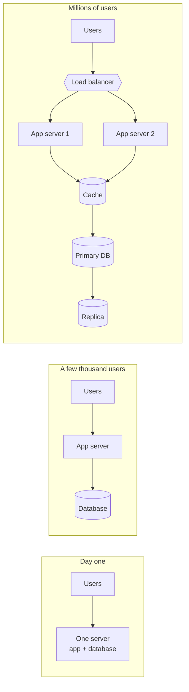

Every box added on the right solves one problem and creates a new one. A load balancer removes the single app server but is now a single point of failure itself. A cache makes reads fast but can serve stale data. A replica spreads read load but can lag behind the primary. Most of system design is knowing what each piece costs.

#### How these notes are organised

Each page covers one idea and stands on its own, though later pages lean on earlier ones. If you're new, read the chapters in order. If you're preparing for an interview, read [How to Approach a Design Interview](#how-to-approach-a-design-interview) and [Numbers Worth Remembering](#numbers-worth-remembering) first, then jump to whatever you're weak on.

### How to Approach a Design Interview

A design interview is open ended on purpose. Nobody expects you to build Twitter in 45 minutes. The interviewer wants to see how you think when the problem is vague, so a clear process matters more than a clever trick.

Here's an order that works for most questions.

1. Ask what the system must do. List the features you'll cover and say out loud what you're leaving out. "Post a message, follow someone, see a feed. No search, no ads."
2. Pin down the non-functional needs. How many users? Read heavy or write heavy? Is it fine if a post shows up two seconds late, or must everything be instantly consistent? How much downtime can you accept?
3. Do rough math. Requests per second, storage per year, bandwidth. It doesn't need to be exact. It only needs to tell you whether one database is enough or not.
4. Sketch the API and the data. A handful of endpoints and the main tables or collections. This forces you to decide what the system actually stores.
5. Draw the simple version first. Clients, a load balancer, some servers, a database. Walk one request through it from start to finish.
6. Find the bottleneck and fix it. Maybe reads overwhelm the database, so you add a cache. Maybe one table is too big, so you shard it. Explain why you picked each fix and what it costs.
7. Talk about failure. What if a server dies, a datacenter goes down, or a queue backs up?

Two habits help a lot. Think out loud so the interviewer can steer you, and when you choose something, name the alternative you rejected. "I'm using a relational database here because we need transactions on payments. If it were only a feed, I'd consider a wide-column store."

What tends to go badly is jumping straight to a fancy architecture before agreeing on requirements, or naming technologies without saying why. Kafka isn't an answer. It's an answer only when you can say what problem it solves in this design.

### Numbers Worth Remembering

Back-of-the-envelope math is how you decide whether a design is reasonable before you build anything. You don't need precision. You need to be right within a factor of ten.

#### Time and traffic

A day has 86,400 seconds, which is close enough to 100,000 for quick math. That gives you a shortcut for turning daily totals into per-second rates.

| Requests per day | Roughly per second |
|---|---|
| 1 million | 12 |
| 100 million | 1,200 |
| 1 billion | 12,000 |

Traffic isn't flat. Peak load is often two to five times the daily average, so size for the peak.

#### Data sizes

| Unit | Approximate size | Power of two |
|---|---|---|
| 1 KB | thousand bytes | 2^10 |
| 1 MB | million bytes | 2^20 |
| 1 GB | billion bytes | 2^30 |
| 1 TB | trillion bytes | 2^40 |
| 1 PB | quadrillion bytes | 2^50 |

A plain text character is about 1 byte. A tweet-sized post with metadata is a few hundred bytes. A compressed photo is around 200 KB to 3 MB, and a minute of compressed video is tens of megabytes.

#### Latency

These are rough, order-of-magnitude figures. Hardware improves, but the ratios between them have stayed similar for years.

| Operation | Time |
|---|---|
| Read from memory | ~100 ns |
| Read from SSD (random) | ~100 µs |
| Round trip inside one datacenter | ~0.5 ms |
| Read from spinning disk (seek) | ~10 ms |
| Round trip across continents | ~100 to 150 ms |

The lesson is that memory is about a thousand times faster than SSD, and the network between regions is slower than almost anything on one machine. That's the whole reason caches and CDNs exist.

#### A worked example

Say a photo app has 10 million daily users and each uploads one 2 MB photo.

Storage per day is 10M × 2 MB = 20 TB. Over a year that's about 7.3 PB, before replicas. If you keep three copies, call it 22 PB.

Upload rate is 10M / 86,400 ≈ 116 per second on average. If peak is four times that, plan for roughly 500 uploads per second, or about 1 GB/s of incoming bandwidth. One server can't take that, so you already know uploads need several servers and a storage system built for large files.

That took thirty seconds and already shaped the design.


---

## Chapter 1: Fundamentals

Networking, load balancing, caching, availability, scalability and storage.

### IP Address

Every device on a network needs an address so other devices can find it. On the internet that address is an IP address. When your browser talks to a server, it's really talking to a number like `142.250.190.78`.

#### IPv4 and IPv6

IPv4 addresses are 32 bits, written as four numbers from 0 to 255 separated by dots, for example `192.168.1.10`. That gives about 4.3 billion addresses, which sounds like a lot until you count every phone, laptop and sensor in the world. We ran out of fresh ones years ago.

IPv6 fixes this with 128-bit addresses, written in hexadecimal groups like `2001:db8::1`. The space is so large that running out isn't a concern. Both versions are in use today, and most big services support both.

#### Public and private addresses

A public address is reachable from the internet. A private address only works inside a local network. Three ranges are reserved for private use:

| Range | Typical use |
|---|---|
| 10.0.0.0 to 10.255.255.255 | Large company and cloud networks |
| 172.16.0.0 to 172.31.255.255 | Mid-sized networks |
| 192.168.0.0 to 192.168.255.255 | Home routers |

Your home router has one public address, and every device behind it has a private one. The router rewrites addresses as traffic passes through, which is called NAT (network address translation).

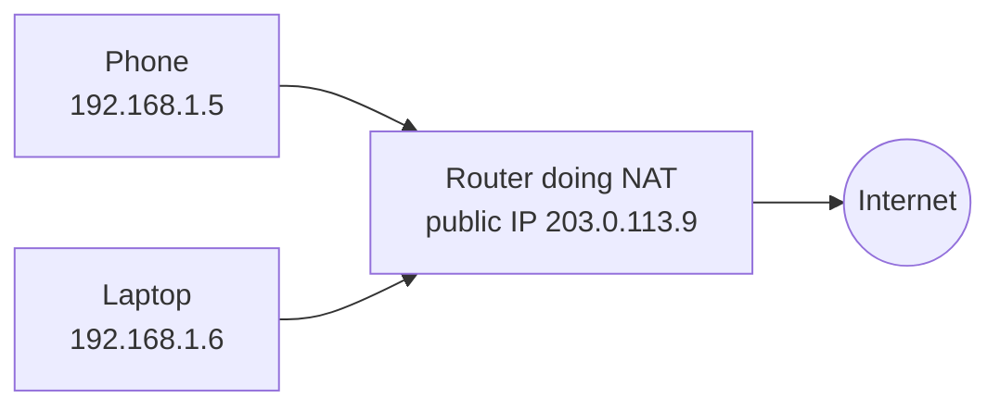

#### Static and dynamic

A static address never changes, which is what servers usually want. A dynamic address is handed out by a DHCP server and can change when you reconnect. Home devices are almost always dynamic.

#### Subnets and CIDR

A subnet is a slice of a network. CIDR notation describes it with a prefix length: `10.0.1.0/24` means the first 24 bits are the network part, which leaves 8 bits for hosts, so 256 addresses. A `/16` has 65,536. Cloud providers ask you to pick these ranges when you create a virtual network.

#### Why this matters in a design

Servers behind a load balancer usually have private addresses, so the original client IP is passed along in a header such as `X-Forwarded-For`. Rate limiting by IP address can hurt real users, because a whole office or a mobile carrier can share one public address through NAT. And `127.0.0.1` always means "this machine", which is why a service listening only on it can't be reached from outside.

### OSI Model

The OSI model describes network communication as seven layers. Each layer does one job and relies on the layer below it. A web request starts at the top as an HTTP message and ends at the bottom as electrical or radio signals.

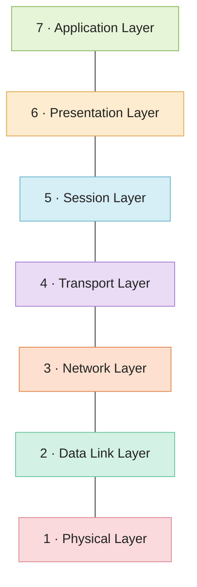

| Layer | What it does | Examples |
|---|---|---|
| 7 Application | The protocols apps use to talk | HTTP, SMTP, FTP, DNS |
| 6 Presentation | Formats, encoding, compression, encryption | JSON, JPEG, TLS (loosely) |
| 5 Session | Starts, keeps and ends a conversation | RPC, session tokens |
| 4 Transport | Delivery between processes, using ports | TCP, UDP |
| 3 Network | Addressing and routing across networks | IP, routers |
| 2 Data Link | Delivery between neighbours on one network | Ethernet, Wi-Fi, switches |
| 1 Physical | Bits on a wire or radio wave | Cables, fibre, radio |

#### Wrapping data as it goes down

When you send something, each layer wraps the data from the layer above with its own header. That's called encapsulation. The receiver unwraps it in reverse.

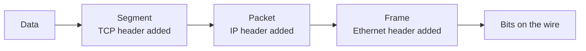

#### The model versus what's really used

The internet runs on the TCP/IP model, which has four layers (application, transport, internet, link) and merges the top three and bottom two of OSI. People still use OSI numbering because it's a handy shared vocabulary. When someone says "layer 4 load balancer" or "layer 7 firewall", they mean transport and application.

For debugging, work from the bottom up. Is the link up? Can you reach the IP? Is the port open? Is the application answering? Most problems show up in the first layer where something fails.

### TCP and UDP

Both protocols live at the transport layer. Their job is to get data from one program on one machine to a program on another, using IP addresses and port numbers to find the right ones. They make very different promises.

#### TCP

TCP is about reliability. Before sending anything, the two sides do a three-step handshake to agree on starting sequence numbers.

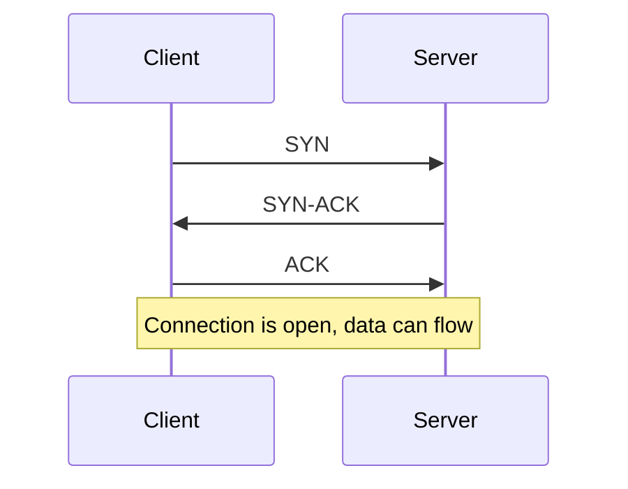

After that, every chunk of data gets a sequence number and has to be acknowledged. If an acknowledgement doesn't arrive, the sender retransmits. The receiver puts chunks back in order before handing them to the application. TCP also slows down when the network looks congested, so it doesn't make things worse.

You get a clean, ordered stream of bytes, and you pay for it in latency and overhead.

#### UDP

UDP just sends a packet and moves on. There's no handshake, no acknowledgement, no ordering, and no retransmission. If a packet is lost or arrives twice, UDP doesn't care. The header is only 8 bytes, against at least 20 for TCP.

That sounds worse but it's often what you want. In a video call, a lost frame from 200 ms ago is useless. Retransmitting it would only delay the frames that matter. Games, voice, live video and DNS lookups all lean on UDP for this reason.

#### Side by side

| | TCP | UDP |
|---|---|---|
| Connection setup | Handshake first | None |
| Delivery | Guaranteed, retried | Best effort |
| Order | Preserved | Not preserved |
| Speed | Slower | Faster |
| Typical uses | Web pages, APIs, email, databases | DNS, streaming, voice, games |

#### Where it gets interesting

TCP has a weakness called head-of-line blocking. If one segment is lost, everything behind it waits until it's resent, even if the later data already arrived. HTTP/2 multiplexes many requests over one TCP connection, so a single lost packet can stall all of them. HTTP/3 avoids this by running on QUIC, which is built on UDP and does its own reliability per stream.

So the choice isn't really "reliable versus unreliable". It's about who handles reliability. TCP does it for you. With UDP you do it yourself, only for the parts that need it.

### DNS

People remember names like `example.com`. Computers need IP addresses. DNS (the Domain Name System) is the phone book that connects the two. It's spread across thousands of servers, and no single machine knows every answer.

#### What happens when you type a domain

Your device first checks its own cache. If the answer isn't there, it asks a recursive resolver, usually run by your ISP or a public service. The resolver does the legwork.

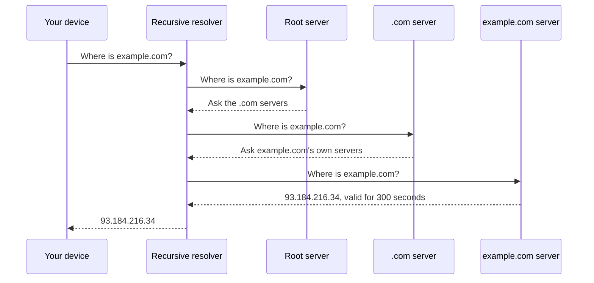

The resolver keeps the answer for the number of seconds the authoritative server gave it. That number is the TTL (time to live). Most lookups never reach the root, because the resolver already knows the .com servers from an earlier request.

#### Common record types

| Record | What it holds |
|---|---|
| A | An IPv4 address for a name |
| AAAA | An IPv6 address for a name |
| CNAME | An alias pointing to another name |
| MX | The mail servers for a domain |
| NS | Which servers are authoritative for a domain |
| TXT | Free text, often used for email and ownership checks |

#### DNS in system design

TTL is a trade-off. A short TTL (say 60 seconds) lets you move traffic quickly when a server fails, but your DNS servers see more queries. A long TTL is cheaper, but if you change an address, some users keep hitting the old one until their cache expires.

DNS is also used as a crude load balancer. A name can return several addresses, or different addresses depending on where the user is. Managed services add health checks so a dead server stops being returned. It's still coarse, because clients cache answers and you can't react in under a TTL.

Since almost everything depends on DNS, an outage there looks like an outage everywhere. Large companies split their DNS across more than one provider for this reason.

### Load Balancing

A load balancer sits in front of a group of servers and spreads incoming requests across them. Clients talk to one address, and the balancer decides which server handles each request.

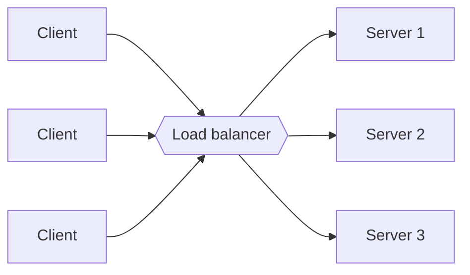

It does two useful things at once. It lets you add capacity by adding servers, and it hides failures. If server 2 dies, the balancer notices and stops sending it traffic.

#### How it picks a server

Round robin goes through the servers in order. It's simple and works well when requests cost about the same. Weighted round robin does the same but sends more traffic to bigger machines.

Least connections sends the request to whichever server is handling the fewest right now. This helps when some requests are slow and others are quick, since plain round robin can pile slow requests onto one unlucky server.

IP hash picks a server from a hash of the client address, so the same client keeps landing on the same server. Consistent hashing does something similar but moves far fewer clients when servers are added or removed. It's popular in front of caches (see [Consistent Hashing](#consistent-hashing)).

#### Layer 4 and layer 7

A layer 4 balancer only looks at IP addresses and ports. It's very fast because it doesn't read the request. A layer 7 balancer understands HTTP, so it can route `/api` to one group of servers and `/images` to another, look at cookies, or terminate TLS. It does more work per request, but the flexibility is usually worth it.

#### Health checks

The balancer keeps asking each server "are you OK?", usually by hitting a small endpoint such as `/health`. If a server fails a few checks in a row, it's taken out of rotation. When it passes again, it's added back. Passive checks also help: if real requests to a server keep failing, that's a sign too.

#### Sessions

If a server keeps user session data in its own memory, the same user needs to keep hitting that server. Sticky sessions do this, but they make load uneven and lose the session when that server dies. A better fix is to keep sessions in a shared store such as Redis, so any server can handle any request.

#### The balancer can fail too

One load balancer is a single point of failure. Real setups run a pair, one active and one on standby, or use a managed cloud balancer that's already redundant behind the scenes.

### Clustering

A cluster is a group of machines that work together and present themselves as one system. Instead of relying on one powerful server, you rely on several ordinary ones that cover for each other.

#### What clusters are used for

The most common reason is availability. If one node fails, another picks up its work. Databases like PostgreSQL with replicas, or message brokers like Kafka, run as clusters for this reason.

The second reason is capacity. A cluster can share a workload that's too big for one machine, which is how Kubernetes spreads containers over many nodes.

A load balancer and a cluster are related but not the same thing. The balancer only decides where each request goes. A cluster is about the nodes themselves knowing about each other, tracking who's alive, and sharing or replicating state. A balancer often sits in front of a cluster.

#### Active-passive and active-active

In an active-passive setup, one node does the work while another waits. The standby takes over if the active node stops responding. It's easy to reason about, but half your hardware sits idle.

In an active-active setup, all nodes serve traffic. You use all your capacity and failover is quick, but state has to stay consistent across nodes, which is harder.

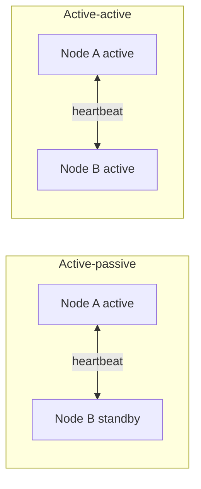

#### Shared nothing or shared storage

In a shared-nothing cluster each node has its own CPU, memory and disk, and data is split or copied between nodes. This scales well and is what most modern systems use. In a shared-storage cluster, all nodes read from the same disk system. That keeps data in one place but the storage becomes a bottleneck and a single point of failure.

#### Split brain

Nodes check on each other with heartbeats. Suppose the network between two halves of a cluster breaks. Each half can't tell whether the other half is dead or just unreachable, and both may decide to become the leader. Now two nodes accept writes and the data diverges. That's a split brain.

The usual defence is a quorum. A group may only act if it holds a majority of the nodes. With five nodes, a group of three can continue and a group of two must stop, so there can never be two active halves. Some systems add fencing, which forcibly cuts off the old leader (by powering it off or revoking its storage access) before a new one takes over. See [Consensus and Leader Election](#consensus-and-leader-election) for how this is done safely.

### Caching

A cache keeps a copy of data somewhere faster than the original source, so repeated requests don't pay the full cost every time. Reading from memory takes around 100 nanoseconds. Reading from a database over the network takes milliseconds. If the same row is requested a thousand times a second, it makes sense to fetch it once.

Caches exist at every level: the browser, a CDN, a reverse proxy, inside your application, in a shared store like Redis or Memcached, and in the database's own memory.

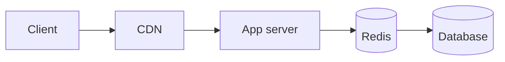

#### Reading and writing

The most common pattern is cache-aside. The app checks the cache first. On a miss, it reads the database, stores the result in the cache, and returns it. The app owns the logic, and the cache only holds what has actually been asked for.

Writes are where the strategies differ.

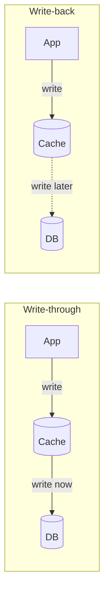

With write-through, every write goes to the cache and the database together. Data is consistent and safe, but writes are slower. Write-back saves to the cache and flushes to the database later in batches. Writes are very fast, but if the cache crashes before flushing, that data is gone. Write-around skips the cache on writes and only fills it on reads, which avoids filling it with data nobody reads back.

#### Deciding what to throw out

A cache has limited space, so it needs an eviction rule. LRU (least recently used) drops the item untouched for the longest time, and it's a sensible default. LFU (least frequently used) drops whatever is requested least often, which suits a stable set of popular items. TTL expiry removes entries after a set time regardless of use, and it's often combined with one of the others.

#### What goes wrong

Stale data is the obvious one. If the database changes and the cache doesn't, users see old values. You can set a short TTL, or delete the cached key whenever you write.

A cache stampede happens when a very popular key expires and hundreds of requests all miss at once, then all hit the database together. Fixes include letting only one request rebuild the value while others wait, and adding a little random jitter to TTLs so keys don't all expire together.

Cache penetration is when requests ask for things that don't exist, so they never get cached and always hit the database. Caching the "not found" result for a short time helps, and so does a [Bloom filter](#bloom-filters) in front.

Phil Karlton's old line says there are only two hard problems in computer science, cache invalidation and naming things. It stays true. Keep your invalidation rules simple, and be honest about how stale a value is allowed to be.

### CDN

A content delivery network is a set of servers spread around the world that keep copies of your content close to users. If your origin server is in Virginia and a user is in Mumbai, every request pays for the trip across the planet, which is over 100 ms before the server does any work. A CDN server in Mumbai can answer in a few milliseconds.

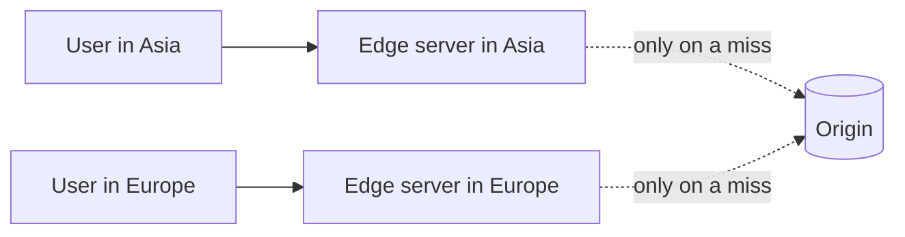

The edge servers are often called points of presence (PoPs). When a user asks for a file, the CDN checks its local copy. If it has one, it returns it. If not, it fetches from your origin, keeps a copy, and serves the user. The next person nearby gets the fast path.

#### Pull and push

Most CDNs are pull based. You point them at your origin and they fetch files the first time someone asks. There's nothing to manage, but that first request is slow. In a push model you upload content to the CDN yourself ahead of time. It suits a small number of large files that rarely change, such as software downloads or video releases.

#### Controlling freshness

You tell the CDN how long it may keep something using headers such as `Cache-Control: max-age=86400`. When content changes before that time is up, you either purge it by URL or tag, or you avoid the problem by putting a version in the filename. `app.3f9a1c.js` can be cached for a year because a new build gets a new name.

#### What a CDN is good for

Static files like images, scripts, stylesheets and video are the obvious fit. CDNs also absorb traffic spikes, since your origin only sees the misses, and they soak up DDoS attacks because the load is spread over many locations. Many can also run small bits of code at the edge, or terminate TLS close to the user.

They help less for content that's different for every user or changes every second, since there's little to reuse. And a CDN adds a layer to debug when something looks stale, so know how to bypass it.

### Proxy

A proxy is a server that sits between two parties and passes messages along on someone's behalf. Which party it acts for decides whether it's a forward proxy or a reverse proxy.

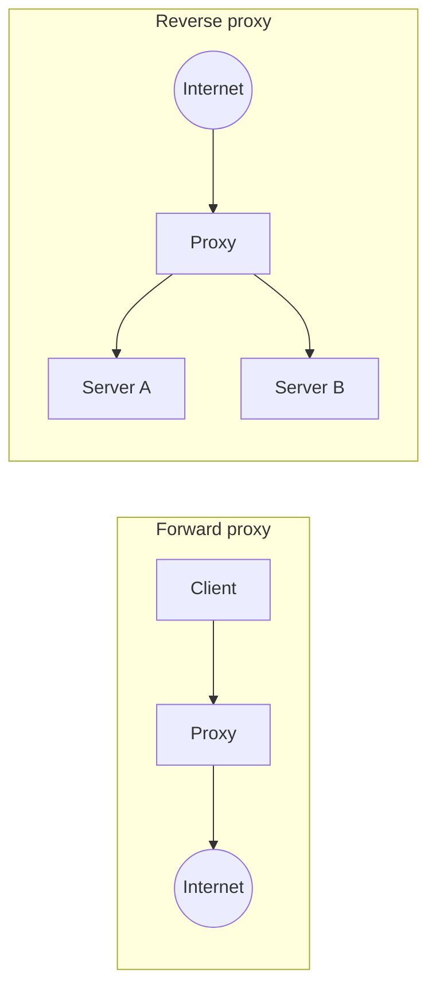

#### Forward proxy

A forward proxy acts for the client. The client sends requests to the proxy, and the proxy goes out to the internet. The websites see the proxy's address, not the client's. Companies use them to filter what employees can reach and to cache popular downloads. People use them to hide their location.

#### Reverse proxy

A reverse proxy acts for the server. Clients think they're talking to your site, but they're talking to the proxy, which forwards each request to a server behind it. The clients never see the real servers.

That position is useful. A reverse proxy can spread load across servers, cache responses, compress them, terminate TLS so the app servers don't have to, enforce rate limits, and block obviously bad requests. Nginx, HAProxy, Envoy and Traefik all do this job.

#### How it relates to other pieces

A load balancer is really a reverse proxy focused on distributing traffic. An [API gateway](#api-gateway) is a reverse proxy with extra features for managing APIs, like authentication and per-client quotas. A CDN edge server is a reverse proxy too, placed close to users. The names change but the idea is the same: a middleman that can look at traffic and make decisions before it reaches the real destination.

### Availability

Availability is the share of time a system is working and reachable. It's usually written as a percentage and described by how many nines it has.

| Availability | Downtime per year | Downtime per 30-day month |
|---|---|---|
| 99% | 3.65 days | 7.2 hours |
| 99.9% | 8.76 hours | 43 minutes |
| 99.99% | 52.6 minutes | 4.3 minutes |
| 99.999% | 5.3 minutes | 26 seconds |

Each extra nine cuts allowed downtime by a factor of ten, and the cost goes up a lot faster than that. Going from 99.9% to 99.99% usually means redundant everything, automatic failover and careful deploys. A human can't react fast enough to meet five minutes a year.

#### How the maths works

When components depend on each other in a chain, availability multiplies, so it goes down. If a request needs a web server (99.9%) and a database (99.9%), the pair is 0.999 × 0.999 ≈ 99.8%. Chains of many services get worse quickly.

When components are redundant, so that either one can do the job, the chance of both failing together is small. Two copies of something that is 99% available fail together only 1% × 1% = 0.01% of the time, so the pair is 99.99% available. That's the reason for running more than one of everything.

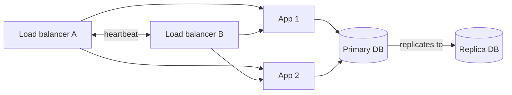

#### Building for it

Remove single points of failure by asking of every box "what happens if this dies?". Run at least two of anything important, spread them over separate failure zones (different racks, then different datacenters), detect failure with health checks, and switch over automatically.

Redundancy only helps if failover works, and failover is code that rarely runs. Teams that care test it on purpose, by killing servers in production or running regular drills. Netflix's Chaos Monkey is the well-known example.

Availability and consistency pull against each other when the network breaks. That tension is the subject of [CAP and PACELC](#cap-and-pacelc).

### Scalability

A system is scalable if it can handle more load by adding resources, without being redesigned. "Load" might be users, requests per second, data volume, or all three.

#### Two ways to grow

Vertical scaling means using a bigger machine, with more CPU, more RAM and faster disks. It's simple because nothing about the software changes. But there's a ceiling on how big a single machine gets, the price rises steeply near the top, and you still have one box that can fail.

Horizontal scaling means adding more machines and sharing the work. There's almost no ceiling and each machine is cheap, but now you have to coordinate them. Requests need a [load balancer](#load-balancing), and data may need to be split across machines.

The practical rule is to go vertical while it's easy and cheap, and plan for horizontal before you hit the wall.

#### What makes horizontal scaling possible

Stateless servers are the big one. If a server keeps nothing between requests, any server can handle any request, and adding another is trivial. Session data, uploaded files and anything else that has to be remembered goes into a shared store instead.

The data layer is harder, because state has to live somewhere. That's why so much of this guide is about databases.

#### Where bottlenecks move

You fix one bottleneck and the next one shows up. A typical path looks like this:

1. Slow queries. Add [indexes](#indexes) and fix bad queries.
2. Too many reads. Add a [cache](#caching) and [read replicas](#replication).
3. Too many writes, or too much data for one machine. [Shard](#sharding) the database.
4. Slow work inside requests. Move it to a [queue](#message-brokers-and-queues) and process it in the background.
5. Global users. Use a [CDN](#cdn) and run in several regions.

Each step adds complexity, so don't take a step until measurements say you need it. Plenty of products serve millions of users from one well-tuned database with a cache in front.

#### Measuring it

Throughput is how much work is done per second. Latency is how long one request takes. Report latency as percentiles, like p50, p95 and p99, rather than the average. An average of 100 ms can hide the fact that 1 in 100 users waits five seconds, and with a big user base that's a lot of unhappy people.

### Storage

Data has to live somewhere, and the kind of storage you pick affects speed, cost and how you access it. There are three main types.

| Type | You see | Good for | Examples |
|---|---|---|---|
| Block | Raw disk blocks you format yourself | Databases, operating systems | AWS EBS, a local SSD |
| File | Folders and files over a network | Shared documents, home directories | NFS, AWS EFS |
| Object | Blobs with a key and metadata, accessed over HTTP | Images, video, backups, logs | AWS S3, Google Cloud Storage |

Block storage is the fastest and has the lowest latency, which is why databases sit on it. File storage adds a familiar folder structure that many machines can share. Object storage gives up fast random edits for huge scale and low cost. You can't modify a byte in the middle of an object. You replace the whole thing. In exchange you get practically unlimited space, built-in replication, and a plain HTTP API.

For something like user photos, the usual pattern is to put the file in object storage, put the URL in your database, and serve it through a CDN.

#### RAID

RAID combines several physical disks so they act as one, trading speed, capacity and safety.

| Level | What it does | Survives |
|---|---|---|
| 0 | Stripes data across disks | Nothing, one failure loses everything |
| 1 | Mirrors data on two disks | One disk failure |
| 5 | Stripes with one disk's worth of parity | One disk failure |
| 6 | Stripes with two disks' worth of parity | Two disk failures |
| 10 | Mirrors, then stripes | One failure per mirror pair |

RAID protects against a disk dying. It doesn't protect against deleting a file by mistake, a bug that corrupts data, or a fire, so it never replaces backups.

#### Distributed file systems

When data outgrows one machine, you spread files across many. HDFS (the Hadoop Distributed File System) is a classic example. A NameNode keeps the map of which blocks make up which file and where they are, and many DataNodes hold the blocks. Files are cut into large blocks, 128 MB by default, and each block is copied to three DataNodes by default. If one node dies, the NameNode notices and makes new copies from the survivors.

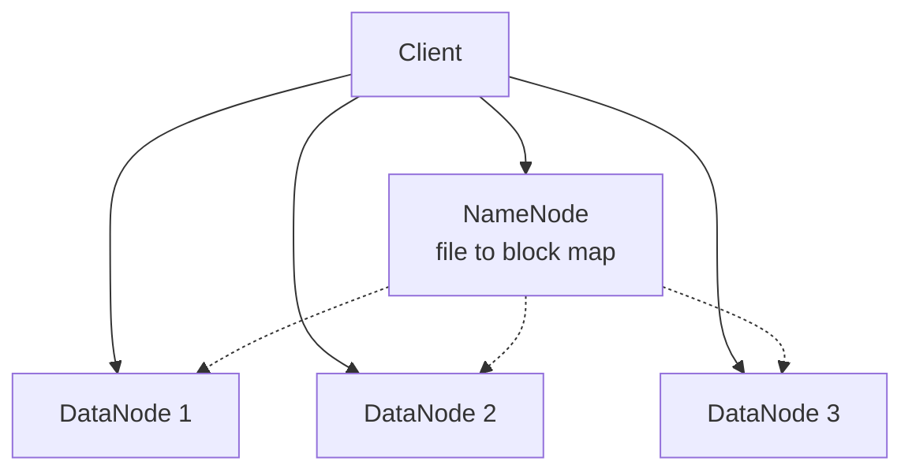

The same idea, with different details, sits behind most cloud object stores: split data into chunks, keep several copies on separate machines, and keep a separate index that says where everything is.


---

## Chapter 2: Databases

How data is stored, queried, copied and split across machines.

### Databases and DBMS

A database is an organised collection of data. A database management system (DBMS) is the software that sits on top and does the heavy lifting, so each application doesn't have to. PostgreSQL, MySQL, MongoDB and Redis are all DBMSs, though people usually just call them databases.

A DBMS takes care of a lot: storing data safely on disk, finding it quickly when you query, letting many users read and write at once without stepping on each other, recovering after a crash, and controlling who can see what. Writing all that yourself on top of plain files would be a huge project.

#### Relational databases

A relational database stores data in tables made of rows and columns, with relationships between tables defined by keys. You query them with SQL. They enforce a schema, so every row in a table has the same shape, and they support transactions. PostgreSQL, MySQL, Oracle and SQL Server are relational.

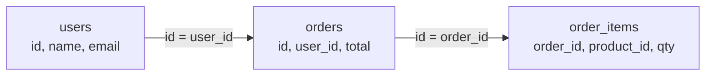

#### Other kinds

Not everything fits neatly into tables. Key-value stores like Redis map a key to a value and are extremely fast for lookups. Document stores like MongoDB hold JSON-like documents with flexible shapes. Wide-column stores like Cassandra handle huge write volumes across many machines. Graph databases like Neo4j are built for data defined by relationships. The next page, [SQL vs NoSQL](#sql-vs-nosql), compares them.

#### Two workloads

OLTP (online transaction processing) means lots of small, fast operations: place an order, update a profile, check a balance. Most application databases do this, and they're usually row-oriented, meaning each row's values are stored together on disk.

OLAP (online analytical processing) means fewer, much larger queries that scan huge amounts of data: total sales per region over three years. Data warehouses like BigQuery, Snowflake and Redshift do this. They're usually column-oriented, since a query that needs two columns out of fifty can then read just those two.

Mixing both on the same database tends to hurt. A heavy analytics query can slow the checkout page. The usual fix is to copy data from the OLTP database into a separate warehouse for analysis.

### SQL vs NoSQL

The two names get used as if they were opposite camps, but they're better seen as different tools. "NoSQL" is a loose label for any database that isn't a traditional relational one, and it covers several quite different designs.

#### What SQL databases give you

You get a fixed schema, powerful queries including joins across tables, and ACID transactions (see [ACID and BASE](#acid-and-base)). You can ask questions you didn't plan for when you designed the tables, which is a huge advantage when requirements change. The cost is that scaling writes beyond one machine takes real effort, since joins and transactions get hard once data is spread out.

#### The NoSQL families

| Family | Shape of data | Examples | Fits well |
|---|---|---|---|
| Key-value | A key and an opaque value | Redis, DynamoDB | Sessions, caches, counters, shopping carts |
| Document | Nested JSON-like documents | MongoDB, Firestore | Product catalogues, user profiles |
| Wide-column | Rows with flexible columns grouped in families | Cassandra, HBase | Time series, huge write volumes, activity logs |
| Graph | Nodes and edges | Neo4j | Social networks, recommendations, fraud rings |

Most of these were built to spread across many machines easily, and many loosen consistency to do it. They usually want you to design around your queries ahead of time. In a document store you often embed related data inside one document, so a single read gets everything. That's fast, but if you later need a query nobody planned for, it can be painful.

#### How to choose

Start from the access pattern, not the brand. Ask what you read, how you read it, and how much consistency you need.

If the data is structured, you need joins or transactions, and the volume fits on one primary with some replicas, use a relational database. That covers a surprising number of products, and it's the safer default.

Reach for NoSQL when there's a clear reason: a simple key lookup at huge scale, a very high write rate, data with no stable schema, or a graph-shaped problem. Many real systems use both, for example PostgreSQL for orders and payments, Redis for sessions, and Elasticsearch for search. Each extra store is more to run, monitor and keep in sync, so don't add one for fashion.

There's also a middle group sometimes called NewSQL, such as CockroachDB and Google Spanner, which aim to give SQL and transactions on top of a database that scales out. They remove some trade-offs but come with their own costs in latency and operations.

### Normalization and Denormalization

Normalization is organising tables so each fact is stored in exactly one place. Denormalization is deliberately breaking that rule to make reads faster.

#### Why normalize

Imagine one big `orders` table where each row holds the customer's name and address along with the order itself. A customer with 200 orders has their address copied 200 times. When they move, you have to update 200 rows, and if you miss one, the data now disagrees with itself. These are called update anomalies.

Splitting it fixes the problem. Customers go in one table, orders in another, and orders point at customers by id.

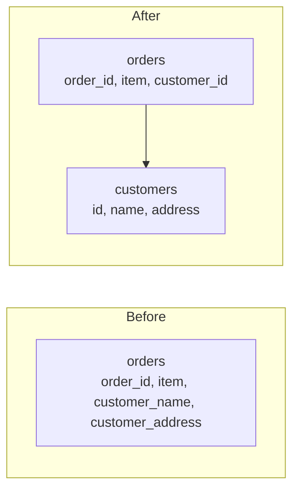

#### The normal forms

These are cumulative levels of tidiness. Most real designs aim for the third.

First normal form means every column holds a single value, with no lists or repeating groups stuffed into one cell. Second normal form means that on top of that, every non-key column depends on the whole primary key, not just part of a composite one. Third normal form adds that non-key columns depend only on the key and not on each other. If `zip_code` determines `city`, then `city` shouldn't sit in the same table as `zip_code` as a separate fact. Boyce-Codd normal form is a slightly stricter version of the third.

#### Why denormalize

Normalized data needs joins to put things back together, and joins cost time, especially across big tables. A product page that joins eight tables on every view may be too slow at high traffic.

So teams copy some data on purpose. They store the author's name inside each comment, keep an `order_total` column instead of summing line items every time, or keep a precomputed count of likes. Reads get faster and simpler. Writes get more work, since every copy has to be kept in step, and bugs can leave copies disagreeing.

A sensible order is to normalize first, measure, and denormalize only the specific places where reads are too slow. In NoSQL document stores, denormalized data is the normal style, because there are usually no joins to lean on.

### ACID and BASE

These are two sets of promises a database can make about how it treats your data. ACID is the traditional one from relational databases. BASE describes the looser approach many distributed systems take.

#### ACID

ACID is four properties that together describe a reliable transaction.

Atomicity means a transaction either happens completely or not at all. If you move 100 from account A to account B, you never end up with the money removed from A and not added to B. If anything fails midway, the whole thing is rolled back.

Consistency means a transaction takes the database from one valid state to another. Rules like "balance can't be negative" or "every order must point to a real customer" hold before and after.

Isolation means concurrent transactions don't see each other's half-finished work. They behave as if they ran one at a time, to a degree you can choose (see [Transactions](#transactions)).

Durability means once the database says a transaction is committed, it stays committed, even if the power goes out a millisecond later. Databases get this by writing to a log on disk before confirming.

Banking, payments, inventory and bookings need these guarantees.

#### BASE

BASE is a deliberately relaxed counterpart, and the name is a bit of a joke against ACID.

Basically available means the system keeps responding even when parts of it fail, though answers might be incomplete. Soft state means the data may change over time even without new input, as replicas catch up. Eventually consistent means that if no new updates arrive, all copies will end up the same, but not necessarily right away.

Think of a like counter on a post. If one user sees 1,041 and another sees 1,043 for a few seconds, nobody is harmed. Allowing that lets the system stay fast and available across many machines and regions.

#### Choosing

| | ACID | BASE |
|---|---|---|
| Priority | Correctness | Availability and scale |
| Consistency | Immediate | Eventual |
| Typical setting | Money, orders, inventory | Feeds, counters, caches, analytics |
| Typical systems | PostgreSQL, MySQL | Cassandra, DynamoDB |

It's not either-or for a whole product. A shop might process the payment with ACID guarantees and show the "people viewing this" counter with BASE ones. The related question of how consistency trades against availability when a network fails is covered in [CAP and PACELC](#cap-and-pacelc).

### CAP and PACELC

CAP is a rule about distributed data stores. It names three properties and says you can't fully have all of them when the network misbehaves.

Consistency here means every read returns the most recent write, as though there were a single copy of the data. Availability means every request to a working node gets a response. Partition tolerance means the system keeps running even when the network splits and some nodes can't talk to others.

#### What the theorem really says

People often draw it as "pick two of three", which is misleading. In a real distributed system, network partitions will happen, so partition tolerance isn't optional. The actual choice is what to do while a partition is happening.

Suppose two replicas lose contact with each other and a write arrives at one of them. The system can refuse or delay requests until the replicas agree again, which keeps data consistent but gives up availability. Or it can accept the write and keep answering, which stays available but means the other replica may return stale data.

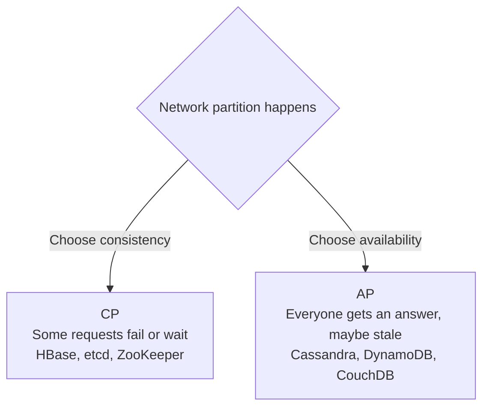

When the network is healthy, you can have both. The theorem is only about what you give up during the failure. Also, the labels on real databases are rough. Many can be configured either way, for example by requiring a quorum of replicas on each read.

#### PACELC

CAP says nothing about normal operation, but there's a trade-off then too. PACELC, proposed by Daniel Abadi, extends it. If there's a Partition, choose between Availability and Consistency. Else, when everything is running normally, choose between Latency and Consistency.

The second half matters because keeping replicas strictly in sync means waiting for them to acknowledge writes, and that waiting is latency. A system that returns as soon as one copy is written is faster but weaker on consistency.

| System | Under partition | Normally | Short form |
|---|---|---|---|
| Cassandra, DynamoDB (default settings) | Availability | Latency | PA/EL |
| Google Spanner | Consistency | Consistency | PC/EC |
| MongoDB (default settings) | Availability | Consistency | PA/EC |

Read those rows as typical tendencies, since configuration changes them.

#### Using it in a design

Ask what's worse for this feature: showing slightly old data, or refusing to answer. For a social feed, old data is fine, so lean towards availability. For an account balance or a seat booking, wrong data is worse than a short error, so lean towards consistency.

### Transactions

A transaction groups several operations into one unit that either all succeed or all fail. The classic example is a money transfer.

```sql
BEGIN;
UPDATE accounts SET balance = balance - 100 WHERE id = 1;
UPDATE accounts SET balance = balance + 100 WHERE id = 2;
COMMIT;
```

If the database crashes after the first update, the transaction was never committed, so on restart it's undone. Nobody loses 100. Databases manage this with a write-ahead log: changes are recorded in a log on disk before they're applied, so after a crash the database can replay or undo them.

#### When transactions run at the same time

Running transactions strictly one after another would be correct but slow. So databases let them overlap and offer isolation levels, which control what odd results you're willing to tolerate. The odd results have names.

A dirty read is seeing another transaction's changes before it has committed. A non-repeatable read is reading the same row twice in one transaction and getting different values, because someone else committed in between. A phantom read is running the same query twice and getting extra rows the second time, because someone inserted matching rows.

| Isolation level | Dirty read | Non-repeatable read | Phantom read |
|---|---|---|---|
| Read uncommitted | Possible | Possible | Possible |
| Read committed | Prevented | Possible | Possible |
| Repeatable read | Prevented | Prevented | Possible by the standard |
| Serializable | Prevented | Prevented | Prevented |

That table is the SQL standard. Real databases differ in the details. PostgreSQL's repeatable read also blocks phantoms, because it uses snapshots. PostgreSQL defaults to read committed, and MySQL's InnoDB defaults to repeatable read. Higher isolation is safer but slower and causes more conflicts, so many applications stay at the default and handle the rare problem cases by hand.

#### How isolation is done

One approach is locking. A transaction locks the rows it touches, and others wait. The other is MVCC (multi-version concurrency control), used by PostgreSQL, MySQL and Oracle. The database keeps several versions of a row, and each transaction reads from a consistent snapshot. Readers don't block writers and writers don't block readers, which is why MVCC does well on read-heavy workloads.

#### Deadlocks

Two transactions can each hold a lock the other needs, and both wait forever. Databases detect the cycle and abort one of them, and your code gets an error to retry. You can reduce them by always touching rows in the same order and keeping transactions short.

Transactions that span more than one database or service are much harder. That's the topic of [Distributed Transactions](#distributed-transactions).

### Distributed Transactions

A distributed transaction needs to change data in more than one place, such as two databases or two services, and still be all-or-nothing. A single database can do this with a log and a lock manager. Once the data is on separate machines that can fail independently, it gets difficult.

#### Two-phase commit

Two-phase commit (2PC) is the classic protocol. One node acts as coordinator and the others are participants.

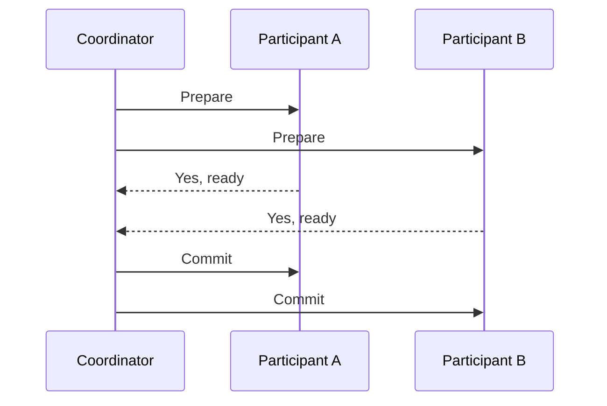

In the prepare phase, the coordinator asks everyone whether they can commit. Each participant does the work, writes it durably, and promises it can finish if asked. In the commit phase, if everyone said yes, the coordinator tells all of them to commit. If anyone said no, or didn't answer, it tells all to roll back.

This gives atomicity across nodes, but it has costs. It's slow, because there are several round trips and locks are held the whole time. And it blocks. If the coordinator crashes after participants have said yes but before it announces the result, they're stuck holding locks until it recovers. Three-phase commit adds another step to avoid that blocking, but it relies on assumptions about the network that don't hold in practice, so it's rarely used.

#### Sagas

Microservice systems usually avoid 2PC and use sagas instead. A saga breaks the big transaction into a series of small local ones, each in its own service. If a step fails, the saga runs compensating actions to undo the earlier steps.

Booking a trip might go like this: reserve a flight, reserve a hotel, charge the card. If the charge fails, the saga cancels the hotel and then the flight. A compensation isn't a true rollback. The flight really was reserved for a while, and cancelling it is a new action. So you design for it, for example by sending an apology email.

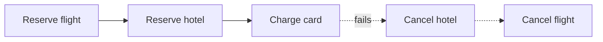

There are two ways to run one. In choreography, each service reacts to events from the previous one and publishes its own, with no central controller. It's simple at first and hard to follow as it grows. In orchestration, a central orchestrator tells each service what to do next and handles failures, which is easier to understand and monitor.

Sagas give you eventual consistency, not isolation. Other users may see the half-finished state in between. Every step and every compensation should be idempotent, meaning safe to run twice, because messages get retried.

#### Practical advice

If you can keep related data in one database and use a normal transaction, do it. Distributed transactions are for when you really can't.

### Indexes

Without an index, finding a row means reading the whole table, row by row, until you hit matches. That's a full scan, and on a table with 100 million rows it's painfully slow. An index is a separate structure that lets the database jump straight to the rows it wants, like the index at the back of a book.

#### The structures behind them

Most relational databases use B-trees. A B-tree keeps keys sorted in a shallow, wide tree, so finding any key takes only a few disk reads even for billions of rows. Because the keys are sorted, it handles range queries (`WHERE age BETWEEN 20 AND 30`) and `ORDER BY` well too.

Many write-heavy databases, such as Cassandra, RocksDB and LevelDB, use LSM trees instead. Writes go into an in-memory table first, plus a log for safety. When the table fills, it's flushed to disk as a sorted file, and background jobs merge those files over time. Writes are fast because they're always sequential, while reads may have to check several files.

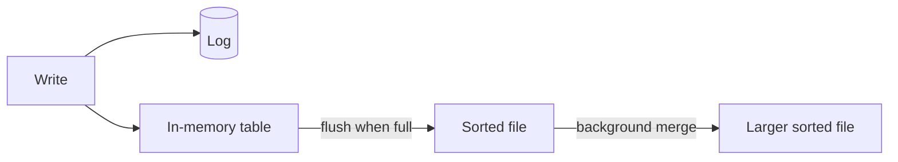

Hash indexes also exist. They give very fast exact lookups but can't do ranges.

#### Kinds of index you'll meet

A primary index is built on the primary key. In some databases, like MySQL's InnoDB, it also decides how rows are laid out on disk. A secondary index is on any other column, and points back to the row.

A composite index covers several columns, and the order matters. An index on `(country, city)` helps queries on `country` alone, or on `country` and `city` together, but does little for a query on `city` alone. This is the leftmost prefix rule.

A covering index contains every column a query needs, so the database never has to visit the table at all. A partial index only covers rows that match a condition, such as unfinished orders, which keeps it small.

#### What indexes cost

Indexes aren't free. Each one takes disk space, and every insert, update and delete has to update all the indexes on the table, so write speed drops as you add more. Indexing a column with only a few distinct values, like a yes/no flag, usually doesn't help, because the index doesn't narrow things down much.

So index the columns you filter, join and sort on frequently, and don't index everything. To see what the database is actually doing, run `EXPLAIN` (or `EXPLAIN ANALYZE` in PostgreSQL) on the slow query. If you see a sequential scan on a big table where you expected an index scan, that's your lead.

### Replication

Replication means keeping copies of the same data on several machines. It protects you if a machine dies, it lets you spread read traffic over more servers, and it can put a copy of the data closer to users in other regions.

#### Leader and followers

The most common setup is single-leader. All writes go to one node, the leader (also called primary). It records every change in a log and sends that log to the followers (replicas), which apply the same changes in the same order. Reads can go to any follower.

```mermaid
flowchart LR
    W[Writes] --> L[(Leader)]
    L -->|change log| F1[(Follower 1)]
    L -->|change log| F2[(Follower 2)]
    F1 --> R[Reads]
    F2 --> R
```

#### Synchronous or asynchronous

In synchronous replication, the leader waits for a follower to confirm before telling the client the write succeeded. Nothing is lost if the leader dies, but every write is slower, and if that follower is down, writes stall. In asynchronous replication, the leader confirms right away and sends changes in the background. It's fast, but a leader crash can lose the most recent writes that hadn't been copied yet.

A common compromise is semi-synchronous: wait for one follower and let the rest be asynchronous.

#### Replication lag

With asynchronous followers, there's a delay between a write on the leader and its appearance on a follower. It's usually milliseconds, but it can grow to seconds or more under load. That causes strange behaviour. A user posts a comment, the page reloads from a follower that hasn't seen it yet, and the comment seems to have vanished. Or a user sees newer data on one refresh and older data on the next, as requests hit different followers.

Common fixes are reading your own recent writes from the leader, or pinning a user to one replica for a while.

#### When the leader dies

Someone has to be promoted. Either a human does it or software detects the failure and picks the most up-to-date follower. This is risky. If the old leader comes back and thinks it's still in charge, you have two leaders, the split brain problem from [Clustering](#clustering). Promotion also loses any writes the new leader hadn't received.

#### Other layouts

Multi-leader setups accept writes in several places, often one per region. Local writes are fast, but two regions can change the same record at the same time, and you need a rule to settle the conflict, such as last write wins or a merge function.

Leaderless systems like Cassandra and DynamoDB send each write to several replicas and each read to several replicas. With N copies, W acknowledgements for a write and R replicas read, choosing W + R > N guarantees that every read overlaps with at least one replica that saw the latest write.

### Sharding

Replication gives you more copies of the same data. Sharding splits the data itself, so each machine holds only a part. When a table is too large for one disk, or the write rate is more than one machine can take, sharding is the way to keep growing.

```mermaid
flowchart LR
    App --> Router{Router}
    Router --> S1[("Shard 1<br/>users A to H")]
    Router --> S2[("Shard 2<br/>users I to P")]
    Router --> S3[("Shard 3<br/>users Q to Z")]
```

Each piece is a shard. A rule maps every record to exactly one shard, and something (the app, a proxy, or the database itself) has to apply that rule on every query.

#### Ways to split

Range-based sharding gives each shard a continuous range of keys, like user ids 1 to 1 million. Range queries are cheap because neighbouring keys sit together. The danger is hotspots. If the key grows over time, such as a timestamp, all new writes go to the last shard.

Hash-based sharding runs the key through a hash function and uses the result to choose a shard. Load spreads evenly, but range queries now touch every shard. A plain `hash(key) % N` also reshuffles almost all the data when N changes, which is why many systems use [consistent hashing](#consistent-hashing) instead.

Directory-based sharding keeps a lookup table saying where each key lives. It's very flexible, since you can move individual keys, but the lookup service becomes something else to scale and protect.

#### Picking the shard key

This is the decision you live with. A good key has many distinct values, spreads load evenly, and matches how you query. Sharding orders by `user_id` makes "show this user's orders" hit one shard. Sharding by country would be a poor choice if one country has most of the traffic.

#### What gets harder

Joins across shards are expensive, so you either denormalize or do the join in application code. Transactions that touch several shards need [distributed transactions](#distributed-transactions). Unique constraints and auto-increment ids can't rely on one database counter. Rebalancing, meaning moving data when you add shards, is slow and delicate. And one shard can still become a hot spot, for instance a celebrity user whose data gets hammered.

Sharding adds a lot of operational weight, so leave it until you've tried the simpler fixes: better indexes, caching, and read replicas.

### Consistent Hashing

Suppose you spread keys across N cache servers with `hash(key) % N`. It works until N changes. Add one server going from 4 to 5, and about 80% of keys now map to a different server. For a cache, that means most of it is suddenly cold and the database gets flooded. Consistent hashing is designed so that changing the number of servers only moves a small share of keys.

#### The ring

Picture the output range of a hash function bent into a circle. Hash each server's name to put it at a point on the circle. To find which server owns a key, hash the key to a point and walk clockwise until you meet a server.

```mermaid
flowchart LR
    K1((key A)) --> N1[Server 1]
    K2((key B)) --> N2[Server 2]
    K3((key C)) --> N2
    K4((key D)) --> N3[Server 3]
    N1 --- N2 --- N3 --- N1
```

If a server is added, it takes over only the keys between it and the previous server on the ring. If one is removed, only its keys move, and they go to its clockwise neighbour. On average only about 1/N of the keys move.

#### Virtual nodes

With only a few servers, hashing can place them unevenly, so one ends up owning a huge arc. The fix is to put each server on the ring many times, under names like `server1#0`, `server1#1`, and so on. These are virtual nodes. The load evens out, and a stronger machine can be given more virtual nodes than a weaker one. When a server dies, its keys scatter across many others rather than landing on a single neighbour.

#### A small implementation

```python
import bisect
import hashlib


class HashRing:
    def __init__(self, nodes: list[str], vnodes: int = 100) -> None:
        self._ring: list[tuple[int, str]] = []
        for node in nodes:
            self.add(node, vnodes)

    @staticmethod
    def _hash(key: str) -> int:
        return int(hashlib.md5(key.encode()).hexdigest(), 16)

    def add(self, node: str, vnodes: int = 100) -> None:
        for i in range(vnodes):
            bisect.insort(self._ring, (self._hash(f"{node}#{i}"), node))

    def remove(self, node: str) -> None:
        self._ring = [(h, n) for h, n in self._ring if n != node]

    def get(self, key: str) -> str:
        index = bisect.bisect(self._ring, (self._hash(key), "")) % len(self._ring)
        return self._ring[index][1]
```

The ring is kept sorted, so a lookup is a binary search. The `% len(...)` handles wrapping from the end of the circle back to the start.

Dynamo, Cassandra, many memcached clients and some load balancers use this idea. It was introduced in a 1997 paper by Karger and others for web caching.

### Database Federation

Federation (sometimes called functional partitioning) splits a database by function instead of by rows. Rather than one giant database holding everything, you run separate databases for separate areas of the product: one for users, one for products, one for orders.

```mermaid
flowchart LR
    App --> U[(Users DB)]
    App --> P[(Products DB)]
    App --> O[(Orders DB)]
```

Each database is smaller, so it fits in memory more easily, has less write traffic, and can be tuned and scaled on its own. A problem in the orders database doesn't take the product catalogue down. Different teams can own different databases, and this fits naturally with a microservices layout where each service owns its own data.

#### What you lose

Joins across databases are no longer a single SQL query. If you want orders along with the user's name, the application fetches from one database, then the other, and combines them. Transactions that span two databases need [distributed transactions](#distributed-transactions) or a saga. And there's more infrastructure to run: more connections, more backups, more things that can fail.

#### Federation and sharding

They solve different problems and are often used together. Federation splits by what the data is about. Sharding splits one big table by key, so every shard has the same structure. A common progression is to federate first, since it's easier, and then shard whichever database still outgrows a single machine, which is often orders or messages.


---

## Chapter 3: Architecture and Communication

How services are structured and how they talk to each other.

### N-Tier Architecture

N-tier architecture splits an application into separate levels, each with one responsibility, where each level only talks to the one next to it. The most common version has three tiers.

```mermaid
flowchart LR
    U[Browser or app] --> P["Presentation tier<br/>UI, web servers"]
    P --> A["Application tier<br/>business logic, APIs"]
    A --> D[("Data tier<br/>database")]
```

The presentation tier is what the user sees and touches: a web page, a mobile app, or the server that delivers them. The application tier holds the business rules, like "an order over 5,000 needs approval" or "apply this discount". The data tier stores and retrieves the information.

You'll also hear about 1-tier and 2-tier. A single-tier app runs everything on one machine, like a desktop program. A two-tier app has a client talking straight to a database, which was common in older office software. Adding the middle tier keeps database credentials and rules off the client and lets you scale the logic separately.

#### Layers and tiers

The two words get mixed up. A layer is a logical division inside code, such as controllers, services and repositories. A tier is a physical one, meaning a separate set of machines or processes. You can have three layers running on a single tier, and that's how most small apps start. Splitting into real tiers is an operational choice made when you need independent scaling or isolation.

#### Why teams use it

Separation makes each part simpler to understand, test and replace. You can swap the database or redo the front end without rewriting the business rules. Each tier can scale on its own. You can put a firewall between tiers, so the database isn't reachable from the internet.

The downsides are extra network hops, which add latency, and more moving parts to deploy. A request has to pass through every tier, so a slow database slows everything above it. When one tier becomes too large and tangled, teams often break it up further, which leads to [microservices](#monoliths-and-microservices).

### Message Brokers and Queues

Some work doesn't have to happen while the user waits. Sending a confirmation email, resizing an uploaded photo and updating a search index can all happen a moment later. A message queue lets one part of the system hand work to another without waiting for it.

A message broker is the server that receives messages from producers, holds them, and delivers them to consumers. The queue is the line inside it.

```mermaid
flowchart LR
    P1[Producer] --> Q[(Queue)]
    P2[Producer] --> Q
    Q --> C1[Consumer 1]
    Q --> C2[Consumer 2]
```

Each message goes to one consumer. If one consumer is slow, another takes the next message, so adding consumers increases throughput.

#### What a queue gives you

It decouples the sides. The producer doesn't need to know who processes the message, or whether they're running right now. It smooths out bursts: if 10,000 orders arrive in a minute, they wait in the queue and get processed at whatever speed the consumers can manage, instead of crashing the service. And it allows retries, since a failed message can be put back.

#### Getting messages delivered

When a consumer takes a message, it must acknowledge it after finishing. If it crashes before acknowledging, the broker hands the message to someone else. In Amazon SQS, this works through a visibility timeout: the message is hidden from others for a while, and reappears if it isn't deleted in time.

That means a message can be delivered more than once. Most brokers promise at-least-once delivery. The other options are at-most-once, where messages can be lost but never repeated, and exactly-once, which is really at-least-once plus consumers that detect duplicates. So write consumers to be idempotent: processing the same message twice should have the same result as processing it once. Store an id for each processed message, or make the operation naturally safe, such as "set status to shipped".

Some messages can never succeed, perhaps because they're malformed. After a few attempts they're moved to a dead-letter queue, where someone can inspect them, instead of blocking the line forever.

#### Different brokers

RabbitMQ is a traditional broker with flexible routing. It pushes messages to consumers and deletes them once acknowledged. Amazon SQS is a managed queue that needs no servers from you. Kafka is different in kind: it's a distributed log. Messages are appended to partitions and stay there for a set retention period, and consumers track their own position. That makes replay possible, and throughput very high. Order is guaranteed only inside one partition, so related messages need the same partition key.

#### One more trap

If a service updates its database and then publishes a message, a crash between the two leaves them out of step. The outbox pattern fixes this: write the message into an outbox table in the same database transaction as the change, and let a separate process publish from that table.

### Publish-Subscribe

In a queue, each message is handled by one consumer. In publish-subscribe, each message is delivered to every interested party. Publishers send messages to a topic without knowing who's listening, and subscribers register interest in topics without knowing who's publishing.

```mermaid
flowchart LR
    P[Order service] -->|order placed| T{{Topic}}
    T --> S1[Email service]
    T --> S2[Inventory service]
    T --> S3[Analytics]
```

When an order is placed, the order service publishes one message. The email service, inventory service and analytics each get their own copy and do their own work. If you later add a fraud check, you subscribe it to the topic. The order service doesn't change at all, and that's the main attraction: new behaviour without touching the sender.

#### Queue or topic?

Use a queue when a pile of work needs doing once, such as resizing images. Use a topic when something happened and several parties care about it independently.

The two combine well. Each subscriber often has its own queue attached to the topic. The topic copies a message into every subscriber's queue, and then each subscriber's workers share the load from their own queue. Amazon SNS feeding multiple SQS queues is the standard example.

Kafka does it with consumer groups. Every group receives all messages from a topic, but inside a group each partition is read by only one member. Different groups give you pub/sub, and several members in one group give you queue-like load sharing.

#### Push and pull

Some systems push messages to subscribers as they arrive, which has low latency but can overwhelm a slow subscriber. Others have subscribers pull at their own pace, which is safer under load but adds a little delay. Many cloud services offer both.

#### Things to watch

Ordering across subscribers isn't guaranteed unless the system says so. Subscribers get messages they don't expect to be there, so message formats need care once several teams depend on them; changing a field name can break people you don't know about. And debugging gets harder, since there's no direct call to follow. You need tracing, which is covered in [Observability](#observability).

### Enterprise Service Bus

An enterprise service bus (ESB) is a central piece of middleware that connects many applications in a company. Instead of every system talking directly to every other system, they all talk to the bus, and the bus routes, transforms and delivers messages between them.

```mermaid
flowchart LR
    CRM[CRM] <--> B{{Enterprise service bus}}
    ERP[ERP] <--> B
    BILL[Billing] <--> B
    WEB[Web shop] <--> B
```

It became popular in the 2000s with service-oriented architecture (SOA). Companies had many old systems that spoke different protocols and formats: one with SOAP, another with flat files, another with a custom format. Linking them point to point creates a tangle of connections, where ten systems could need 45 separate integrations. A bus cuts that to ten, one per system.

#### What it does

The bus converts between protocols and message formats, so a system that only understands XML over SOAP can talk to one that wants JSON over REST. It routes messages by content or rules. It can run workflows, such as orchestrating several calls, and it handles things like security and monitoring in one place. Common products include MuleSoft, IBM Integration Bus and WSO2.

#### Why it fell out of fashion

Putting all the logic in one central place has a cost. The bus becomes a bottleneck for performance and also for teams, since every change goes through whoever owns it. If it fails, everything fails. And business logic tends to leak into the bus configuration, where it's hard to test and version.

Microservices took the opposite approach, often summed up as smart endpoints and dumb pipes. Services hold their own logic, and the connection between them is something simple, like HTTP or a message broker such as Kafka. Today a lot of companies use a broker plus an [API gateway](#api-gateway) where they once used an ESB.

That said, an ESB still makes sense when you need to connect many legacy systems that you can't change, and that's the case it was built for.

### Monoliths and Microservices

A monolith is one application, built and deployed as a single unit. The user interface, business logic and data access are all in the same codebase and run in the same process. A microservice architecture splits the application into many small services, each doing one job, each deployable on its own, and talking to the others over the network.

```mermaid
flowchart LR
    subgraph M[Monolith]
    A["One deployable<br/>users, orders, payments"] --> D1[(One database)]
    end
    subgraph MS[Microservices]
    G[Gateway] --> U[Users] --> DU[(DB)]
    G --> O[Orders] --> DO[(DB)]
    G --> P[Payments] --> DP[(DB)]
    end
```

#### The case for a monolith

A monolith is easy to build, test and deploy. A function call is just a function call, with no network in between, so it's fast and can't fail halfway. You can wrap changes across the whole app in one database transaction. For a small team, or a product still finding its shape, this is the right place to start, and many large companies ran monoliths for years.

The trouble comes as it grows. Builds and tests get slow. Everyone works in the same code, so teams collide. One bad change can bring everything down, and you can't scale one hot component without scaling the whole thing.

#### The case for microservices

Each service can be developed, deployed and scaled independently. A payments team can release five times a day without waiting for anyone. A heavy service can run on more machines without paying for more of the others. A failure can be contained, and teams can pick different tools where it helps.

#### The price

Everything that used to be a function call is now a network call, which is slower and can fail. Data is split up, so you lose easy joins and transactions and need patterns like [sagas](#distributed-transactions). You need serious tooling: automated deployment, service discovery, centralised logging and tracing. Debugging means following a request through many services.

A distributed monolith is the worst outcome. That's when services are split apart but still so tightly linked that they have to be deployed together, so you get all the costs and none of the benefits.

#### What to do in practice

Start with a well-organised monolith, with clear module boundaries inside it. When a part really needs its own team, scaling profile or release schedule, pull it out. Draw the lines around business areas such as billing or inventory, not around technical layers. Each service should own its data, and no other service should reach into its database directly.

Resilience patterns matter more once you're distributed. Use timeouts on every call, retry with backoff, and a [circuit breaker](#circuit-breaker) to stop hammering a failing service.

### Event-Driven Architecture

In an event-driven system, components communicate by announcing that something happened, instead of calling each other directly. An event is a fact about the past, named in the past tense: `OrderPlaced`, `PaymentFailed`, `UserSignedUp`. The sender publishes it and carries on. Anyone who cares reacts.

```mermaid
flowchart LR
    O[Order service] -->|OrderPlaced| B{{Event broker}}
    B --> I[Inventory reserves stock]
    B --> N[Notifications send email]
    B --> A[Analytics records sale]
```

Compare this with the direct approach, where the order service calls inventory, then notifications, then analytics. It has to know about all of them, wait for each, and deal with each one's failures. In the event-driven version it knows about none of them. Adding a new consumer means subscribing to the event, with no change to the producer.

#### Event or command?

An event says what happened and doesn't expect any particular response. A command tells a specific service to do something, like `ChargeCard`. Mixing them up leads to muddled designs. Events are broadcast, commands are addressed.

#### How big is the event?

A thin event carries just an id, such as `{orderId: 42}`, and consumers call back for details. It's small but couples consumers to the producer's API. A fat event carries all the relevant data, so consumers don't need to ask, but the schema is bigger and changes are more delicate.

#### Benefits

Services are loosely coupled and can be built and deployed independently. The system absorbs spikes, since the broker buffers events. It's easy to add new behaviour, and the event stream is also a natural source for analytics and audit.

#### Costs

The flow of logic is no longer visible in one place. To understand what happens when an order is placed, you have to find every subscriber. Debugging a chain of events needs good tracing. Results become eventually consistent, so the UI may not reflect a change instantly. And event formats become a public contract. Change them carelessly and you'll break consumers you didn't know about, so use versioning and a schema registry.

Events also don't have to be thrown away after delivery. Storing them as the source of truth is the next idea, covered in [Event Sourcing](#event-sourcing).

### Event Sourcing

Normally a database stores the current state: this account has a balance of 340. Event sourcing stores the history that led there instead: opened with 500, withdrew 100, deposited 40, withdrew 100. The current state is whatever you get by replaying those events from the start.

```mermaid
flowchart LR
    E1[AccountOpened 500] --> E2[Withdrew 100] --> E3[Deposited 40] --> E4[Withdrew 100] --> S["State: balance 340"]
```

Events are only ever appended. Nothing is updated or deleted. A mistake is corrected by adding a new event that fixes it, the way an accountant adds a correcting entry instead of erasing a line in the ledger.

#### What you get

You have a complete audit trail for free, because the history is the data. You can rebuild the state at any past moment by replaying up to that point, which helps with debugging ("how did this order end up in that state?") and with answering questions you hadn't thought of yet. You can also build new views of the data later by replaying the whole history into them. Systems that deal with money, orders or compliance find these properties valuable.

#### What it costs

Replaying a long history for every read would be slow, so systems take snapshots: a saved copy of the state at some point, so replay starts from the snapshot instead of the beginning. Querying is awkward, since the event log isn't shaped for questions like "show all customers in Paris". The usual answer is to pair it with [CQRS](#cqrs) and build read-friendly projections from the events.

Event formats must be kept compatible for years, because old events never go away. When the structure of an event changes, you need upcasters that translate old versions on read, or a migration.

Deleting data is a real problem. Privacy laws such as the GDPR give people the right to be forgotten, but the log is meant to be immutable. Common workarounds are to keep personal data outside the events, with only a reference inside, or to encrypt it with a per-user key and discard the key when asked to delete.

#### Should you use it?

Not by default. It's a good fit when history is genuinely part of the business, as in banking, trading and logistics. For a simple CRUD application it adds a lot of complexity for little gain.

### CQRS

CQRS stands for Command Query Responsibility Segregation. The idea is to use one model for changing data and a different model for reading it. A command changes state, like "place order". A query returns data and changes nothing, like "list my orders".

```mermaid
flowchart LR
    C[Command] --> W[Write model] --> WD[(Write store)]
    WD -->|events or change feed| PR[Projector]
    PR --> RD[(Read store)]
    Q[Query] --> RD
```

#### Why separate them

Reads and writes often want very different things. Writes care about validation and consistency, and a normalised relational schema suits them. Reads care about speed and want data already shaped for the screen, such as an order with its items, customer name and shipping status in one record. Trying to satisfy both in one model means compromising on both. There's also often a big difference in volume. Many systems have hundreds of reads for every write, and splitting lets you scale and optimise each side independently.

With CQRS, a write goes to the write model, which applies the business rules. The change then flows, usually through events, to a projector that updates one or more read stores. Those stores can be anything suited to the questions: a denormalised table, a search index, a cache.

#### The catch

The read side is behind the write side by a short while, so it's eventually consistent. A user who submits a form and is taken to a list may not see their change yet. You have to handle that in the interface, for instance by showing the new item optimistically.

It also doubles the number of moving parts: two models, a way to move changes between them, and code to keep them in sync. For an ordinary CRUD app that's far more machinery than needed.

#### Relationship to event sourcing

They're often mentioned together but are independent ideas. You can use CQRS with a normal database underneath, and event sourcing without CQRS. They fit well, though. Event sourcing's log is awkward to query, and CQRS provides the read models that fix that.

Use CQRS when reads and writes truly diverge in shape or scale, or where the domain is complicated. Leave it out of simple systems.

### API Gateway

An API gateway is the single entry point that clients use to reach a set of backend services. Instead of a mobile app knowing the addresses of the user service, the order service and the catalogue service, it talks to one address, and the gateway forwards each request to the right place.

```mermaid
flowchart LR
    W[Web app] --> G["API gateway<br/>auth, rate limit, routing"]
    M[Mobile app] --> G
    X[Partner] --> G
    G --> U[User service]
    G --> O[Order service]
    G --> C[Catalogue service]
```

#### What it takes care of

Routing is the basic job: `/users/*` goes to one service, `/orders/*` to another. Beyond that it can handle things every service would otherwise have to repeat. It checks authentication tokens, enforces [rate limits](#rate-limiting), terminates TLS, logs and measures traffic, and caches common responses. Some gateways also translate protocols, for example accepting REST from clients and calling gRPC inside.

It can also combine calls. A mobile home screen might need data from four services. The gateway can fetch all four and return one response, which saves the phone several slow round trips.

#### Backend for frontend

Different clients want different things. A phone wants small responses, a web dashboard wants more detail. A common approach is a separate gateway for each kind of client, tailored to its needs. This is the backend-for-frontend (BFF) pattern.

#### Risks

The gateway sits in the path of every request, so it must be highly available and fast, and it's a possible single point of failure. It's also tempting to pile business logic into it. Resist that. Keep it to cross-cutting concerns, or it turns into a new monolith.

Gateways are close relatives of [reverse proxies](#proxy) and [load balancers](#load-balancing), and the products overlap. Kong, AWS API Gateway, Apigee and Envoy-based gateways are common choices.

### REST, GraphQL and gRPC

These are three popular ways for programs to talk to each other over a network. They make different trade-offs.

#### REST

REST models an API as resources identified by URLs, manipulated with the standard HTTP methods. `GET /users/42` reads a user, `POST /users` creates one, `PUT` replaces, `DELETE` removes. Responses are usually JSON, and status codes say what happened: 200 for success, 404 for not found, 429 for too many requests.

It's simple, works with every client and tool, and takes full advantage of HTTP caching. Its weak spots are fetching too much or too little. A mobile screen might need data from three endpoints, or get ten fields when it wants two.

Some habits make REST APIs better. Use cursor-based pagination for large lists, because page numbers break when items are added mid-browse. Make `GET`, `PUT` and `DELETE` idempotent, and let clients send an idempotency key with `POST` so a retried payment isn't charged twice. Version the API so you can change it without breaking existing clients.

#### GraphQL

With GraphQL there's one endpoint, and the client sends a query describing exactly the fields it wants. The server returns that shape and nothing else.

```graphql
query {
  user(id: 42) {
    name
    orders(last: 3) { total }
  }
}
```

It solves over-fetching and lets front-end teams change what they ask for without waiting for new endpoints. It has a strongly typed schema. The costs are on the server side. Caching is harder because everything goes through one `POST` endpoint, a careless query can ask for an enormous amount of nested data, and naive resolvers can fire a database query per item, the well-known N+1 problem. You end up needing query depth limits and batching tools.

#### gRPC

gRPC defines services and messages in `.proto` files, and generates client and server code in many languages. Messages are encoded in Protocol Buffers, a compact binary format, and sent over HTTP/2. It's fast, strictly typed, and supports streaming in either direction.

It's an excellent choice for calls between internal services, where speed and strict contracts matter. It's a poor fit for public APIs consumed by browsers, since browsers can't speak it directly without a proxy layer (gRPC-Web), and binary messages are harder to inspect by hand.

#### Which to pick

| | REST | GraphQL | gRPC |
|---|---|---|---|
| Format | JSON over HTTP | JSON over HTTP | Protobuf over HTTP/2 |
| Contract | Optional (OpenAPI) | Typed schema | Required `.proto` |
| Caching | Easy, uses HTTP | Hard | Manual |
| Streaming | Awkward | Via subscriptions | Built in |
| Best for | Public APIs | Varied clients with complex screens | Service-to-service |

It's common to mix them: REST or GraphQL at the edge facing clients, gRPC between services inside.

### Long Polling, WebSockets and Server-Sent Events

Normal HTTP is a question followed by an answer. The client asks, the server replies, and the server can't speak first. For things like chat, notifications, live scores or a stock ticker, the server needs to push data the moment it's ready. These three techniques solve that.

#### Polling and long polling

The simplest approach is ordinary polling: the client asks "anything new?" every few seconds. It's easy, but most requests come back empty and updates arrive late.

Long polling improves on it. The client sends a request, and the server doesn't answer until it has something to say or a timeout expires. As soon as the client gets a response, it immediately sends the next request.

```mermaid
sequenceDiagram
    participant C as Client
    participant S as Server
    C->>S: Any news?
    Note over S: Holds the request open
    S-->>C: New message arrives, respond
    C->>S: Any news?
```

Updates arrive almost instantly, and it works everywhere because it's plain HTTP. But each message costs a full request and response, and a held connection ties up a server resource.

#### WebSockets

A WebSocket starts as a normal HTTP request that asks to upgrade. If the server agrees (it replies with status 101), the connection stays open and turns into a two-way channel where either side can send messages whenever it likes, with very little overhead per message.

It's the usual choice for chat, multiplayer games and collaborative editing, where both sides talk a lot. The challenge is scale. Every user holds an open connection, so servers must manage hundreds of thousands of them, and load balancers need to deal with long-lived connections. When a server restarts, all its clients reconnect at once. You have to build reconnection, heartbeats and message recovery yourself.

#### Server-sent events

SSE keeps one HTTP response open and lets the server stream text events down it. It only goes one way, from server to client. In return it's very simple. Browsers have built-in support, they reconnect automatically after a drop, and they can resume from the last event id they saw. It works over ordinary HTTP, so proxies and load balancers handle it easily.

It suits live feeds, notifications and progress updates, where the client only listens. Streaming responses from AI chatbots usually use it.

#### Choosing

| | Direction | Complexity | Good for |
|---|---|---|---|
| Long polling | Server to client, by repeated requests | Low | Fallback, simple updates |
| SSE | Server to client | Low | Feeds, notifications, streaming text |
| WebSocket | Both ways | Higher | Chat, games, collaboration |

If the client only needs to listen, SSE is usually enough. Reach for WebSockets when the client also sends frequent messages.


---

## Chapter 4: Design Toolkit

Reusable techniques for reliability, scale and observability.

### Rate Limiting

Rate limiting caps how many requests a client can make in a period of time. It protects a service from abuse and from honest mistakes, like a client stuck in a retry loop. It also keeps one heavy user from slowing everyone else, and it's how paid API plans enforce quotas.

When a client goes over the limit, the server answers with HTTP status 429 (Too Many Requests), ideally with a `Retry-After` header saying when to try again.

#### Common algorithms

A fixed window counter counts requests in each clock interval, say 100 per minute, and resets at the boundary. It's very cheap, but it lets through a burst at the edge: 100 requests at 12:00:59 and another 100 at 12:01:00 is 200 in two seconds.

A sliding window log fixes that by keeping a timestamp for every request and counting those in the last minute. It's exact, but memory grows with traffic. A sliding window counter approximates the same thing with two fixed counters weighted by how far you are into the current window, and costs almost nothing.

The token bucket is the most widely used. Picture a bucket holding up to `capacity` tokens, refilled at a steady rate. Each request takes a token. If the bucket's empty, the request is rejected. Short bursts are allowed (up to the bucket size) while the long-run average stays at the refill rate.

```python
import time


class TokenBucket:
    def __init__(self, rate: float, capacity: int) -> None:
        self.rate = rate            # tokens added per second
        self.capacity = capacity    # maximum burst size
        self.tokens = float(capacity)
        self.last = time.monotonic()

    def allow(self, cost: int = 1) -> bool:
        now = time.monotonic()
        self.tokens = min(self.capacity, self.tokens + (now - self.last) * self.rate)
        self.last = now
        if self.tokens >= cost:
            self.tokens -= cost
            return True
        return False
```

The leaky bucket is similar but drains at a constant rate, which smooths traffic into an even stream instead of allowing bursts.

#### Doing it across many servers

One in-memory counter per server doesn't work when several servers share the load, since a client could get the limit on each. The counters need to live in a shared place, and Redis is the usual one.

```mermaid
flowchart LR
    C[Client] --> G[Gateway] -->|check and update counter| R[(Redis)]
    G -->|allowed| S[Service]
    G -->|429 Too Many Requests| C
```

The check and the update have to happen atomically. Two servers reading the same count at the same moment and both adding one will undercount. A short Lua script in Redis, or an atomic increment command, avoids that race.

#### Details to decide

Choose what to limit by: user id, API key, IP address, or a combination. Remember that IP limits hit everyone behind a shared NAT. Choose where it lives: at the [API gateway](#api-gateway) for coarse global limits, and inside services for expensive operations. And decide what happens if the limiter itself is down. Failing open keeps the service usable but unprotected. Failing closed protects it but blocks everyone.

### Circuit Breaker

When a service you depend on is failing, continuing to call it makes things worse. Requests pile up waiting for timeouts, your threads are all stuck, and soon your service is down too. One broken dependency spreads outward as a cascading failure.

A circuit breaker works like the one in your home's electrical panel. It watches calls to a dependency, and when too many fail, it trips and stops sending calls for a while.

```mermaid
stateDiagram-v2
    [*] --> Closed
    Closed --> Open: failures pass threshold
    Open --> HalfOpen: wait time over
    HalfOpen --> Closed: trial calls succeed
    HalfOpen --> Open: a trial call fails
```

In the closed state, calls go through normally while the breaker counts failures. If the failure rate crosses a threshold (for example 50% of the last 20 calls), it moves to open. While open, calls fail immediately without touching the dependency, which protects it and gives it room to recover, and saves your own resources. After a cool-down it goes half-open and lets a few trial calls through. If they succeed, it closes again. If they fail, it reopens.

#### What to do when it's open

Failing fast is already better than waiting on a timeout, but you can often do better with a fallback. Show cached data, return a sensible default, or hide the optional feature. If a recommendations service is down, the product page can still load without recommendations.

#### Working with retries and timeouts

A circuit breaker is one of a small set of tools that go together. Every remote call needs a timeout, or a hung dependency holds your resources forever. Retries help with brief glitches, but they should use exponential backoff (wait longer after each failure) and jitter (a random offset), otherwise all clients retry at the same instant and flatten the recovering service. Retry only operations that are safe to repeat. And a bulkhead limits how many resources one dependency can use, like the sealed compartments of a ship, so one bad dependency can't eat all your threads.

Libraries like Resilience4j (Java) and Polly (.NET) provide these ready-made, and a service mesh such as Istio can apply them without code changes.

### Service Discovery

In a modern deployment, service instances come and go constantly. Autoscaling adds some, deployments replace them, and crashes remove them. Their IP addresses change every time, so you can't hard-code where the payment service lives. Service discovery is how services find each other anyway.

The core piece is a service registry, a database of which instances of each service are running and at what address. Instances register themselves on startup, send regular heartbeats, and are removed when the heartbeats stop or when they shut down. Consul, etcd, ZooKeeper and Eureka are common registries, and Kubernetes has one built in.

```mermaid
flowchart LR
    S1[Payment instance 1] -->|register + heartbeat| R[(Registry)]
    S2[Payment instance 2] -->|register + heartbeat| R
    C[Order service] -->|where is payment?| R
    C -->|call| S1
```

#### Client-side and server-side

In client-side discovery, the caller asks the registry for the list of instances and picks one itself, doing its own load balancing. It saves a hop and gives the client control, but every client needs the discovery logic, in every language you use.

In server-side discovery, the caller sends the request to a fixed address, such as a load balancer or router, and that component asks the registry and forwards it. Clients stay simple and know nothing about instances. The cost is one more component in the request path that must be reliable. Kubernetes works this way: a Service gives a stable name and virtual address in front of changing pods.

#### DNS-based discovery

Many systems just use DNS. The name `payments.internal` resolves to the current healthy instances. It needs no special client library, but DNS caching means changes can take a moment to show up, so keep TTLs short.

#### Health

The registry is only useful if it's accurate. Beyond heartbeats, active health checks catch instances that are alive but unable to do their job, such as ones that have lost their database connection. Entries should expire on their own if not refreshed, so a crashed instance doesn't stay listed. Also remember that the registry is critical infrastructure. Run it as a cluster, and have clients cache the last known good answer so a registry outage doesn't take everything down.

Some teams push all of this into a service mesh, where sidecar proxies handle discovery, load balancing, retries and encryption outside the application code.

### SLA, SLO and SLI

Three related terms describe how reliable a service is supposed to be, and how you know whether it is.

An SLI (service level indicator) is a measurement. It's a number taken from the real system, such as the share of requests that succeeded, or the 95th percentile response time.

An SLO (service level objective) is the target you set for an SLI. For example, "99.9% of requests succeed over 30 days" or "95% of requests finish in under 300 ms". It's an internal goal for the engineering team.

An SLA (service level agreement) is a contract with customers that says what happens if you miss a target, usually a refund or service credit. SLAs are looser than SLOs on purpose. If you promise customers 99.9%, you aim internally for 99.95%, so you have room to react before you owe anyone money.

```mermaid
flowchart LR
    I["SLI<br/>what you measure"] --> O["SLO<br/>the target"] --> A["SLA<br/>the promise and penalty"]
```

#### Choosing good indicators

Pick what users actually feel. Availability (successful requests divided by all requests), latency, and error rate are the usual ones. For a data pipeline, freshness might matter more: how old is the newest data. For storage, durability. Measure latency with percentiles, because averages hide the slow tail.

Measure as close to the user as you can. A health check that says "the server is up" doesn't tell you whether people can check out.

#### Error budgets

If the SLO is 99.9% over 30 days, then 0.1% of the time is allowed to fail. That's about 43 minutes. This allowance is the error budget. It turns reliability into something you can spend.

While there's budget left, teams can ship quickly and take risks. When the budget is nearly gone, they slow down, freeze risky releases and spend time on stability. It gives product and engineering a shared, objective way to settle the argument between new features and reliability. Google's SRE books popularised this approach.

#### Setting targets

Don't aim for 100%. It's unreachable, extremely expensive, and users can't tell the difference anyway, since their own phone and network are less reliable than that. Pick a target slightly better than what keeps users happy, and revisit it as the product grows. The table in [Availability](#availability) shows what each number of nines allows in downtime.

### Bloom Filters

A Bloom filter answers one question very cheaply: "have I seen this item before?" It uses far less memory than storing the items, and in exchange it's allowed to be wrong in one specific direction.

If it says no, the item is definitely not in the set. If it says yes, the item is probably in the set, with a small chance of a false alarm. It never produces a false negative.

#### How it works

It's a long array of bits, all starting at 0, plus several hash functions. To add an item, run it through each hash function and set the bit at each resulting position to 1. To check an item, run the same hashes and look at those positions. If any bit is 0, the item was never added. If they're all 1, it was probably added, though other items might have set those same bits by coincidence.

```mermaid
flowchart LR
    I1[add 'apple'] --> B["Bit array<br/>0 1 0 1 1 0 0 1 0 1"]
    I2[add 'mango'] --> B
    Q[check 'grape'] -->|one position is 0| N[Definitely not present]
```

#### Sizing

With `n` items expected and a target false positive rate `p`, the bit array needs about `m = -n × ln(p) / (ln 2)²` bits, and the best number of hash functions is `k = (m / n) × ln 2`. For a 1% false positive rate that's roughly 9.6 bits per item and 7 hashes. A set of a million items fits in about 1.2 MB. Lowering the rate to 0.1% costs about 14.4 bits per item.

```python
import hashlib
import math


class BloomFilter:
    def __init__(self, expected_items: int, false_positive_rate: float = 0.01) -> None:
        self.size = math.ceil(-expected_items * math.log(false_positive_rate) / math.log(2) ** 2)
        self.hash_count = max(1, round(self.size / expected_items * math.log(2)))
        self.bits = bytearray((self.size + 7) // 8)

    def _positions(self, item: str):
        digest = hashlib.sha256(item.encode()).digest()
        h1 = int.from_bytes(digest[:8], "big")
        h2 = int.from_bytes(digest[8:16], "big") | 1
        for i in range(self.hash_count):
            yield (h1 + i * h2) % self.size

    def add(self, item: str) -> None:
        for pos in self._positions(item):
            self.bits[pos // 8] |= 1 << (pos % 8)

    def might_contain(self, item: str) -> bool:
        return all(self.bits[pos // 8] & (1 << (pos % 8)) for pos in self._positions(item))
```

#### Where it's used

The pattern is always the same: put a Bloom filter in front of something expensive, so most useless lookups are rejected without touching it. Databases built on LSM trees, like Cassandra and RocksDB, keep one per disk file so they skip files that can't contain a key. Caches use one to avoid hitting the database for keys that don't exist (see [Caching](#caching)). Crawlers use one to avoid fetching the same URL twice, and sign-up forms use one to quickly rule out a username.

#### Limits

You can't remove an item, because clearing a bit might erase evidence of other items. A counting Bloom filter uses small counters instead of bits to allow deletions, at the cost of more memory. And the filter must be sized up front. If you add far more items than planned, the false positive rate climbs fast.

### Geohashing and Quadtrees

Finding "everything within 2 km of me" sounds easy, but a database can't index two numbers (latitude and longitude) as a single sorted line. Scanning every row and computing distances doesn't scale. Both techniques here turn a map into something you can index.

#### Geohash

A geohash encodes a location as a short string. The world is split in half again and again, alternating between longitude and latitude, and each half is recorded as a bit. The bits are packed into base-32 characters, five bits per character.

The useful property is that a longer string means a smaller area, and places that share a prefix are in the same area. The strings `9q8yy` and `9q8yz` are neighbours inside the larger cell `9q8y`.

| Length | Approximate cell size |
|---|---|
| 4 | 39 km × 19.5 km |
| 5 | 4.9 km × 4.9 km |
| 6 | 1.2 km × 0.6 km |
| 7 | 153 m × 153 m |
| 8 | 38 m × 19 m |

To find nearby places, compute the geohash of the user at a suitable length, and query for items with the same prefix, which is just a normal indexed text search. A database can do that.

There's a catch. Two points very close together can sit on opposite sides of a cell boundary and have totally different prefixes. So you search the user's cell and its eight neighbouring cells, then filter by exact distance.

#### Quadtree

A quadtree divides a square region into four quadrants. Any quadrant that holds more than a set number of points, say 100, is divided into four again, and so on.

```mermaid
flowchart TB
    R["Whole map<br/>too many points"] --> NW["NW<br/>few points, stop"]
    R --> NE["NE<br/>too many, split again"]
    R --> SW["SW<br/>few points, stop"]
    R --> SE["SE<br/>few points, stop"]
    NE --> NE1[NE-NW]
    NE --> NE2[NE-NE]
    NE --> NE3[NE-SW]
    NE --> NE4[NE-SE]
```

Dense areas like city centres end up with many small cells, and empty areas like oceans stay as a few large ones. To search, you walk down the tree to the user's cell, collect the points, and check neighbouring cells if you need more.

#### Which to use

Geohash is simple and lives happily in an ordinary database or key-value store, since it's just a string. Its cells are a fixed size, so dense cities and empty countryside use the same grid. A quadtree adapts to density, which gives balanced result counts, but it's usually held in memory, needs rebuilding or updating as points move, and takes more work to distribute across servers.

Google S2 and Uber's H3 are more advanced grid systems built on the same idea. They fix distortions that appear near the poles and with long thin cells.

### Consensus and Leader Election

Several machines sometimes need to agree on one thing: who the leader is, what the next entry in a log is, or whether a lock is held. That's the consensus problem. It's hard because machines crash, messages are lost or delayed, and nobody can be sure whether a silent node is dead or just slow.

#### Why a majority

The standard trick is to require a majority, called a quorum. A decision only counts when more than half the nodes agree. Two different majorities of the same group always share at least one member, so two conflicting decisions can't both succeed. That also prevents the split brain described in [Clustering](#clustering).

The result is that a group of 2f + 1 nodes can survive f failures. Three nodes tolerate one failure, five tolerate two. That's why consensus clusters usually have an odd number of nodes. Four nodes don't tolerate any more failures than three, since a majority of four is still three.

#### Raft

Paxos was the first proven algorithm for this, but it's famously difficult to understand. Raft was designed to be easier to follow and is what most new systems use. It breaks the problem into leader election and log replication.

Every node is a follower, a candidate or the leader. Time is divided into numbered terms. Followers expect regular heartbeats from the leader. If one doesn't hear any before a randomised timeout expires, it becomes a candidate, increases the term, and asks the others for votes. A node that gets votes from a majority becomes the leader. The random timeouts make it unlikely that several nodes start an election at the same moment.

```mermaid
stateDiagram-v2
    [*] --> Follower
    Follower --> Candidate: no heartbeat before timeout
    Candidate --> Leader: wins majority of votes
    Candidate --> Follower: another leader found
    Leader --> Follower: sees a higher term
```

Once there's a leader, all changes go through it. It appends each change to its log, sends it to the followers, and treats it as committed once a majority has stored it. Then it tells everyone to apply it. If the leader dies, a follower with an up-to-date log is elected, and no committed entry is lost.

#### Where you see it

etcd (which stores Kubernetes' state), Consul and CockroachDB use Raft. ZooKeeper uses a similar protocol called ZAB. Kafka now uses its own Raft-based controller in place of ZooKeeper. Applications rarely implement consensus themselves. Instead, they use one of these systems for the small amount of critical coordination data, such as configuration, locks and leader election.

#### Leader election and locks

To elect a leader among your own service instances, each instance tries to take a lock or a short lease in something like etcd or ZooKeeper. Whoever holds it is the leader and must keep renewing it. If the leader freezes, perhaps through a long garbage collection pause, its lease expires and someone else takes over, and then the old one wakes up and still thinks it's the leader. A fencing token guards against that: each lease carries an increasing number, and the storage rejects writes carrying an older one.

#### Cost

Every decision waits for a majority round trip, so consensus adds latency and limits throughput. Spreading nodes across distant regions makes it slower still. Use it for small, critical data, and not as a general-purpose database for large volumes.

### Observability

Observability is being able to understand what's happening inside a running system by looking at what it emits. In a distributed system, a single user request may pass through a dozen services, and when it's slow, nobody can attach a debugger. You need evidence recorded ahead of time.

Three kinds of data do most of the work.

#### Logs

A log is a timestamped record of something that happened: a request arrived, a query failed, a user signed in. They're the most detailed and the most expensive to store. Write them as structured JSON instead of free text so they can be searched and filtered, include ids that tie them to a request, and send them to a central place such as Elasticsearch, Loki or a cloud logging service. Logs on a server that has just died are useless.

#### Metrics

A metric is a number measured over time: requests per second, error rate, CPU use, queue depth. They're cheap to store, fast to query and good for dashboards and alerts. Prometheus with Grafana is the common open source pairing. Metrics tell you that something is wrong, but not why.

A handy checklist for services is the four golden signals from Google's SRE book: latency, traffic, errors and saturation (how full the resource is). Another, called RED, covers request rate, errors and duration.

#### Traces

A trace follows one request across every service it touches. It's made of spans, one per operation, with timings and parent-child links. A trace shows you that a checkout took 2 seconds and that 1.7 of them were a slow call to the inventory service.

```mermaid
flowchart LR
    G["Gateway span<br/>2000 ms"] --> O["Order service span<br/>1900 ms"]
    O --> P["Payment span<br/>150 ms"]
    O --> I["Inventory span<br/>1700 ms"]
```

For this to work, a trace id is created at the edge and passed along on every call, usually in a header. OpenTelemetry is the open standard for producing traces, metrics and logs, and Jaeger and Tempo are common backends. Tracing every request is costly, so most systems sample, perhaps keeping 1% plus all the slow or failed ones.

#### Using them together

A typical investigation goes like this. An alert fires on a metric: the error rate is up. A dashboard narrows it to one service. A trace of a failing request shows which downstream call is slow. The logs for that trace id give the exact error.

#### Alerting

Alert on symptoms users feel, such as high error rate or slow responses, not on every internal cause like high CPU. Too many alerts and people stop reading them. Tie alerts to your [SLOs](#sla-slo-and-sli), and make each one actionable, with a link to what to do about it.


---

## Chapter 5: Infrastructure and Security

Recovery, containers, identity and encrypted connections.

### Disaster Recovery

High availability handles small failures, like a server or a disk. Disaster recovery (DR) covers the large ones: a whole datacenter or region going offline, a ransomware attack, a mistaken deletion of a production database. The question changes from "how do we avoid downtime?" to "how do we get back?"

#### Two numbers that drive everything

Recovery time objective (RTO) is how long the business can accept being down. Recovery point objective (RPO) is how much recent data it can afford to lose, measured in time. An RPO of 15 minutes means that after recovery you may lose up to the last 15 minutes of data. An RPO of zero means no loss at all, which needs synchronous copies elsewhere.

```mermaid
flowchart LR
    A["Last good copy"] -->|"RPO: data lost"| B["Disaster"] -->|"RTO: time to recover"| C["Back in service"]
```

Both are business decisions with a price tag. Smaller numbers mean more infrastructure running all the time. Ask the owners what an hour of downtime actually costs before choosing.

#### Strategies

These go from cheapest and slowest to most expensive and fastest.

| Strategy | What you keep ready | Typical RTO | Typical RPO |
|---|---|---|---|
| Backup and restore | Backups stored in another region | Hours | Hours |
| Pilot light | Data replicated, core services off or tiny | Tens of minutes | Minutes |
| Warm standby | Smaller but running copy of the whole system | Minutes | Seconds to minutes |
| Active-active | Full system live in two or more regions | Near zero | Near zero |

Backup and restore is simplest but slowest. A pilot light keeps the database replicated so data is current, and the application servers are created only when needed. Warm standby keeps a scaled-down but working copy that you scale up on failover. Active-active runs everywhere all the time, and failing over is mostly a matter of routing traffic away, but it's the hardest to build, since data has to stay consistent across regions.

#### Backups

A common rule is 3-2-1: three copies of the data, on two different kinds of storage, with one off-site. Keep at least one copy immutable or offline so ransomware can't encrypt or delete it. Replication is not a backup. If someone deletes a table, replication faithfully deletes it everywhere within seconds.

#### Practice

A plan that's never been tested is a hope. Run restore drills, time them, and compare against the RTO. Many teams find during their first drill that backups were incomplete, credentials were missing, or the runbook was out of date. Automate failover where you can, because during a real incident people are stressed and make mistakes. See [Availability](#availability) for the related day-to-day failure handling.

### Virtual Machines and Containers

Both let you run several isolated workloads on one physical machine. They do it at different levels, and that's where their differences come from.

#### Virtual machines

A virtual machine emulates a whole computer. A piece of software called a hypervisor (VMware ESXi, KVM, Hyper-V) divides the physical hardware into several virtual ones, and each VM runs its own full operating system on top. Cloud servers like an EC2 instance are VMs.

Isolation is strong because each VM has its own kernel. A problem inside one is very unlikely to reach another. The price is weight. Each VM carries a full operating system, uses gigabytes of disk and memory, and takes tens of seconds to minutes to boot.

#### Containers

A container isolates just a process, not a whole machine. All containers on a host share the host's operating system kernel. Linux provides the building blocks: namespaces give each container its own view of processes, network and filesystem, and cgroups limit how much CPU and memory it can use.

```mermaid
flowchart TB
    subgraph VM[Virtual machines]
    H1[Hypervisor] --> V1["Guest OS + app"]
    H1 --> V2["Guest OS + app"]
    end
    subgraph CT[Containers]
    K[Host OS and container runtime] --> C1[App + libraries]
    K --> C2[App + libraries]
    end
```

A container image packages the app along with its libraries and settings, so it runs the same on a laptop and in production. Images are small (often tens of megabytes), and containers start in a second or less. That makes them ideal for scaling quickly and for packing many services onto fewer machines. Docker made this approachable.

#### Comparing them

| | Virtual machine | Container |
|---|---|---|
| Isolation | Strong, separate kernel | Lighter, shared kernel |
| Size | Gigabytes | Megabytes |
| Start time | Seconds to minutes | Under a second to seconds |
| Overhead | Higher | Low |
| Runs | Any operating system | Same kernel family as the host |

Because containers share the host kernel, a kernel vulnerability can affect all of them, and a Linux container can't run a Windows app. For hostile or multi-tenant workloads, people often run containers inside VMs, or use lightweight VMs such as Firecracker.

#### Orchestration

Running a handful of containers by hand is fine. Running thousands needs automation to decide which machine each goes on, restart the ones that crash, scale them with load, and roll out new versions gradually. Kubernetes is the dominant tool for this. It's also what ties together several ideas from this guide: [service discovery](#service-discovery), [load balancing](#load-balancing) and health checks.

### OAuth 2.0 and OpenID Connect

When you click "Sign in with Google" or let an app read your calendar, two standards are at work. They're often confused, so it helps to separate them.

OAuth 2.0 is about authorization: letting an app act on your behalf with limited access, without giving it your password. OpenID Connect (OIDC) sits on top of OAuth and adds authentication: telling the app who you are.

#### The players

The resource owner is the user. The client is the app that wants access. The authorization server is the service that authenticates the user and issues tokens (Google, Okta, Auth0). The resource server is the API holding the data, such as the calendar API.

#### Authorization code flow

This is the standard flow for web and mobile apps. The user never types their password into the client.

```mermaid
sequenceDiagram
    participant U as User
    participant C as Client app
    participant A as Authorization server
    participant R as Resource server
    U->>C: Click "Connect"
    C->>A: Redirect user, asking for scopes
    U->>A: Logs in and approves
    A->>C: Redirect back with a one-time code
    C->>A: Swap code for tokens
    A-->>C: Access token (and refresh token)
    C->>R: API call with access token
    R-->>C: Data
```

The code is short-lived and useless alone. The client exchanges it, directly with the authorization server, for tokens. Public clients such as mobile apps and single-page apps add PKCE, a small extra step in which the client proves it's the same one that started the flow, so an intercepted code can't be used by someone else. Current guidance is to use PKCE for all clients.

#### Tokens and scopes

An access token is a credential the client presents to the API. It's short-lived, often 5 to 60 minutes, to limit damage if it leaks. A refresh token is longer-lived and lets the client get new access tokens without sending the user through login again, so it must be stored very carefully.

Scopes describe what the token may do, such as `calendar.read`. The user sees them on the consent screen and the API enforces them. Ask only for what you need.

#### What OpenID Connect adds

OIDC adds an ID token, a signed JWT that contains claims about the user: a stable user id, their email, when they logged in. The client verifies the signature and checks that the token was meant for it. It also defines a standard `/userinfo` endpoint. Request the `openid` scope and you're doing OIDC.

The key distinction is that an access token is for the API and says what you may do, and an ID token is for the client and says who logged in. Don't use an access token to decide who the user is.

#### Mistakes to avoid

Don't use the old implicit flow, which returns tokens in the URL, and is dropped in OAuth 2.1. Check the `state` parameter to prevent forged callbacks, and the redirect URI must exactly match a registered one. Don't put tokens in places scripts can read if you can avoid it, and never log them.

### Single Sign-On

Single sign-on (SSO) lets a person log in once and then use many applications without logging in again. At work you sign in with your company account in the morning and then open email, the ticket tracker and the wiki without typing a password.

The apps don't handle passwords at all. They trust a central identity provider (IdP), such as Okta, Microsoft Entra ID or Google Workspace. Each application is a service provider (SP) that relies on the IdP's word about who the user is.

```mermaid
sequenceDiagram
    participant U as User
    participant A as App A
    participant I as Identity provider
    participant B as App B
    U->>A: Open App A
    A->>U: Redirect to identity provider
    U->>I: Log in once
    I->>U: Signed proof of identity
    U->>A: Present proof, you're in
    U->>B: Open App B
    B->>U: Redirect to identity provider
    I->>U: Already logged in, send proof
    U->>B: Present proof, you're in
```

The second time, the IdP already has a session for the user, so it skips the login screen and issues a new proof straight away. The apps never see the password.

#### The protocols

SAML 2.0 is the older standard, XML based, and still the norm in big enterprises and older software. The IdP sends the app a signed XML assertion. OpenID Connect, described in [OAuth 2.0 and OpenID Connect](#oauth-20-and-openid-connect), does the same job with JSON and JWTs, and is more common in newer apps and mobile. Kerberos is another long-standing mechanism inside company networks.

#### What you get

Users have one password to remember and one place for multi-factor authentication, which makes it practical to require it. Admins can create and remove accounts in one place, so when someone leaves, access to everything ends at once. Apps are spared from storing credentials, which is a big security burden.

#### Trade-offs

The IdP becomes a single point of failure and a high-value target. If it's down, nobody can log in anywhere, and if an attacker takes over one account, they get everything it can reach. That's why SSO accounts should have strong multi-factor authentication and the IdP should be highly available.

Logging out is also trickier than logging in. Ending the IdP session doesn't automatically end the sessions in each app, so single logout needs extra mechanisms and isn't always reliable. Keep app session lifetimes short for sensitive systems.

### TLS and mTLS

TLS (Transport Layer Security) is what puts the padlock in the browser and the "s" in HTTPS. It protects data travelling over a network in three ways. Encryption stops eavesdroppers reading it. Integrity checks stop anyone altering it unnoticed. Authentication lets the client confirm it's really talking to the server it meant to.

SSL is the old name for the same idea, and its versions are long obsolete. People still say "SSL certificate" out of habit, but what's in use today is TLS. Versions 1.0 and 1.1 are deprecated, and the current ones are TLS 1.2 and 1.3.

#### The handshake

Before sending any data, the two sides agree on how to encrypt it. In simplified form, in TLS 1.3:

```mermaid
sequenceDiagram
    participant C as Client
    participant S as Server
    C->>S: Hello, supported ciphers, key share
    S->>C: Hello, key share, certificate, proof
    Note over C: Checks the certificate
    Note over C,S: Both derive the same session keys
    C->>S: Finished, encrypted application data begins
```

The key idea is that the client and server use a key exchange to reach a shared secret without ever sending it over the wire. They then use fast symmetric encryption with that secret for the actual traffic. TLS 1.3 completes the handshake in one round trip, where 1.2 needed two, and it removed several weak older options.

#### Certificates

How does the client know the server's public key really belongs to `example.com` and not an impostor? Through a certificate, a document that binds a domain name to a public key, signed by a certificate authority (CA). Your operating system and browser ship with a list of CAs they trust. The server usually sends a chain: its own certificate, signed by an intermediate CA, signed by a root the client already trusts. The client checks each signature, the domain name, and that none have expired.

Certificates expire, commonly after 90 days for free ones from Let's Encrypt, so automate renewal. An expired certificate is one of the most common causes of preventable outages.

#### Where TLS ends

In many systems, the load balancer or reverse proxy handles TLS and passes plain HTTP to the servers behind it. That's called TLS termination. It saves your servers the work, and the certificates sit in one place. The traffic behind it is unencrypted though, so if the internal network isn't fully trusted, re-encrypt it or use mTLS.

#### mTLS

In ordinary TLS, only the server proves who it is. In mutual TLS, the client has to present a certificate too, and the server checks it. Both sides are authenticated.

That's not much use for a public website, since you can't hand out certificates to every visitor. It's very useful between services in your own system. A payment service can accept connections only from services that hold a valid certificate issued by your internal CA, and traffic between them is encrypted. This is part of the zero trust approach, where being inside the network isn't enough to be trusted.

Managing certificates for hundreds of services is a chore. Service meshes like Istio and Linkerd do it for you, issuing short-lived certificates and rotating them automatically.

---

## About this file

This README is generated from the files in `docs/`. To change something, edit the page there and run `python build.py`. See [CONTRIBUTING.md](CONTRIBUTING.md).
