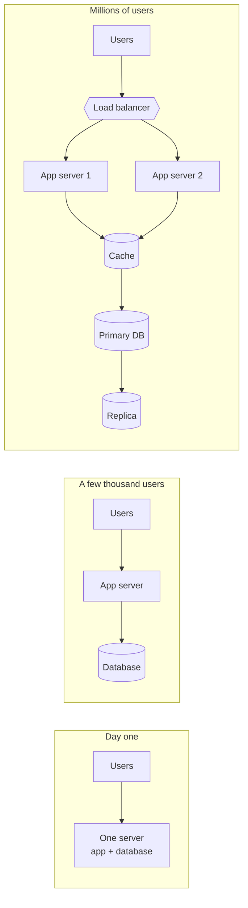

# What Is System Design

System design is the work of deciding which pieces a piece of software needs and how they talk to each other, so the whole thing keeps working when a lot of people use it. It covers servers, databases, caches, queues, and the network between them.

It's different from low-level design, which is about classes, functions and code structure inside one service. System design starts a level above that: should this be one service or five? Where does the data live? What happens when a machine dies at 3 a.m.?

## Why scale changes the answer

A small app can run on one machine. The web server, the application and the database all sit in the same box, and for a few hundred users that's fine. Problems start when traffic grows. The machine runs out of CPU, the disk fills up, or it simply crashes and takes the whole product down with it.

Most systems grow in the same rough order.

Every box added on the right solves one problem and creates a new one. A load balancer removes the single app server but is now a single point of failure itself. A cache makes reads fast but can serve stale data. A replica spreads read load but can lag behind the primary. Most of system design is knowing what each piece costs.

## How these notes are organised

Each page covers one idea and stands on its own, though later pages lean on earlier ones. If you're new, read the chapters in order. If you're preparing for an interview, read [How to Approach a Design Interview](02-interview-approach.md) and [Numbers Worth Remembering](03-numbers-to-know.md) first, then jump to whatever you're weak on.

<!-- nav:start -->
---

Next: [How to Approach a Design Interview](02-interview-approach.md) | [All topics](../README.md)
<!-- nav:end -->
