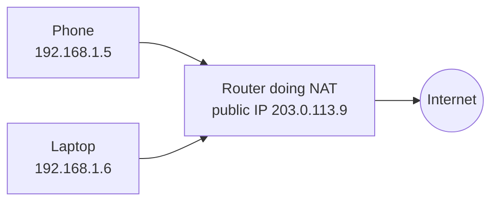

# IP Address

Every device on a network needs an address so other devices can find it. On the internet that address is an IP address. When your browser talks to a server, it's really talking to a number like `142.250.190.78`.

## IPv4 and IPv6

IPv4 addresses are 32 bits, written as four numbers from 0 to 255 separated by dots, for example `192.168.1.10`. That gives about 4.3 billion addresses, which sounds like a lot until you count every phone, laptop and sensor in the world. We ran out of fresh ones years ago.

IPv6 fixes this with 128-bit addresses, written in hexadecimal groups like `2001:db8::1`. The space is so large that running out isn't a concern. Both versions are in use today, and most big services support both.

## Public and private addresses

A public address is reachable from the internet. A private address only works inside a local network. Three ranges are reserved for private use:

| Range | Typical use |
|---|---|
| 10.0.0.0 to 10.255.255.255 | Large company and cloud networks |
| 172.16.0.0 to 172.31.255.255 | Mid-sized networks |
| 192.168.0.0 to 192.168.255.255 | Home routers |

Your home router has one public address, and every device behind it has a private one. The router rewrites addresses as traffic passes through, which is called NAT (network address translation).

## Static and dynamic

A static address never changes, which is what servers usually want. A dynamic address is handed out by a DHCP server and can change when you reconnect. Home devices are almost always dynamic.

## Subnets and CIDR

A subnet is a slice of a network. CIDR notation describes it with a prefix length: `10.0.1.0/24` means the first 24 bits are the network part, which leaves 8 bits for hosts, so 256 addresses. A `/16` has 65,536. Cloud providers ask you to pick these ranges when you create a virtual network.

## Why this matters in a design

Servers behind a load balancer usually have private addresses, so the original client IP is passed along in a header such as `X-Forwarded-For`. Rate limiting by IP address can hurt real users, because a whole office or a mobile carrier can share one public address through NAT. And `127.0.0.1` always means "this machine", which is why a service listening only on it can't be reached from outside.

<!-- nav:start -->
---

Previous: [Numbers Worth Remembering](../00-start-here/03-numbers-to-know.md) | Next: [OSI Model](02-osi-model.md) | [All topics](../README.md)
<!-- nav:end -->
