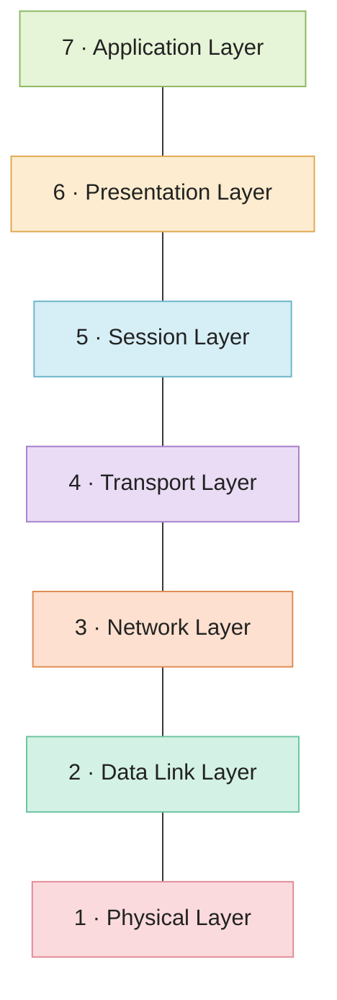
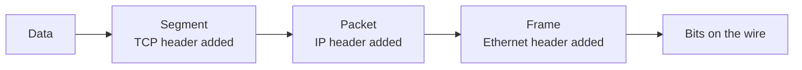

# OSI Model

The OSI model describes network communication as seven layers. Each layer does one job and relies on the layer below it. A web request starts at the top as an HTTP message and ends at the bottom as electrical or radio signals.

| Layer | What it does | Examples |
|---|---|---|
| 7 Application | The protocols apps use to talk | HTTP, SMTP, FTP, DNS |
| 6 Presentation | Formats, encoding, compression, encryption | JSON, JPEG, TLS (loosely) |
| 5 Session | Starts, keeps and ends a conversation | RPC, session tokens |
| 4 Transport | Delivery between processes, using ports | TCP, UDP |
| 3 Network | Addressing and routing across networks | IP, routers |
| 2 Data Link | Delivery between neighbours on one network | Ethernet, Wi-Fi, switches |
| 1 Physical | Bits on a wire or radio wave | Cables, fibre, radio |

## Wrapping data as it goes down

When you send something, each layer wraps the data from the layer above with its own header. That's called encapsulation. The receiver unwraps it in reverse.

## The model versus what's really used

The internet runs on the TCP/IP model, which has four layers (application, transport, internet, link) and merges the top three and bottom two of OSI. People still use OSI numbering because it's a handy shared vocabulary. When someone says "layer 4 load balancer" or "layer 7 firewall", they mean transport and application.

For debugging, work from the bottom up. Is the link up? Can you reach the IP? Is the port open? Is the application answering? Most problems show up in the first layer where something fails.

<!-- nav:start -->
---

Previous: [IP Address](01-ip.md) | Next: [TCP and UDP](03-tcp-and-udp.md) | [All topics](../README.md)
<!-- nav:end -->
