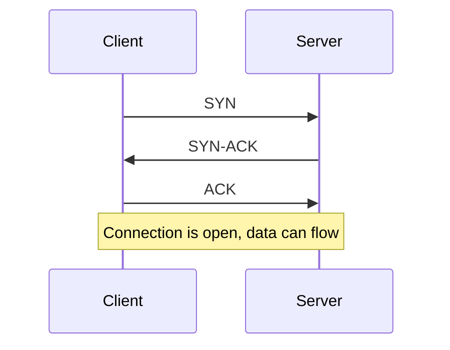

# TCP and UDP

Both protocols live at the transport layer. Their job is to get data from one program on one machine to a program on another, using IP addresses and port numbers to find the right ones. They make very different promises.

## TCP

TCP is about reliability. Before sending anything, the two sides do a three-step handshake to agree on starting sequence numbers.

After that, every chunk of data gets a sequence number and has to be acknowledged. If an acknowledgement doesn't arrive, the sender retransmits. The receiver puts chunks back in order before handing them to the application. TCP also slows down when the network looks congested, so it doesn't make things worse.

You get a clean, ordered stream of bytes, and you pay for it in latency and overhead.

## UDP

UDP just sends a packet and moves on. There's no handshake, no acknowledgement, no ordering, and no retransmission. If a packet is lost or arrives twice, UDP doesn't care. The header is only 8 bytes, against at least 20 for TCP.

That sounds worse but it's often what you want. In a video call, a lost frame from 200 ms ago is useless. Retransmitting it would only delay the frames that matter. Games, voice, live video and DNS lookups all lean on UDP for this reason.

## Side by side

| | TCP | UDP |
|---|---|---|
| Connection setup | Handshake first | None |
| Delivery | Guaranteed, retried | Best effort |
| Order | Preserved | Not preserved |
| Speed | Slower | Faster |
| Typical uses | Web pages, APIs, email, databases | DNS, streaming, voice, games |

## Where it gets interesting

TCP has a weakness called head-of-line blocking. If one segment is lost, everything behind it waits until it's resent, even if the later data already arrived. HTTP/2 multiplexes many requests over one TCP connection, so a single lost packet can stall all of them. HTTP/3 avoids this by running on QUIC, which is built on UDP and does its own reliability per stream.

So the choice isn't really "reliable versus unreliable". It's about who handles reliability. TCP does it for you. With UDP you do it yourself, only for the parts that need it.

<!-- nav:start -->
---

Previous: [OSI Model](02-osi-model.md) | Next: [DNS](04-dns.md) | [All topics](../README.md)
<!-- nav:end -->
