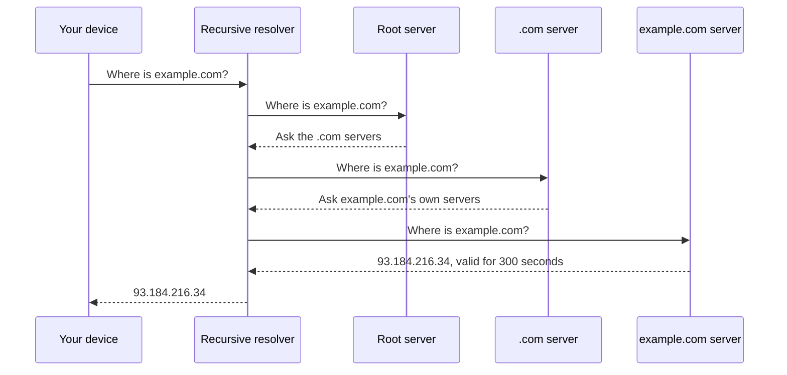

# DNS

People remember names like `example.com`. Computers need IP addresses. DNS (the Domain Name System) is the phone book that connects the two. It's spread across thousands of servers, and no single machine knows every answer.

## What happens when you type a domain

Your device first checks its own cache. If the answer isn't there, it asks a recursive resolver, usually run by your ISP or a public service. The resolver does the legwork.

The resolver keeps the answer for the number of seconds the authoritative server gave it. That number is the TTL (time to live). Most lookups never reach the root, because the resolver already knows the .com servers from an earlier request.

## Common record types

| Record | What it holds |
|---|---|
| A | An IPv4 address for a name |
| AAAA | An IPv6 address for a name |
| CNAME | An alias pointing to another name |
| MX | The mail servers for a domain |
| NS | Which servers are authoritative for a domain |
| TXT | Free text, often used for email and ownership checks |

## DNS in system design

TTL is a trade-off. A short TTL (say 60 seconds) lets you move traffic quickly when a server fails, but your DNS servers see more queries. A long TTL is cheaper, but if you change an address, some users keep hitting the old one until their cache expires.

DNS is also used as a crude load balancer. A name can return several addresses, or different addresses depending on where the user is. Managed services add health checks so a dead server stops being returned. It's still coarse, because clients cache answers and you can't react in under a TTL.

Since almost everything depends on DNS, an outage there looks like an outage everywhere. Large companies split their DNS across more than one provider for this reason.

<!-- nav:start -->
---

Previous: [TCP and UDP](03-tcp-and-udp.md) | Next: [Load Balancing](05-load-balancing.md) | [All topics](../README.md)
<!-- nav:end -->
