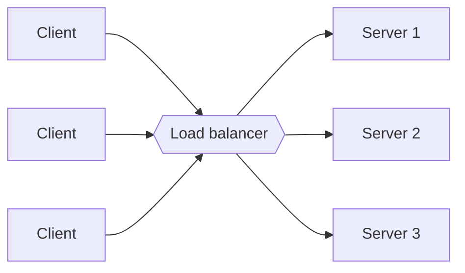

# Load Balancing

A load balancer sits in front of a group of servers and spreads incoming requests across them. Clients talk to one address, and the balancer decides which server handles each request.

It does two useful things at once. It lets you add capacity by adding servers, and it hides failures. If server 2 dies, the balancer notices and stops sending it traffic.

## How it picks a server

Round robin goes through the servers in order. It's simple and works well when requests cost about the same. Weighted round robin does the same but sends more traffic to bigger machines.

Least connections sends the request to whichever server is handling the fewest right now. This helps when some requests are slow and others are quick, since plain round robin can pile slow requests onto one unlucky server.

IP hash picks a server from a hash of the client address, so the same client keeps landing on the same server. Consistent hashing does something similar but moves far fewer clients when servers are added or removed. It's popular in front of caches (see [Consistent Hashing](../02-databases/11-consistent-hashing.md)).

## Layer 4 and layer 7

A layer 4 balancer only looks at IP addresses and ports. It's very fast because it doesn't read the request. A layer 7 balancer understands HTTP, so it can route `/api` to one group of servers and `/images` to another, look at cookies, or terminate TLS. It does more work per request, but the flexibility is usually worth it.

## Health checks

The balancer keeps asking each server "are you OK?", usually by hitting a small endpoint such as `/health`. If a server fails a few checks in a row, it's taken out of rotation. When it passes again, it's added back. Passive checks also help: if real requests to a server keep failing, that's a sign too.

## Sessions

If a server keeps user session data in its own memory, the same user needs to keep hitting that server. Sticky sessions do this, but they make load uneven and lose the session when that server dies. A better fix is to keep sessions in a shared store such as Redis, so any server can handle any request.

## The balancer can fail too

One load balancer is a single point of failure. Real setups run a pair, one active and one on standby, or use a managed cloud balancer that's already redundant behind the scenes.

<!-- nav:start -->
---

Previous: [DNS](04-dns.md) | Next: [Clustering](06-clustering.md) | [All topics](../README.md)
<!-- nav:end -->
