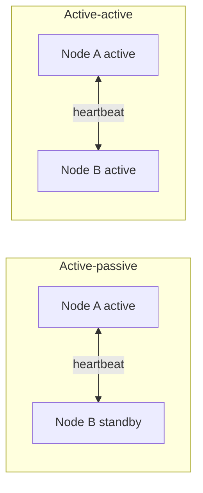

# Clustering

A cluster is a group of machines that work together and present themselves as one system. Instead of relying on one powerful server, you rely on several ordinary ones that cover for each other.

## What clusters are used for

The most common reason is availability. If one node fails, another picks up its work. Databases like PostgreSQL with replicas, or message brokers like Kafka, run as clusters for this reason.

The second reason is capacity. A cluster can share a workload that's too big for one machine, which is how Kubernetes spreads containers over many nodes.

A load balancer and a cluster are related but not the same thing. The balancer only decides where each request goes. A cluster is about the nodes themselves knowing about each other, tracking who's alive, and sharing or replicating state. A balancer often sits in front of a cluster.

## Active-passive and active-active

In an active-passive setup, one node does the work while another waits. The standby takes over if the active node stops responding. It's easy to reason about, but half your hardware sits idle.

In an active-active setup, all nodes serve traffic. You use all your capacity and failover is quick, but state has to stay consistent across nodes, which is harder.

## Shared nothing or shared storage

In a shared-nothing cluster each node has its own CPU, memory and disk, and data is split or copied between nodes. This scales well and is what most modern systems use. In a shared-storage cluster, all nodes read from the same disk system. That keeps data in one place but the storage becomes a bottleneck and a single point of failure.

## Split brain

Nodes check on each other with heartbeats. Suppose the network between two halves of a cluster breaks. Each half can't tell whether the other half is dead or just unreachable, and both may decide to become the leader. Now two nodes accept writes and the data diverges. That's a split brain.

The usual defence is a quorum. A group may only act if it holds a majority of the nodes. With five nodes, a group of three can continue and a group of two must stop, so there can never be two active halves. Some systems add fencing, which forcibly cuts off the old leader (by powering it off or revoking its storage access) before a new one takes over. See [Consensus and Leader Election](../04-design-toolkit/07-consensus-and-leader-election.md) for how this is done safely.

<!-- nav:start -->
---

Previous: [Load Balancing](05-load-balancing.md) | Next: [Caching](07-caching.md) | [All topics](../README.md)
<!-- nav:end -->
