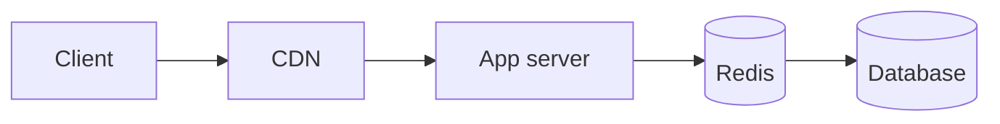
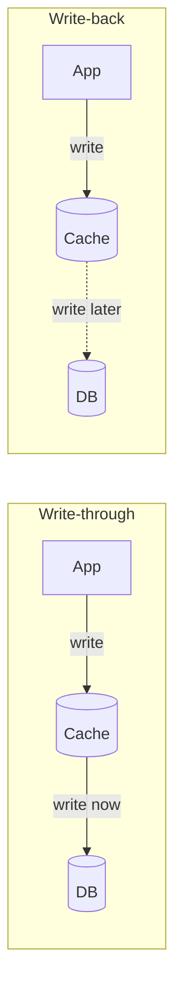

# Caching

A cache keeps a copy of data somewhere faster than the original source, so repeated requests don't pay the full cost every time. Reading from memory takes around 100 nanoseconds. Reading from a database over the network takes milliseconds. If the same row is requested a thousand times a second, it makes sense to fetch it once.

Caches exist at every level: the browser, a CDN, a reverse proxy, inside your application, in a shared store like Redis or Memcached, and in the database's own memory.

## Reading and writing

The most common pattern is cache-aside. The app checks the cache first. On a miss, it reads the database, stores the result in the cache, and returns it. The app owns the logic, and the cache only holds what has actually been asked for.

Writes are where the strategies differ.

With write-through, every write goes to the cache and the database together. Data is consistent and safe, but writes are slower. Write-back saves to the cache and flushes to the database later in batches. Writes are very fast, but if the cache crashes before flushing, that data is gone. Write-around skips the cache on writes and only fills it on reads, which avoids filling it with data nobody reads back.

## Deciding what to throw out

A cache has limited space, so it needs an eviction rule. LRU (least recently used) drops the item untouched for the longest time, and it's a sensible default. LFU (least frequently used) drops whatever is requested least often, which suits a stable set of popular items. TTL expiry removes entries after a set time regardless of use, and it's often combined with one of the others.

## What goes wrong

Stale data is the obvious one. If the database changes and the cache doesn't, users see old values. You can set a short TTL, or delete the cached key whenever you write.

A cache stampede happens when a very popular key expires and hundreds of requests all miss at once, then all hit the database together. Fixes include letting only one request rebuild the value while others wait, and adding a little random jitter to TTLs so keys don't all expire together.

Cache penetration is when requests ask for things that don't exist, so they never get cached and always hit the database. Caching the "not found" result for a short time helps, and so does a [Bloom filter](../04-design-toolkit/05-bloom-filters.md) in front.

Phil Karlton's old line says there are only two hard problems in computer science, cache invalidation and naming things. It stays true. Keep your invalidation rules simple, and be honest about how stale a value is allowed to be.

<!-- nav:start -->
---

Previous: [Clustering](06-clustering.md) | Next: [CDN](08-cdn.md) | [All topics](../README.md)
<!-- nav:end -->
