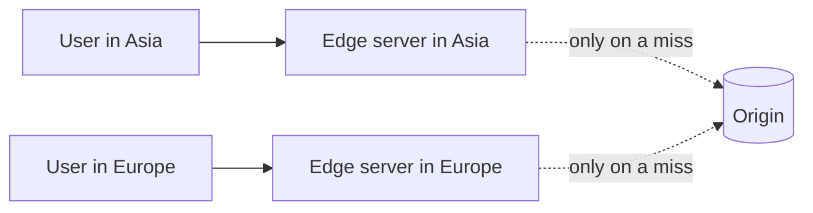

# CDN

A content delivery network is a set of servers spread around the world that keep copies of your content close to users. If your origin server is in Virginia and a user is in Mumbai, every request pays for the trip across the planet, which is over 100 ms before the server does any work. A CDN server in Mumbai can answer in a few milliseconds.

The edge servers are often called points of presence (PoPs). When a user asks for a file, the CDN checks its local copy. If it has one, it returns it. If not, it fetches from your origin, keeps a copy, and serves the user. The next person nearby gets the fast path.

## Pull and push

Most CDNs are pull based. You point them at your origin and they fetch files the first time someone asks. There's nothing to manage, but that first request is slow. In a push model you upload content to the CDN yourself ahead of time. It suits a small number of large files that rarely change, such as software downloads or video releases.

## Controlling freshness

You tell the CDN how long it may keep something using headers such as `Cache-Control: max-age=86400`. When content changes before that time is up, you either purge it by URL or tag, or you avoid the problem by putting a version in the filename. `app.3f9a1c.js` can be cached for a year because a new build gets a new name.

## What a CDN is good for

Static files like images, scripts, stylesheets and video are the obvious fit. CDNs also absorb traffic spikes, since your origin only sees the misses, and they soak up DDoS attacks because the load is spread over many locations. Many can also run small bits of code at the edge, or terminate TLS close to the user.

They help less for content that's different for every user or changes every second, since there's little to reuse. And a CDN adds a layer to debug when something looks stale, so know how to bypass it.

<!-- nav:start -->
---

Previous: [Caching](07-caching.md) | Next: [Proxy](09-proxy.md) | [All topics](../README.md)
<!-- nav:end -->
