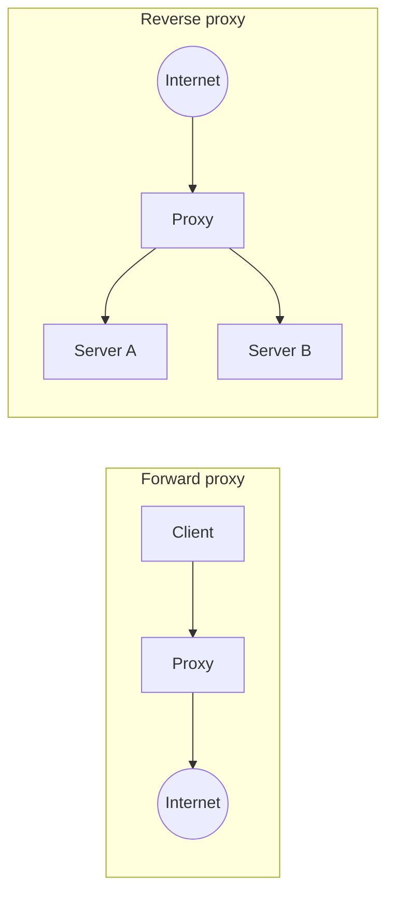

# Proxy

A proxy is a server that sits between two parties and passes messages along on someone's behalf. Which party it acts for decides whether it's a forward proxy or a reverse proxy.

## Forward proxy

A forward proxy acts for the client. The client sends requests to the proxy, and the proxy goes out to the internet. The websites see the proxy's address, not the client's. Companies use them to filter what employees can reach and to cache popular downloads. People use them to hide their location.

## Reverse proxy

A reverse proxy acts for the server. Clients think they're talking to your site, but they're talking to the proxy, which forwards each request to a server behind it. The clients never see the real servers.

That position is useful. A reverse proxy can spread load across servers, cache responses, compress them, terminate TLS so the app servers don't have to, enforce rate limits, and block obviously bad requests. Nginx, HAProxy, Envoy and Traefik all do this job.

## How it relates to other pieces

A load balancer is really a reverse proxy focused on distributing traffic. An [API gateway](../03-architecture/09-api-gateway.md) is a reverse proxy with extra features for managing APIs, like authentication and per-client quotas. A CDN edge server is a reverse proxy too, placed close to users. The names change but the idea is the same: a middleman that can look at traffic and make decisions before it reaches the real destination.

<!-- nav:start -->
---

Previous: [CDN](08-cdn.md) | Next: [Availability](10-availability.md) | [All topics](../README.md)
<!-- nav:end -->
