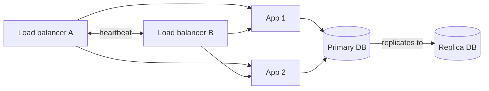

# Availability

Availability is the share of time a system is working and reachable. It's usually written as a percentage and described by how many nines it has.

| Availability | Downtime per year | Downtime per 30-day month |
|---|---|---|
| 99% | 3.65 days | 7.2 hours |
| 99.9% | 8.76 hours | 43 minutes |
| 99.99% | 52.6 minutes | 4.3 minutes |
| 99.999% | 5.3 minutes | 26 seconds |

Each extra nine cuts allowed downtime by a factor of ten, and the cost goes up a lot faster than that. Going from 99.9% to 99.99% usually means redundant everything, automatic failover and careful deploys. A human can't react fast enough to meet five minutes a year.

## How the maths works

When components depend on each other in a chain, availability multiplies, so it goes down. If a request needs a web server (99.9%) and a database (99.9%), the pair is 0.999 × 0.999 ≈ 99.8%. Chains of many services get worse quickly.

When components are redundant, so that either one can do the job, the chance of both failing together is small. Two copies of something that is 99% available fail together only 1% × 1% = 0.01% of the time, so the pair is 99.99% available. That's the reason for running more than one of everything.

## Building for it

Remove single points of failure by asking of every box "what happens if this dies?". Run at least two of anything important, spread them over separate failure zones (different racks, then different datacenters), detect failure with health checks, and switch over automatically.

Redundancy only helps if failover works, and failover is code that rarely runs. Teams that care test it on purpose, by killing servers in production or running regular drills. Netflix's Chaos Monkey is the well-known example.

Availability and consistency pull against each other when the network breaks. That tension is the subject of [CAP and PACELC](../02-databases/05-cap-and-pacelc.md).

<!-- nav:start -->
---

Previous: [Proxy](09-proxy.md) | Next: [Scalability](11-scalability.md) | [All topics](../README.md)
<!-- nav:end -->
