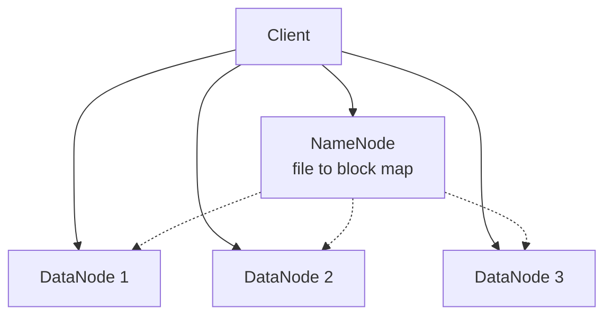

# Storage

Data has to live somewhere, and the kind of storage you pick affects speed, cost and how you access it. There are three main types.

| Type | You see | Good for | Examples |
|---|---|---|---|
| Block | Raw disk blocks you format yourself | Databases, operating systems | AWS EBS, a local SSD |
| File | Folders and files over a network | Shared documents, home directories | NFS, AWS EFS |
| Object | Blobs with a key and metadata, accessed over HTTP | Images, video, backups, logs | AWS S3, Google Cloud Storage |

Block storage is the fastest and has the lowest latency, which is why databases sit on it. File storage adds a familiar folder structure that many machines can share. Object storage gives up fast random edits for huge scale and low cost. You can't modify a byte in the middle of an object. You replace the whole thing. In exchange you get practically unlimited space, built-in replication, and a plain HTTP API.

For something like user photos, the usual pattern is to put the file in object storage, put the URL in your database, and serve it through a CDN.

## RAID

RAID combines several physical disks so they act as one, trading speed, capacity and safety.

| Level | What it does | Survives |
|---|---|---|
| 0 | Stripes data across disks | Nothing, one failure loses everything |
| 1 | Mirrors data on two disks | One disk failure |
| 5 | Stripes with one disk's worth of parity | One disk failure |
| 6 | Stripes with two disks' worth of parity | Two disk failures |
| 10 | Mirrors, then stripes | One failure per mirror pair |

RAID protects against a disk dying. It doesn't protect against deleting a file by mistake, a bug that corrupts data, or a fire, so it never replaces backups.

## Distributed file systems

When data outgrows one machine, you spread files across many. HDFS (the Hadoop Distributed File System) is a classic example. A NameNode keeps the map of which blocks make up which file and where they are, and many DataNodes hold the blocks. Files are cut into large blocks, 128 MB by default, and each block is copied to three DataNodes by default. If one node dies, the NameNode notices and makes new copies from the survivors.

The same idea, with different details, sits behind most cloud object stores: split data into chunks, keep several copies on separate machines, and keep a separate index that says where everything is.

<!-- nav:start -->
---

Previous: [Scalability](11-scalability.md) | Next: [Databases and DBMS](../02-databases/01-databases-and-dbms.md) | [All topics](../README.md)
<!-- nav:end -->
