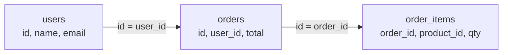

# Databases and DBMS

A database is an organised collection of data. A database management system (DBMS) is the software that sits on top and does the heavy lifting, so each application doesn't have to. PostgreSQL, MySQL, MongoDB and Redis are all DBMSs, though people usually just call them databases.

A DBMS takes care of a lot: storing data safely on disk, finding it quickly when you query, letting many users read and write at once without stepping on each other, recovering after a crash, and controlling who can see what. Writing all that yourself on top of plain files would be a huge project.

## Relational databases

A relational database stores data in tables made of rows and columns, with relationships between tables defined by keys. You query them with SQL. They enforce a schema, so every row in a table has the same shape, and they support transactions. PostgreSQL, MySQL, Oracle and SQL Server are relational.

## Other kinds

Not everything fits neatly into tables. Key-value stores like Redis map a key to a value and are extremely fast for lookups. Document stores like MongoDB hold JSON-like documents with flexible shapes. Wide-column stores like Cassandra handle huge write volumes across many machines. Graph databases like Neo4j are built for data defined by relationships. The next page, [SQL vs NoSQL](02-sql-vs-nosql.md), compares them.

## Two workloads

OLTP (online transaction processing) means lots of small, fast operations: place an order, update a profile, check a balance. Most application databases do this, and they're usually row-oriented, meaning each row's values are stored together on disk.

OLAP (online analytical processing) means fewer, much larger queries that scan huge amounts of data: total sales per region over three years. Data warehouses like BigQuery, Snowflake and Redshift do this. They're usually column-oriented, since a query that needs two columns out of fifty can then read just those two.

Mixing both on the same database tends to hurt. A heavy analytics query can slow the checkout page. The usual fix is to copy data from the OLTP database into a separate warehouse for analysis.

<!-- nav:start -->
---

Previous: [Storage](../01-fundamentals/12-storage.md) | Next: [SQL vs NoSQL](02-sql-vs-nosql.md) | [All topics](../README.md)
<!-- nav:end -->
