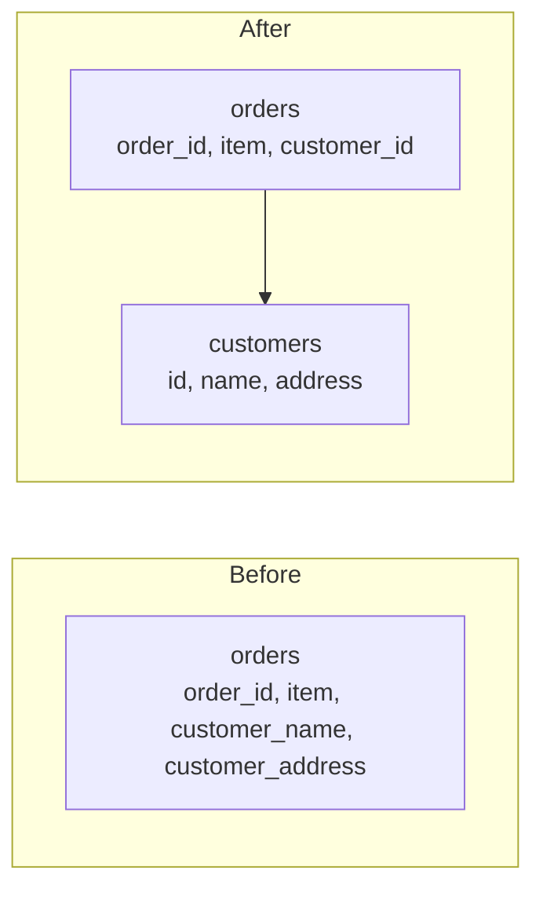

# Normalization and Denormalization

Normalization is organising tables so each fact is stored in exactly one place. Denormalization is deliberately breaking that rule to make reads faster.

## Why normalize

Imagine one big `orders` table where each row holds the customer's name and address along with the order itself. A customer with 200 orders has their address copied 200 times. When they move, you have to update 200 rows, and if you miss one, the data now disagrees with itself. These are called update anomalies.

Splitting it fixes the problem. Customers go in one table, orders in another, and orders point at customers by id.

## The normal forms

These are cumulative levels of tidiness. Most real designs aim for the third.

First normal form means every column holds a single value, with no lists or repeating groups stuffed into one cell. Second normal form means that on top of that, every non-key column depends on the whole primary key, not just part of a composite one. Third normal form adds that non-key columns depend only on the key and not on each other. If `zip_code` determines `city`, then `city` shouldn't sit in the same table as `zip_code` as a separate fact. Boyce-Codd normal form is a slightly stricter version of the third.

## Why denormalize

Normalized data needs joins to put things back together, and joins cost time, especially across big tables. A product page that joins eight tables on every view may be too slow at high traffic.

So teams copy some data on purpose. They store the author's name inside each comment, keep an `order_total` column instead of summing line items every time, or keep a precomputed count of likes. Reads get faster and simpler. Writes get more work, since every copy has to be kept in step, and bugs can leave copies disagreeing.

A sensible order is to normalize first, measure, and denormalize only the specific places where reads are too slow. In NoSQL document stores, denormalized data is the normal style, because there are usually no joins to lean on.

<!-- nav:start -->
---

Previous: [SQL vs NoSQL](02-sql-vs-nosql.md) | Next: [ACID and BASE](04-acid-and-base.md) | [All topics](../README.md)
<!-- nav:end -->
