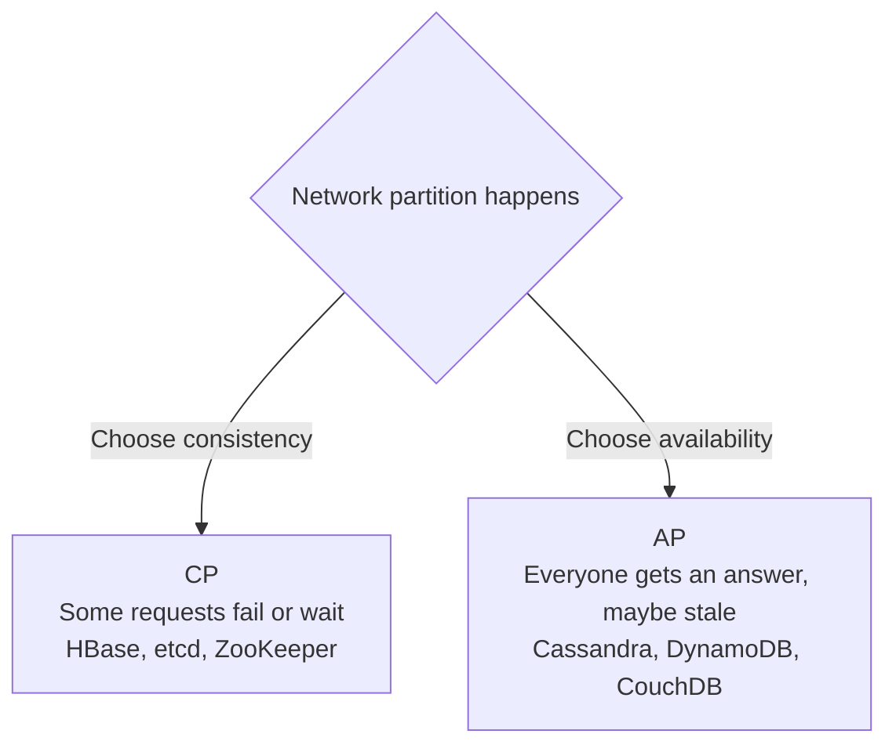

# CAP and PACELC

CAP is a rule about distributed data stores. It names three properties and says you can't fully have all of them when the network misbehaves.

Consistency here means every read returns the most recent write, as though there were a single copy of the data. Availability means every request to a working node gets a response. Partition tolerance means the system keeps running even when the network splits and some nodes can't talk to others.

## What the theorem really says

People often draw it as "pick two of three", which is misleading. In a real distributed system, network partitions will happen, so partition tolerance isn't optional. The actual choice is what to do while a partition is happening.

Suppose two replicas lose contact with each other and a write arrives at one of them. The system can refuse or delay requests until the replicas agree again, which keeps data consistent but gives up availability. Or it can accept the write and keep answering, which stays available but means the other replica may return stale data.

When the network is healthy, you can have both. The theorem is only about what you give up during the failure. Also, the labels on real databases are rough. Many can be configured either way, for example by requiring a quorum of replicas on each read.

## PACELC

CAP says nothing about normal operation, but there's a trade-off then too. PACELC, proposed by Daniel Abadi, extends it. If there's a Partition, choose between Availability and Consistency. Else, when everything is running normally, choose between Latency and Consistency.

The second half matters because keeping replicas strictly in sync means waiting for them to acknowledge writes, and that waiting is latency. A system that returns as soon as one copy is written is faster but weaker on consistency.

| System | Under partition | Normally | Short form |
|---|---|---|---|
| Cassandra, DynamoDB (default settings) | Availability | Latency | PA/EL |
| Google Spanner | Consistency | Consistency | PC/EC |
| MongoDB (default settings) | Availability | Consistency | PA/EC |

Read those rows as typical tendencies, since configuration changes them.

## Using it in a design

Ask what's worse for this feature: showing slightly old data, or refusing to answer. For a social feed, old data is fine, so lean towards availability. For an account balance or a seat booking, wrong data is worse than a short error, so lean towards consistency.

<!-- nav:start -->
---

Previous: [ACID and BASE](04-acid-and-base.md) | Next: [Transactions](06-transactions.md) | [All topics](../README.md)
<!-- nav:end -->
