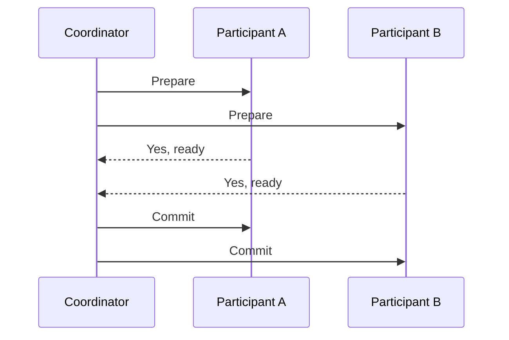
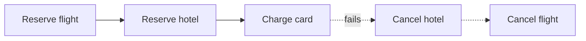

# Distributed Transactions

A distributed transaction needs to change data in more than one place, such as two databases or two services, and still be all-or-nothing. A single database can do this with a log and a lock manager. Once the data is on separate machines that can fail independently, it gets difficult.

## Two-phase commit

Two-phase commit (2PC) is the classic protocol. One node acts as coordinator and the others are participants.

In the prepare phase, the coordinator asks everyone whether they can commit. Each participant does the work, writes it durably, and promises it can finish if asked. In the commit phase, if everyone said yes, the coordinator tells all of them to commit. If anyone said no, or didn't answer, it tells all to roll back.

This gives atomicity across nodes, but it has costs. It's slow, because there are several round trips and locks are held the whole time. And it blocks. If the coordinator crashes after participants have said yes but before it announces the result, they're stuck holding locks until it recovers. Three-phase commit adds another step to avoid that blocking, but it relies on assumptions about the network that don't hold in practice, so it's rarely used.

## Sagas

Microservice systems usually avoid 2PC and use sagas instead. A saga breaks the big transaction into a series of small local ones, each in its own service. If a step fails, the saga runs compensating actions to undo the earlier steps.

Booking a trip might go like this: reserve a flight, reserve a hotel, charge the card. If the charge fails, the saga cancels the hotel and then the flight. A compensation isn't a true rollback. The flight really was reserved for a while, and cancelling it is a new action. So you design for it, for example by sending an apology email.

There are two ways to run one. In choreography, each service reacts to events from the previous one and publishes its own, with no central controller. It's simple at first and hard to follow as it grows. In orchestration, a central orchestrator tells each service what to do next and handles failures, which is easier to understand and monitor.

Sagas give you eventual consistency, not isolation. Other users may see the half-finished state in between. Every step and every compensation should be idempotent, meaning safe to run twice, because messages get retried.

## Practical advice

If you can keep related data in one database and use a normal transaction, do it. Distributed transactions are for when you really can't.

<!-- nav:start -->
---

Previous: [Transactions](06-transactions.md) | Next: [Indexes](08-indexes.md) | [All topics](../README.md)
<!-- nav:end -->
