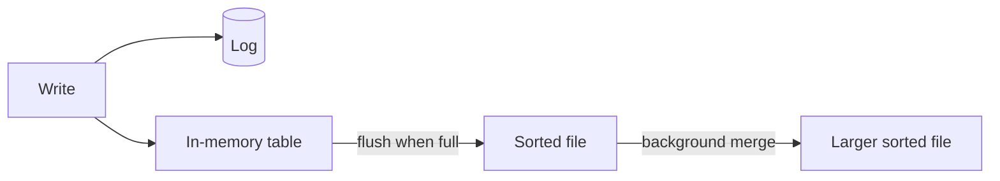

# Indexes

Without an index, finding a row means reading the whole table, row by row, until you hit matches. That's a full scan, and on a table with 100 million rows it's painfully slow. An index is a separate structure that lets the database jump straight to the rows it wants, like the index at the back of a book.

## The structures behind them

Most relational databases use B-trees. A B-tree keeps keys sorted in a shallow, wide tree, so finding any key takes only a few disk reads even for billions of rows. Because the keys are sorted, it handles range queries (`WHERE age BETWEEN 20 AND 30`) and `ORDER BY` well too.

Many write-heavy databases, such as Cassandra, RocksDB and LevelDB, use LSM trees instead. Writes go into an in-memory table first, plus a log for safety. When the table fills, it's flushed to disk as a sorted file, and background jobs merge those files over time. Writes are fast because they're always sequential, while reads may have to check several files.

Hash indexes also exist. They give very fast exact lookups but can't do ranges.

## Kinds of index you'll meet

A primary index is built on the primary key. In some databases, like MySQL's InnoDB, it also decides how rows are laid out on disk. A secondary index is on any other column, and points back to the row.

A composite index covers several columns, and the order matters. An index on `(country, city)` helps queries on `country` alone, or on `country` and `city` together, but does little for a query on `city` alone. This is the leftmost prefix rule.

A covering index contains every column a query needs, so the database never has to visit the table at all. A partial index only covers rows that match a condition, such as unfinished orders, which keeps it small.

## What indexes cost

Indexes aren't free. Each one takes disk space, and every insert, update and delete has to update all the indexes on the table, so write speed drops as you add more. Indexing a column with only a few distinct values, like a yes/no flag, usually doesn't help, because the index doesn't narrow things down much.

So index the columns you filter, join and sort on frequently, and don't index everything. To see what the database is actually doing, run `EXPLAIN` (or `EXPLAIN ANALYZE` in PostgreSQL) on the slow query. If you see a sequential scan on a big table where you expected an index scan, that's your lead.

<!-- nav:start -->
---

Previous: [Distributed Transactions](07-distributed-transactions.md) | Next: [Replication](09-replication.md) | [All topics](../README.md)
<!-- nav:end -->
