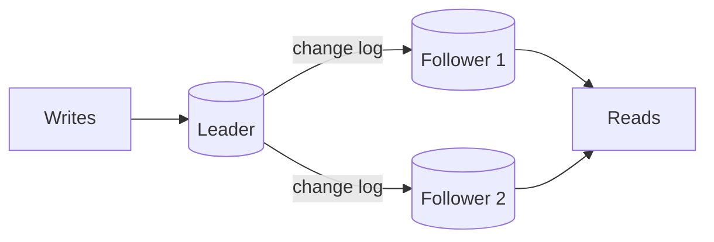

# Replication

Replication means keeping copies of the same data on several machines. It protects you if a machine dies, it lets you spread read traffic over more servers, and it can put a copy of the data closer to users in other regions.

## Leader and followers

The most common setup is single-leader. All writes go to one node, the leader (also called primary). It records every change in a log and sends that log to the followers (replicas), which apply the same changes in the same order. Reads can go to any follower.

## Synchronous or asynchronous

In synchronous replication, the leader waits for a follower to confirm before telling the client the write succeeded. Nothing is lost if the leader dies, but every write is slower, and if that follower is down, writes stall. In asynchronous replication, the leader confirms right away and sends changes in the background. It's fast, but a leader crash can lose the most recent writes that hadn't been copied yet.

A common compromise is semi-synchronous: wait for one follower and let the rest be asynchronous.

## Replication lag

With asynchronous followers, there's a delay between a write on the leader and its appearance on a follower. It's usually milliseconds, but it can grow to seconds or more under load. That causes strange behaviour. A user posts a comment, the page reloads from a follower that hasn't seen it yet, and the comment seems to have vanished. Or a user sees newer data on one refresh and older data on the next, as requests hit different followers.

Common fixes are reading your own recent writes from the leader, or pinning a user to one replica for a while.

## When the leader dies

Someone has to be promoted. Either a human does it or software detects the failure and picks the most up-to-date follower. This is risky. If the old leader comes back and thinks it's still in charge, you have two leaders, the split brain problem from [Clustering](../01-fundamentals/06-clustering.md). Promotion also loses any writes the new leader hadn't received.

## Other layouts

Multi-leader setups accept writes in several places, often one per region. Local writes are fast, but two regions can change the same record at the same time, and you need a rule to settle the conflict, such as last write wins or a merge function.

Leaderless systems like Cassandra and DynamoDB send each write to several replicas and each read to several replicas. With N copies, W acknowledgements for a write and R replicas read, choosing W + R > N guarantees that every read overlaps with at least one replica that saw the latest write.

<!-- nav:start -->
---

Previous: [Indexes](08-indexes.md) | Next: [Sharding](10-sharding.md) | [All topics](../README.md)
<!-- nav:end -->
