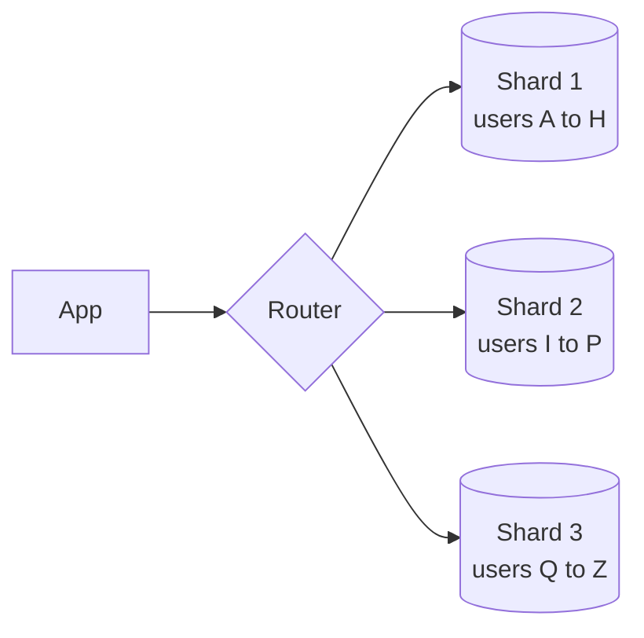

# Sharding

Replication gives you more copies of the same data. Sharding splits the data itself, so each machine holds only a part. When a table is too large for one disk, or the write rate is more than one machine can take, sharding is the way to keep growing.

Each piece is a shard. A rule maps every record to exactly one shard, and something (the app, a proxy, or the database itself) has to apply that rule on every query.

## Ways to split

Range-based sharding gives each shard a continuous range of keys, like user ids 1 to 1 million. Range queries are cheap because neighbouring keys sit together. The danger is hotspots. If the key grows over time, such as a timestamp, all new writes go to the last shard.

Hash-based sharding runs the key through a hash function and uses the result to choose a shard. Load spreads evenly, but range queries now touch every shard. A plain `hash(key) % N` also reshuffles almost all the data when N changes, which is why many systems use [consistent hashing](11-consistent-hashing.md) instead.

Directory-based sharding keeps a lookup table saying where each key lives. It's very flexible, since you can move individual keys, but the lookup service becomes something else to scale and protect.

## Picking the shard key

This is the decision you live with. A good key has many distinct values, spreads load evenly, and matches how you query. Sharding orders by `user_id` makes "show this user's orders" hit one shard. Sharding by country would be a poor choice if one country has most of the traffic.

## What gets harder

Joins across shards are expensive, so you either denormalize or do the join in application code. Transactions that touch several shards need [distributed transactions](07-distributed-transactions.md). Unique constraints and auto-increment ids can't rely on one database counter. Rebalancing, meaning moving data when you add shards, is slow and delicate. And one shard can still become a hot spot, for instance a celebrity user whose data gets hammered.

Sharding adds a lot of operational weight, so leave it until you've tried the simpler fixes: better indexes, caching, and read replicas.

<!-- nav:start -->
---

Previous: [Replication](09-replication.md) | Next: [Consistent Hashing](11-consistent-hashing.md) | [All topics](../README.md)
<!-- nav:end -->
