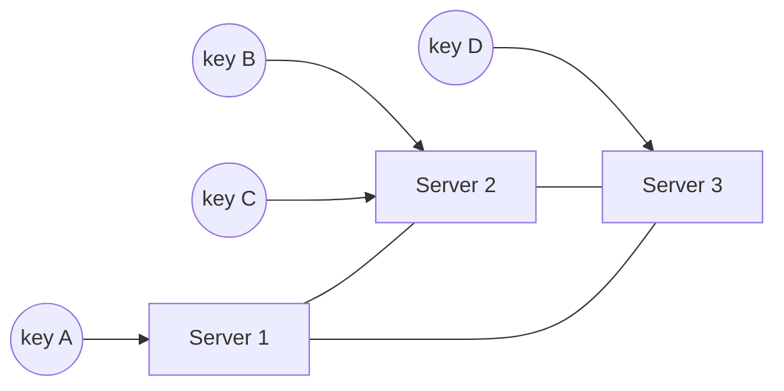

# Consistent Hashing

Suppose you spread keys across N cache servers with `hash(key) % N`. It works until N changes. Add one server going from 4 to 5, and about 80% of keys now map to a different server. For a cache, that means most of it is suddenly cold and the database gets flooded. Consistent hashing is designed so that changing the number of servers only moves a small share of keys.

## The ring

Picture the output range of a hash function bent into a circle. Hash each server's name to put it at a point on the circle. To find which server owns a key, hash the key to a point and walk clockwise until you meet a server.



If a server is added, it takes over only the keys between it and the previous server on the ring. If one is removed, only its keys move, and they go to its clockwise neighbour. On average only about 1/N of the keys move.

## Virtual nodes

With only a few servers, hashing can place them unevenly, so one ends up owning a huge arc. The fix is to put each server on the ring many times, under names like `server1#0`, `server1#1`, and so on. These are virtual nodes. The load evens out, and a stronger machine can be given more virtual nodes than a weaker one. When a server dies, its keys scatter across many others rather than landing on a single neighbour.

## A small implementation

```python
import bisect
import hashlib


class HashRing:
    def __init__(self, nodes: list[str], vnodes: int = 100) -> None:
        self._ring: list[tuple[int, str]] = []
        for node in nodes:
            self.add(node, vnodes)

    @staticmethod
    def _hash(key: str) -> int:
        return int(hashlib.md5(key.encode()).hexdigest(), 16)

    def add(self, node: str, vnodes: int = 100) -> None:
        for i in range(vnodes):
            bisect.insort(self._ring, (self._hash(f"{node}#{i}"), node))

    def remove(self, node: str) -> None:
        self._ring = [(h, n) for h, n in self._ring if n != node]

    def get(self, key: str) -> str:
        index = bisect.bisect(self._ring, (self._hash(key), "")) % len(self._ring)
        return self._ring[index][1]
```

The ring is kept sorted, so a lookup is a binary search. The `% len(...)` handles wrapping from the end of the circle back to the start.

Dynamo, Cassandra, many memcached clients and some load balancers use this idea. It was introduced in a 1997 paper by Karger and others for web caching.

<!-- nav:start -->
---

Previous: [Sharding](10-sharding.md) | Next: [Database Federation](12-database-federation.md) | [All topics](../README.md)
<!-- nav:end -->
