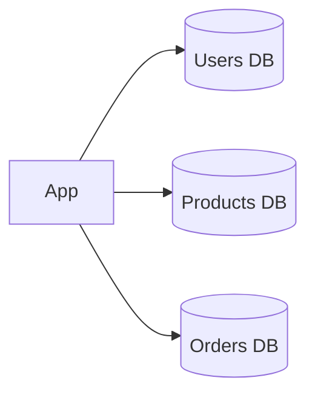

# Database Federation

Federation (sometimes called functional partitioning) splits a database by function instead of by rows. Rather than one giant database holding everything, you run separate databases for separate areas of the product: one for users, one for products, one for orders.

Each database is smaller, so it fits in memory more easily, has less write traffic, and can be tuned and scaled on its own. A problem in the orders database doesn't take the product catalogue down. Different teams can own different databases, and this fits naturally with a microservices layout where each service owns its own data.

## What you lose

Joins across databases are no longer a single SQL query. If you want orders along with the user's name, the application fetches from one database, then the other, and combines them. Transactions that span two databases need [distributed transactions](07-distributed-transactions.md) or a saga. And there's more infrastructure to run: more connections, more backups, more things that can fail.

## Federation and sharding

They solve different problems and are often used together. Federation splits by what the data is about. Sharding splits one big table by key, so every shard has the same structure. A common progression is to federate first, since it's easier, and then shard whichever database still outgrows a single machine, which is often orders or messages.

<!-- nav:start -->
---

Previous: [Consistent Hashing](11-consistent-hashing.md) | Next: [N-Tier Architecture](../03-architecture/01-n-tier.md) | [All topics](../README.md)
<!-- nav:end -->
