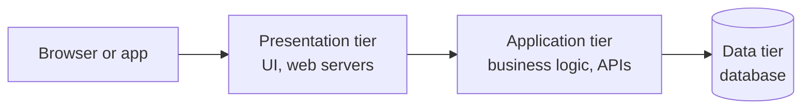

# N-Tier Architecture

N-tier architecture splits an application into separate levels, each with one responsibility, where each level only talks to the one next to it. The most common version has three tiers.

The presentation tier is what the user sees and touches: a web page, a mobile app, or the server that delivers them. The application tier holds the business rules, like "an order over 5,000 needs approval" or "apply this discount". The data tier stores and retrieves the information.

You'll also hear about 1-tier and 2-tier. A single-tier app runs everything on one machine, like a desktop program. A two-tier app has a client talking straight to a database, which was common in older office software. Adding the middle tier keeps database credentials and rules off the client and lets you scale the logic separately.

## Layers and tiers

The two words get mixed up. A layer is a logical division inside code, such as controllers, services and repositories. A tier is a physical one, meaning a separate set of machines or processes. You can have three layers running on a single tier, and that's how most small apps start. Splitting into real tiers is an operational choice made when you need independent scaling or isolation.

## Why teams use it

Separation makes each part simpler to understand, test and replace. You can swap the database or redo the front end without rewriting the business rules. Each tier can scale on its own. You can put a firewall between tiers, so the database isn't reachable from the internet.

The downsides are extra network hops, which add latency, and more moving parts to deploy. A request has to pass through every tier, so a slow database slows everything above it. When one tier becomes too large and tangled, teams often break it up further, which leads to [microservices](05-monoliths-and-microservices.md).

<!-- nav:start -->
---

Previous: [Database Federation](../02-databases/12-database-federation.md) | Next: [Message Brokers and Queues](02-message-brokers-and-queues.md) | [All topics](../README.md)
<!-- nav:end -->
