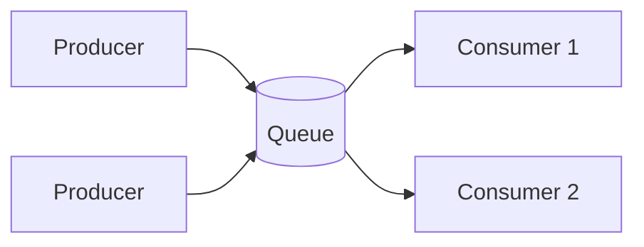

# Message Brokers and Queues

Some work doesn't have to happen while the user waits. Sending a confirmation email, resizing an uploaded photo and updating a search index can all happen a moment later. A message queue lets one part of the system hand work to another without waiting for it.

A message broker is the server that receives messages from producers, holds them, and delivers them to consumers. The queue is the line inside it.

Each message goes to one consumer. If one consumer is slow, another takes the next message, so adding consumers increases throughput.

## What a queue gives you

It decouples the sides. The producer doesn't need to know who processes the message, or whether they're running right now. It smooths out bursts: if 10,000 orders arrive in a minute, they wait in the queue and get processed at whatever speed the consumers can manage, instead of crashing the service. And it allows retries, since a failed message can be put back.

## Getting messages delivered

When a consumer takes a message, it must acknowledge it after finishing. If it crashes before acknowledging, the broker hands the message to someone else. In Amazon SQS, this works through a visibility timeout: the message is hidden from others for a while, and reappears if it isn't deleted in time.

That means a message can be delivered more than once. Most brokers promise at-least-once delivery. The other options are at-most-once, where messages can be lost but never repeated, and exactly-once, which is really at-least-once plus consumers that detect duplicates. So write consumers to be idempotent: processing the same message twice should have the same result as processing it once. Store an id for each processed message, or make the operation naturally safe, such as "set status to shipped".

Some messages can never succeed, perhaps because they're malformed. After a few attempts they're moved to a dead-letter queue, where someone can inspect them, instead of blocking the line forever.

## Different brokers

RabbitMQ is a traditional broker with flexible routing. It pushes messages to consumers and deletes them once acknowledged. Amazon SQS is a managed queue that needs no servers from you. Kafka is different in kind: it's a distributed log. Messages are appended to partitions and stay there for a set retention period, and consumers track their own position. That makes replay possible, and throughput very high. Order is guaranteed only inside one partition, so related messages need the same partition key.

## One more trap

If a service updates its database and then publishes a message, a crash between the two leaves them out of step. The outbox pattern fixes this: write the message into an outbox table in the same database transaction as the change, and let a separate process publish from that table.

<!-- nav:start -->
---

Previous: [N-Tier Architecture](01-n-tier.md) | Next: [Publish-Subscribe](03-publish-subscribe.md) | [All topics](../README.md)
<!-- nav:end -->
