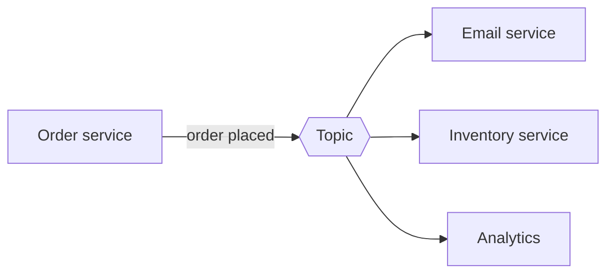

# Publish-Subscribe

In a queue, each message is handled by one consumer. In publish-subscribe, each message is delivered to every interested party. Publishers send messages to a topic without knowing who's listening, and subscribers register interest in topics without knowing who's publishing.

When an order is placed, the order service publishes one message. The email service, inventory service and analytics each get their own copy and do their own work. If you later add a fraud check, you subscribe it to the topic. The order service doesn't change at all, and that's the main attraction: new behaviour without touching the sender.

## Queue or topic?

Use a queue when a pile of work needs doing once, such as resizing images. Use a topic when something happened and several parties care about it independently.

The two combine well. Each subscriber often has its own queue attached to the topic. The topic copies a message into every subscriber's queue, and then each subscriber's workers share the load from their own queue. Amazon SNS feeding multiple SQS queues is the standard example.

Kafka does it with consumer groups. Every group receives all messages from a topic, but inside a group each partition is read by only one member. Different groups give you pub/sub, and several members in one group give you queue-like load sharing.

## Push and pull

Some systems push messages to subscribers as they arrive, which has low latency but can overwhelm a slow subscriber. Others have subscribers pull at their own pace, which is safer under load but adds a little delay. Many cloud services offer both.

## Things to watch

Ordering across subscribers isn't guaranteed unless the system says so. Subscribers get messages they don't expect to be there, so message formats need care once several teams depend on them; changing a field name can break people you don't know about. And debugging gets harder, since there's no direct call to follow. You need tracing, which is covered in [Observability](../04-design-toolkit/08-observability.md).

<!-- nav:start -->
---

Previous: [Message Brokers and Queues](02-message-brokers-and-queues.md) | Next: [Enterprise Service Bus](04-enterprise-service-bus.md) | [All topics](../README.md)
<!-- nav:end -->
