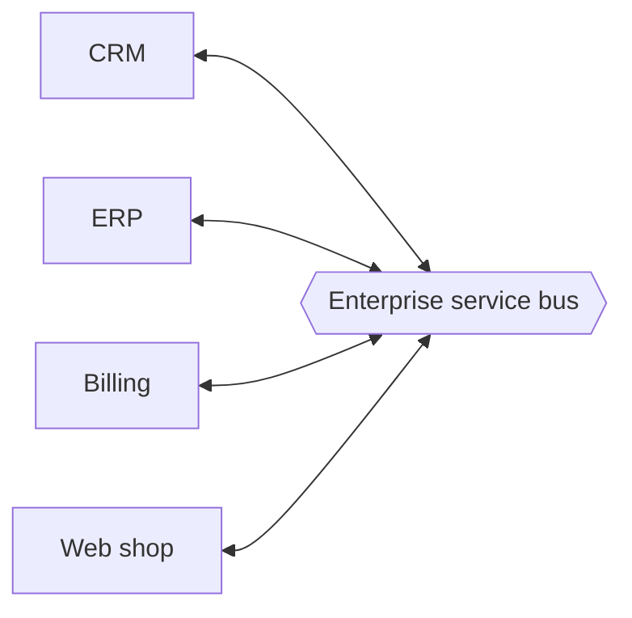

# Enterprise Service Bus

An enterprise service bus (ESB) is a central piece of middleware that connects many applications in a company. Instead of every system talking directly to every other system, they all talk to the bus, and the bus routes, transforms and delivers messages between them.

It became popular in the 2000s with service-oriented architecture (SOA). Companies had many old systems that spoke different protocols and formats: one with SOAP, another with flat files, another with a custom format. Linking them point to point creates a tangle of connections, where ten systems could need 45 separate integrations. A bus cuts that to ten, one per system.

## What it does

The bus converts between protocols and message formats, so a system that only understands XML over SOAP can talk to one that wants JSON over REST. It routes messages by content or rules. It can run workflows, such as orchestrating several calls, and it handles things like security and monitoring in one place. Common products include MuleSoft, IBM Integration Bus and WSO2.

## Why it fell out of fashion

Putting all the logic in one central place has a cost. The bus becomes a bottleneck for performance and also for teams, since every change goes through whoever owns it. If it fails, everything fails. And business logic tends to leak into the bus configuration, where it's hard to test and version.

Microservices took the opposite approach, often summed up as smart endpoints and dumb pipes. Services hold their own logic, and the connection between them is something simple, like HTTP or a message broker such as Kafka. Today a lot of companies use a broker plus an [API gateway](09-api-gateway.md) where they once used an ESB.

That said, an ESB still makes sense when you need to connect many legacy systems that you can't change, and that's the case it was built for.

<!-- nav:start -->
---

Previous: [Publish-Subscribe](03-publish-subscribe.md) | Next: [Monoliths and Microservices](05-monoliths-and-microservices.md) | [All topics](../README.md)
<!-- nav:end -->
