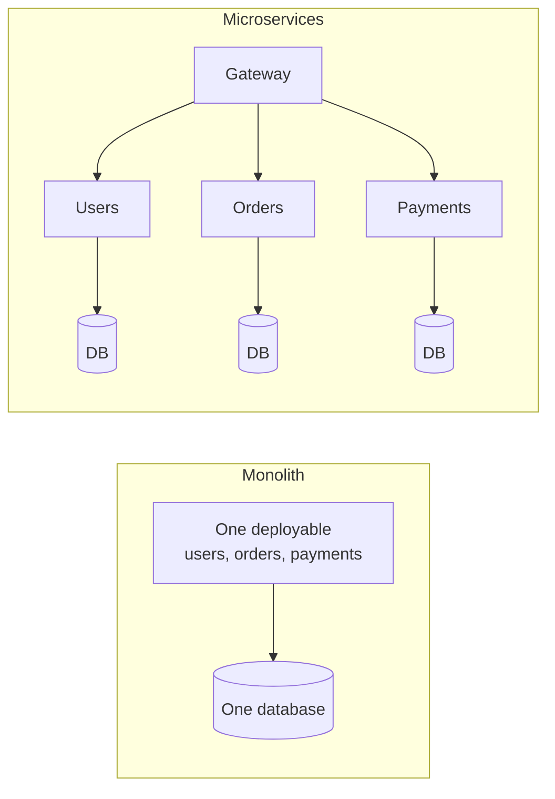

# Monoliths and Microservices

A monolith is one application, built and deployed as a single unit. The user interface, business logic and data access are all in the same codebase and run in the same process. A microservice architecture splits the application into many small services, each doing one job, each deployable on its own, and talking to the others over the network.

## The case for a monolith

A monolith is easy to build, test and deploy. A function call is just a function call, with no network in between, so it's fast and can't fail halfway. You can wrap changes across the whole app in one database transaction. For a small team, or a product still finding its shape, this is the right place to start, and many large companies ran monoliths for years.

The trouble comes as it grows. Builds and tests get slow. Everyone works in the same code, so teams collide. One bad change can bring everything down, and you can't scale one hot component without scaling the whole thing.

## The case for microservices

Each service can be developed, deployed and scaled independently. A payments team can release five times a day without waiting for anyone. A heavy service can run on more machines without paying for more of the others. A failure can be contained, and teams can pick different tools where it helps.

## The price

Everything that used to be a function call is now a network call, which is slower and can fail. Data is split up, so you lose easy joins and transactions and need patterns like [sagas](../02-databases/07-distributed-transactions.md). You need serious tooling: automated deployment, service discovery, centralised logging and tracing. Debugging means following a request through many services.

A distributed monolith is the worst outcome. That's when services are split apart but still so tightly linked that they have to be deployed together, so you get all the costs and none of the benefits.

## What to do in practice

Start with a well-organised monolith, with clear module boundaries inside it. When a part really needs its own team, scaling profile or release schedule, pull it out. Draw the lines around business areas such as billing or inventory, not around technical layers. Each service should own its data, and no other service should reach into its database directly.

Resilience patterns matter more once you're distributed. Use timeouts on every call, retry with backoff, and a [circuit breaker](../04-design-toolkit/02-circuit-breaker.md) to stop hammering a failing service.

<!-- nav:start -->
---

Previous: [Enterprise Service Bus](04-enterprise-service-bus.md) | Next: [Event-Driven Architecture](06-event-driven-architecture.md) | [All topics](../README.md)
<!-- nav:end -->
