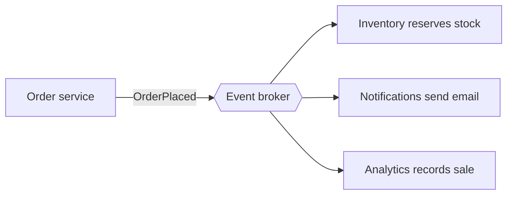

# Event-Driven Architecture

In an event-driven system, components communicate by announcing that something happened, instead of calling each other directly. An event is a fact about the past, named in the past tense: `OrderPlaced`, `PaymentFailed`, `UserSignedUp`. The sender publishes it and carries on. Anyone who cares reacts.

Compare this with the direct approach, where the order service calls inventory, then notifications, then analytics. It has to know about all of them, wait for each, and deal with each one's failures. In the event-driven version it knows about none of them. Adding a new consumer means subscribing to the event, with no change to the producer.

## Event or command?

An event says what happened and doesn't expect any particular response. A command tells a specific service to do something, like `ChargeCard`. Mixing them up leads to muddled designs. Events are broadcast, commands are addressed.

## How big is the event?

A thin event carries just an id, such as `{orderId: 42}`, and consumers call back for details. It's small but couples consumers to the producer's API. A fat event carries all the relevant data, so consumers don't need to ask, but the schema is bigger and changes are more delicate.

## Benefits

Services are loosely coupled and can be built and deployed independently. The system absorbs spikes, since the broker buffers events. It's easy to add new behaviour, and the event stream is also a natural source for analytics and audit.

## Costs

The flow of logic is no longer visible in one place. To understand what happens when an order is placed, you have to find every subscriber. Debugging a chain of events needs good tracing. Results become eventually consistent, so the UI may not reflect a change instantly. And event formats become a public contract. Change them carelessly and you'll break consumers you didn't know about, so use versioning and a schema registry.

Events also don't have to be thrown away after delivery. Storing them as the source of truth is the next idea, covered in [Event Sourcing](07-event-sourcing.md).

<!-- nav:start -->
---

Previous: [Monoliths and Microservices](05-monoliths-and-microservices.md) | Next: [Event Sourcing](07-event-sourcing.md) | [All topics](../README.md)
<!-- nav:end -->
