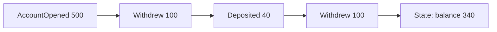

# Event Sourcing

Normally a database stores the current state: this account has a balance of 340. Event sourcing stores the history that led there instead: opened with 500, withdrew 100, deposited 40, withdrew 100. The current state is whatever you get by replaying those events from the start.

Events are only ever appended. Nothing is updated or deleted. A mistake is corrected by adding a new event that fixes it, the way an accountant adds a correcting entry instead of erasing a line in the ledger.

## What you get

You have a complete audit trail for free, because the history is the data. You can rebuild the state at any past moment by replaying up to that point, which helps with debugging ("how did this order end up in that state?") and with answering questions you hadn't thought of yet. You can also build new views of the data later by replaying the whole history into them. Systems that deal with money, orders or compliance find these properties valuable.

## What it costs

Replaying a long history for every read would be slow, so systems take snapshots: a saved copy of the state at some point, so replay starts from the snapshot instead of the beginning. Querying is awkward, since the event log isn't shaped for questions like "show all customers in Paris". The usual answer is to pair it with [CQRS](08-cqrs.md) and build read-friendly projections from the events.

Event formats must be kept compatible for years, because old events never go away. When the structure of an event changes, you need upcasters that translate old versions on read, or a migration.

Deleting data is a real problem. Privacy laws such as the GDPR give people the right to be forgotten, but the log is meant to be immutable. Common workarounds are to keep personal data outside the events, with only a reference inside, or to encrypt it with a per-user key and discard the key when asked to delete.

## Should you use it?

Not by default. It's a good fit when history is genuinely part of the business, as in banking, trading and logistics. For a simple CRUD application it adds a lot of complexity for little gain.

<!-- nav:start -->
---

Previous: [Event-Driven Architecture](06-event-driven-architecture.md) | Next: [CQRS](08-cqrs.md) | [All topics](../README.md)
<!-- nav:end -->
