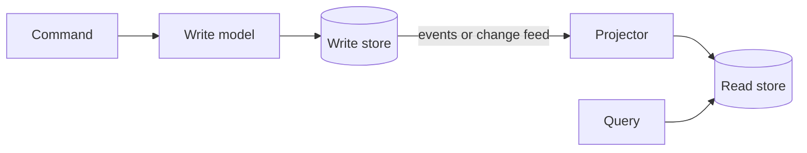

# CQRS

CQRS stands for Command Query Responsibility Segregation. The idea is to use one model for changing data and a different model for reading it. A command changes state, like "place order". A query returns data and changes nothing, like "list my orders".

## Why separate them

Reads and writes often want very different things. Writes care about validation and consistency, and a normalised relational schema suits them. Reads care about speed and want data already shaped for the screen, such as an order with its items, customer name and shipping status in one record. Trying to satisfy both in one model means compromising on both. There's also often a big difference in volume. Many systems have hundreds of reads for every write, and splitting lets you scale and optimise each side independently.

With CQRS, a write goes to the write model, which applies the business rules. The change then flows, usually through events, to a projector that updates one or more read stores. Those stores can be anything suited to the questions: a denormalised table, a search index, a cache.

## The catch

The read side is behind the write side by a short while, so it's eventually consistent. A user who submits a form and is taken to a list may not see their change yet. You have to handle that in the interface, for instance by showing the new item optimistically.

It also doubles the number of moving parts: two models, a way to move changes between them, and code to keep them in sync. For an ordinary CRUD app that's far more machinery than needed.

## Relationship to event sourcing

They're often mentioned together but are independent ideas. You can use CQRS with a normal database underneath, and event sourcing without CQRS. They fit well, though. Event sourcing's log is awkward to query, and CQRS provides the read models that fix that.

Use CQRS when reads and writes truly diverge in shape or scale, or where the domain is complicated. Leave it out of simple systems.

<!-- nav:start -->
---

Previous: [Event Sourcing](07-event-sourcing.md) | Next: [API Gateway](09-api-gateway.md) | [All topics](../README.md)
<!-- nav:end -->
