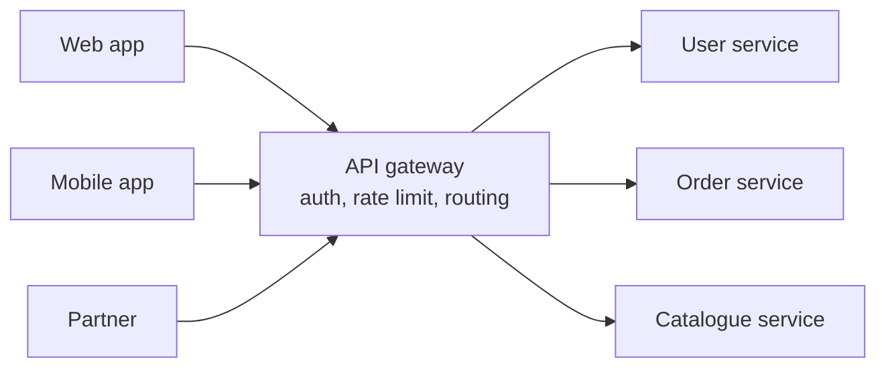

# API Gateway

An API gateway is the single entry point that clients use to reach a set of backend services. Instead of a mobile app knowing the addresses of the user service, the order service and the catalogue service, it talks to one address, and the gateway forwards each request to the right place.

## What it takes care of

Routing is the basic job: `/users/*` goes to one service, `/orders/*` to another. Beyond that it can handle things every service would otherwise have to repeat. It checks authentication tokens, enforces [rate limits](../04-design-toolkit/01-rate-limiting.md), terminates TLS, logs and measures traffic, and caches common responses. Some gateways also translate protocols, for example accepting REST from clients and calling gRPC inside.

It can also combine calls. A mobile home screen might need data from four services. The gateway can fetch all four and return one response, which saves the phone several slow round trips.

## Backend for frontend

Different clients want different things. A phone wants small responses, a web dashboard wants more detail. A common approach is a separate gateway for each kind of client, tailored to its needs. This is the backend-for-frontend (BFF) pattern.

## Risks

The gateway sits in the path of every request, so it must be highly available and fast, and it's a possible single point of failure. It's also tempting to pile business logic into it. Resist that. Keep it to cross-cutting concerns, or it turns into a new monolith.

Gateways are close relatives of [reverse proxies](../01-fundamentals/09-proxy.md) and [load balancers](../01-fundamentals/05-load-balancing.md), and the products overlap. Kong, AWS API Gateway, Apigee and Envoy-based gateways are common choices.

<!-- nav:start -->
---

Previous: [CQRS](08-cqrs.md) | Next: [REST, GraphQL and gRPC](10-rest-graphql-grpc.md) | [All topics](../README.md)
<!-- nav:end -->
