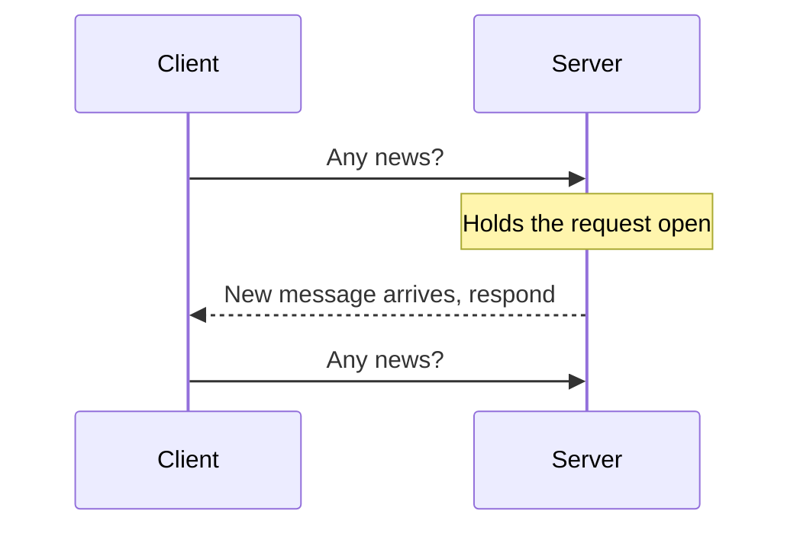

# Long Polling, WebSockets and Server-Sent Events

Normal HTTP is a question followed by an answer. The client asks, the server replies, and the server can't speak first. For things like chat, notifications, live scores or a stock ticker, the server needs to push data the moment it's ready. These three techniques solve that.

## Polling and long polling

The simplest approach is ordinary polling: the client asks "anything new?" every few seconds. It's easy, but most requests come back empty and updates arrive late.

Long polling improves on it. The client sends a request, and the server doesn't answer until it has something to say or a timeout expires. As soon as the client gets a response, it immediately sends the next request.

Updates arrive almost instantly, and it works everywhere because it's plain HTTP. But each message costs a full request and response, and a held connection ties up a server resource.

## WebSockets

A WebSocket starts as a normal HTTP request that asks to upgrade. If the server agrees (it replies with status 101), the connection stays open and turns into a two-way channel where either side can send messages whenever it likes, with very little overhead per message.

It's the usual choice for chat, multiplayer games and collaborative editing, where both sides talk a lot. The challenge is scale. Every user holds an open connection, so servers must manage hundreds of thousands of them, and load balancers need to deal with long-lived connections. When a server restarts, all its clients reconnect at once. You have to build reconnection, heartbeats and message recovery yourself.

## Server-sent events

SSE keeps one HTTP response open and lets the server stream text events down it. It only goes one way, from server to client. In return it's very simple. Browsers have built-in support, they reconnect automatically after a drop, and they can resume from the last event id they saw. It works over ordinary HTTP, so proxies and load balancers handle it easily.

It suits live feeds, notifications and progress updates, where the client only listens. Streaming responses from AI chatbots usually use it.

## Choosing

| | Direction | Complexity | Good for |
|---|---|---|---|
| Long polling | Server to client, by repeated requests | Low | Fallback, simple updates |
| SSE | Server to client | Low | Feeds, notifications, streaming text |
| WebSocket | Both ways | Higher | Chat, games, collaboration |

If the client only needs to listen, SSE is usually enough. Reach for WebSockets when the client also sends frequent messages.

<!-- nav:start -->
---

Previous: [REST, GraphQL and gRPC](10-rest-graphql-grpc.md) | Next: [Rate Limiting](../04-design-toolkit/01-rate-limiting.md) | [All topics](../README.md)
<!-- nav:end -->
