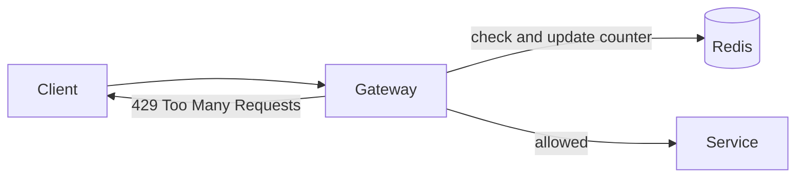

# Rate Limiting

Rate limiting caps how many requests a client can make in a period of time. It protects a service from abuse and from honest mistakes, like a client stuck in a retry loop. It also keeps one heavy user from slowing everyone else, and it's how paid API plans enforce quotas.

When a client goes over the limit, the server answers with HTTP status 429 (Too Many Requests), ideally with a `Retry-After` header saying when to try again.

## Common algorithms

A fixed window counter counts requests in each clock interval, say 100 per minute, and resets at the boundary. It's very cheap, but it lets through a burst at the edge: 100 requests at 12:00:59 and another 100 at 12:01:00 is 200 in two seconds.

A sliding window log fixes that by keeping a timestamp for every request and counting those in the last minute. It's exact, but memory grows with traffic. A sliding window counter approximates the same thing with two fixed counters weighted by how far you are into the current window, and costs almost nothing.

The token bucket is the most widely used. Picture a bucket holding up to `capacity` tokens, refilled at a steady rate. Each request takes a token. If the bucket's empty, the request is rejected. Short bursts are allowed (up to the bucket size) while the long-run average stays at the refill rate.

```python
import time


class TokenBucket:
    def __init__(self, rate: float, capacity: int) -> None:
        self.rate = rate            # tokens added per second
        self.capacity = capacity    # maximum burst size
        self.tokens = float(capacity)
        self.last = time.monotonic()

    def allow(self, cost: int = 1) -> bool:
        now = time.monotonic()
        self.tokens = min(self.capacity, self.tokens + (now - self.last) * self.rate)
        self.last = now
        if self.tokens >= cost:
            self.tokens -= cost
            return True
        return False
```

The leaky bucket is similar but drains at a constant rate, which smooths traffic into an even stream instead of allowing bursts.

## Doing it across many servers

One in-memory counter per server doesn't work when several servers share the load, since a client could get the limit on each. The counters need to live in a shared place, and Redis is the usual one.



The check and the update have to happen atomically. Two servers reading the same count at the same moment and both adding one will undercount. A short Lua script in Redis, or an atomic increment command, avoids that race.

## Details to decide

Choose what to limit by: user id, API key, IP address, or a combination. Remember that IP limits hit everyone behind a shared NAT. Choose where it lives: at the [API gateway](../03-architecture/09-api-gateway.md) for coarse global limits, and inside services for expensive operations. And decide what happens if the limiter itself is down. Failing open keeps the service usable but unprotected. Failing closed protects it but blocks everyone.

<!-- nav:start -->
---

Previous: [Long Polling, WebSockets and Server-Sent Events](../03-architecture/11-long-polling-websockets-sse.md) | Next: [Circuit Breaker](02-circuit-breaker.md) | [All topics](../README.md)
<!-- nav:end -->
