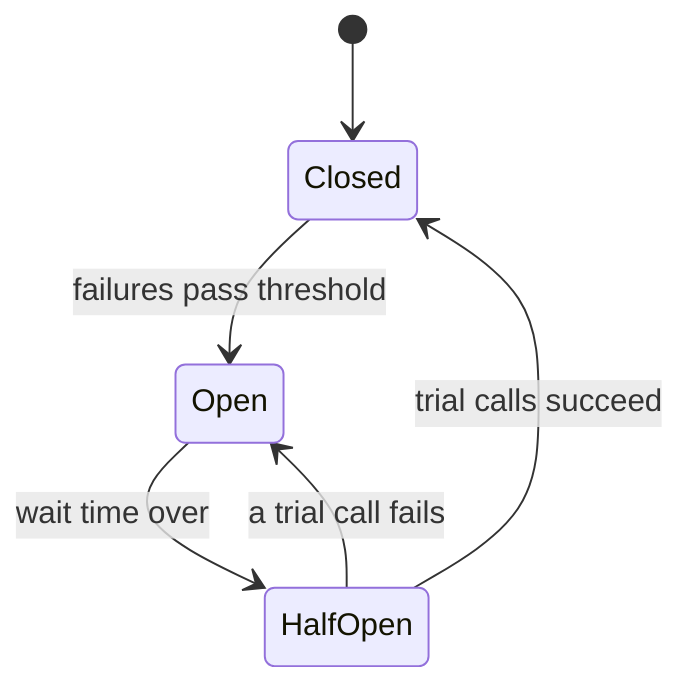

# Circuit Breaker

When a service you depend on is failing, continuing to call it makes things worse. Requests pile up waiting for timeouts, your threads are all stuck, and soon your service is down too. One broken dependency spreads outward as a cascading failure.

A circuit breaker works like the one in your home's electrical panel. It watches calls to a dependency, and when too many fail, it trips and stops sending calls for a while.

In the closed state, calls go through normally while the breaker counts failures. If the failure rate crosses a threshold (for example 50% of the last 20 calls), it moves to open. While open, calls fail immediately without touching the dependency, which protects it and gives it room to recover, and saves your own resources. After a cool-down it goes half-open and lets a few trial calls through. If they succeed, it closes again. If they fail, it reopens.

## What to do when it's open

Failing fast is already better than waiting on a timeout, but you can often do better with a fallback. Show cached data, return a sensible default, or hide the optional feature. If a recommendations service is down, the product page can still load without recommendations.

## Working with retries and timeouts

A circuit breaker is one of a small set of tools that go together. Every remote call needs a timeout, or a hung dependency holds your resources forever. Retries help with brief glitches, but they should use exponential backoff (wait longer after each failure) and jitter (a random offset), otherwise all clients retry at the same instant and flatten the recovering service. Retry only operations that are safe to repeat. And a bulkhead limits how many resources one dependency can use, like the sealed compartments of a ship, so one bad dependency can't eat all your threads.

Libraries like Resilience4j (Java) and Polly (.NET) provide these ready-made, and a service mesh such as Istio can apply them without code changes.

<!-- nav:start -->
---

Previous: [Rate Limiting](01-rate-limiting.md) | Next: [Service Discovery](03-service-discovery.md) | [All topics](../README.md)
<!-- nav:end -->
