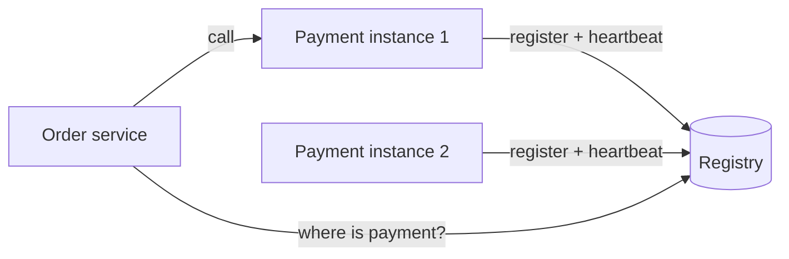

# Service Discovery

In a modern deployment, service instances come and go constantly. Autoscaling adds some, deployments replace them, and crashes remove them. Their IP addresses change every time, so you can't hard-code where the payment service lives. Service discovery is how services find each other anyway.

The core piece is a service registry, a database of which instances of each service are running and at what address. Instances register themselves on startup, send regular heartbeats, and are removed when the heartbeats stop or when they shut down. Consul, etcd, ZooKeeper and Eureka are common registries, and Kubernetes has one built in.

## Client-side and server-side

In client-side discovery, the caller asks the registry for the list of instances and picks one itself, doing its own load balancing. It saves a hop and gives the client control, but every client needs the discovery logic, in every language you use.

In server-side discovery, the caller sends the request to a fixed address, such as a load balancer or router, and that component asks the registry and forwards it. Clients stay simple and know nothing about instances. The cost is one more component in the request path that must be reliable. Kubernetes works this way: a Service gives a stable name and virtual address in front of changing pods.

## DNS-based discovery

Many systems just use DNS. The name `payments.internal` resolves to the current healthy instances. It needs no special client library, but DNS caching means changes can take a moment to show up, so keep TTLs short.

## Health

The registry is only useful if it's accurate. Beyond heartbeats, active health checks catch instances that are alive but unable to do their job, such as ones that have lost their database connection. Entries should expire on their own if not refreshed, so a crashed instance doesn't stay listed. Also remember that the registry is critical infrastructure. Run it as a cluster, and have clients cache the last known good answer so a registry outage doesn't take everything down.

Some teams push all of this into a service mesh, where sidecar proxies handle discovery, load balancing, retries and encryption outside the application code.

<!-- nav:start -->
---

Previous: [Circuit Breaker](02-circuit-breaker.md) | Next: [SLA, SLO and SLI](04-sla-slo-sli.md) | [All topics](../README.md)
<!-- nav:end -->
