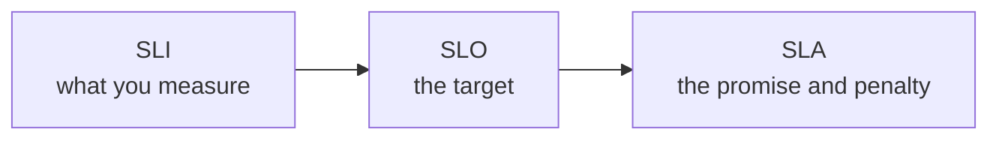

# SLA, SLO and SLI

Three related terms describe how reliable a service is supposed to be, and how you know whether it is.

An SLI (service level indicator) is a measurement. It's a number taken from the real system, such as the share of requests that succeeded, or the 95th percentile response time.

An SLO (service level objective) is the target you set for an SLI. For example, "99.9% of requests succeed over 30 days" or "95% of requests finish in under 300 ms". It's an internal goal for the engineering team.

An SLA (service level agreement) is a contract with customers that says what happens if you miss a target, usually a refund or service credit. SLAs are looser than SLOs on purpose. If you promise customers 99.9%, you aim internally for 99.95%, so you have room to react before you owe anyone money.

## Choosing good indicators

Pick what users actually feel. Availability (successful requests divided by all requests), latency, and error rate are the usual ones. For a data pipeline, freshness might matter more: how old is the newest data. For storage, durability. Measure latency with percentiles, because averages hide the slow tail.

Measure as close to the user as you can. A health check that says "the server is up" doesn't tell you whether people can check out.

## Error budgets

If the SLO is 99.9% over 30 days, then 0.1% of the time is allowed to fail. That's about 43 minutes. This allowance is the error budget. It turns reliability into something you can spend.

While there's budget left, teams can ship quickly and take risks. When the budget is nearly gone, they slow down, freeze risky releases and spend time on stability. It gives product and engineering a shared, objective way to settle the argument between new features and reliability. Google's SRE books popularised this approach.

## Setting targets

Don't aim for 100%. It's unreachable, extremely expensive, and users can't tell the difference anyway, since their own phone and network are less reliable than that. Pick a target slightly better than what keeps users happy, and revisit it as the product grows. The table in [Availability](../01-fundamentals/10-availability.md) shows what each number of nines allows in downtime.

<!-- nav:start -->
---

Previous: [Service Discovery](03-service-discovery.md) | Next: [Bloom Filters](05-bloom-filters.md) | [All topics](../README.md)
<!-- nav:end -->
