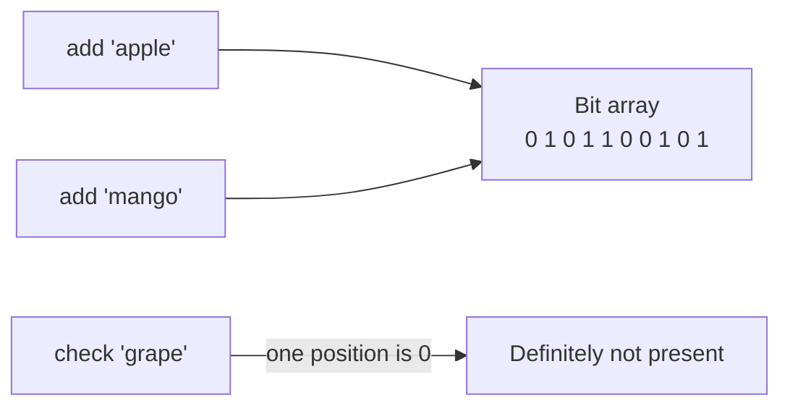

# Bloom Filters

A Bloom filter answers one question very cheaply: "have I seen this item before?" It uses far less memory than storing the items, and in exchange it's allowed to be wrong in one specific direction.

If it says no, the item is definitely not in the set. If it says yes, the item is probably in the set, with a small chance of a false alarm. It never produces a false negative.

## How it works

It's a long array of bits, all starting at 0, plus several hash functions. To add an item, run it through each hash function and set the bit at each resulting position to 1. To check an item, run the same hashes and look at those positions. If any bit is 0, the item was never added. If they're all 1, it was probably added, though other items might have set those same bits by coincidence.



## Sizing

With `n` items expected and a target false positive rate `p`, the bit array needs about `m = -n × ln(p) / (ln 2)²` bits, and the best number of hash functions is `k = (m / n) × ln 2`. For a 1% false positive rate that's roughly 9.6 bits per item and 7 hashes. A set of a million items fits in about 1.2 MB. Lowering the rate to 0.1% costs about 14.4 bits per item.

```python
import hashlib
import math


class BloomFilter:
    def __init__(self, expected_items: int, false_positive_rate: float = 0.01) -> None:
        self.size = math.ceil(-expected_items * math.log(false_positive_rate) / math.log(2) ** 2)
        self.hash_count = max(1, round(self.size / expected_items * math.log(2)))
        self.bits = bytearray((self.size + 7) // 8)

    def _positions(self, item: str):
        digest = hashlib.sha256(item.encode()).digest()
        h1 = int.from_bytes(digest[:8], "big")
        h2 = int.from_bytes(digest[8:16], "big") | 1
        for i in range(self.hash_count):
            yield (h1 + i * h2) % self.size

    def add(self, item: str) -> None:
        for pos in self._positions(item):
            self.bits[pos // 8] |= 1 << (pos % 8)

    def might_contain(self, item: str) -> bool:
        return all(self.bits[pos // 8] & (1 << (pos % 8)) for pos in self._positions(item))
```

## Where it's used

The pattern is always the same: put a Bloom filter in front of something expensive, so most useless lookups are rejected without touching it. Databases built on LSM trees, like Cassandra and RocksDB, keep one per disk file so they skip files that can't contain a key. Caches use one to avoid hitting the database for keys that don't exist (see [Caching](../01-fundamentals/07-caching.md)). Crawlers use one to avoid fetching the same URL twice, and sign-up forms use one to quickly rule out a username.

## Limits

You can't remove an item, because clearing a bit might erase evidence of other items. A counting Bloom filter uses small counters instead of bits to allow deletions, at the cost of more memory. And the filter must be sized up front. If you add far more items than planned, the false positive rate climbs fast.

<!-- nav:start -->
---

Previous: [SLA, SLO and SLI](04-sla-slo-sli.md) | Next: [Geohashing and Quadtrees](06-geohashing-and-quadtrees.md) | [All topics](../README.md)
<!-- nav:end -->
