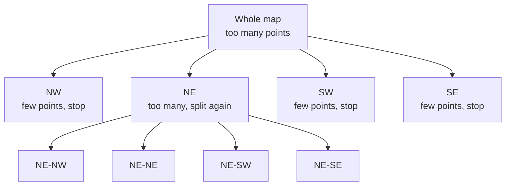

# Geohashing and Quadtrees

Finding "everything within 2 km of me" sounds easy, but a database can't index two numbers (latitude and longitude) as a single sorted line. Scanning every row and computing distances doesn't scale. Both techniques here turn a map into something you can index.

## Geohash

A geohash encodes a location as a short string. The world is split in half again and again, alternating between longitude and latitude, and each half is recorded as a bit. The bits are packed into base-32 characters, five bits per character.

The useful property is that a longer string means a smaller area, and places that share a prefix are in the same area. The strings `9q8yy` and `9q8yz` are neighbours inside the larger cell `9q8y`.

| Length | Approximate cell size |
|---|---|
| 4 | 39 km × 19.5 km |
| 5 | 4.9 km × 4.9 km |
| 6 | 1.2 km × 0.6 km |
| 7 | 153 m × 153 m |
| 8 | 38 m × 19 m |

To find nearby places, compute the geohash of the user at a suitable length, and query for items with the same prefix, which is just a normal indexed text search. A database can do that.

There's a catch. Two points very close together can sit on opposite sides of a cell boundary and have totally different prefixes. So you search the user's cell and its eight neighbouring cells, then filter by exact distance.

## Quadtree

A quadtree divides a square region into four quadrants. Any quadrant that holds more than a set number of points, say 100, is divided into four again, and so on.

Dense areas like city centres end up with many small cells, and empty areas like oceans stay as a few large ones. To search, you walk down the tree to the user's cell, collect the points, and check neighbouring cells if you need more.

## Which to use

Geohash is simple and lives happily in an ordinary database or key-value store, since it's just a string. Its cells are a fixed size, so dense cities and empty countryside use the same grid. A quadtree adapts to density, which gives balanced result counts, but it's usually held in memory, needs rebuilding or updating as points move, and takes more work to distribute across servers.

Google S2 and Uber's H3 are more advanced grid systems built on the same idea. They fix distortions that appear near the poles and with long thin cells.

<!-- nav:start -->
---

Previous: [Bloom Filters](05-bloom-filters.md) | Next: [Consensus and Leader Election](07-consensus-and-leader-election.md) | [All topics](../README.md)
<!-- nav:end -->
