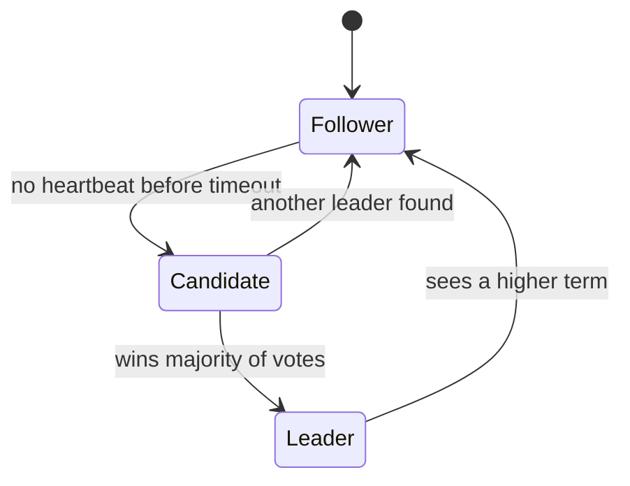

# Consensus and Leader Election

Several machines sometimes need to agree on one thing: who the leader is, what the next entry in a log is, or whether a lock is held. That's the consensus problem. It's hard because machines crash, messages are lost or delayed, and nobody can be sure whether a silent node is dead or just slow.

## Why a majority

The standard trick is to require a majority, called a quorum. A decision only counts when more than half the nodes agree. Two different majorities of the same group always share at least one member, so two conflicting decisions can't both succeed. That also prevents the split brain described in [Clustering](../01-fundamentals/06-clustering.md).

The result is that a group of 2f + 1 nodes can survive f failures. Three nodes tolerate one failure, five tolerate two. That's why consensus clusters usually have an odd number of nodes. Four nodes don't tolerate any more failures than three, since a majority of four is still three.

## Raft

Paxos was the first proven algorithm for this, but it's famously difficult to understand. Raft was designed to be easier to follow and is what most new systems use. It breaks the problem into leader election and log replication.

Every node is a follower, a candidate or the leader. Time is divided into numbered terms. Followers expect regular heartbeats from the leader. If one doesn't hear any before a randomised timeout expires, it becomes a candidate, increases the term, and asks the others for votes. A node that gets votes from a majority becomes the leader. The random timeouts make it unlikely that several nodes start an election at the same moment.

Once there's a leader, all changes go through it. It appends each change to its log, sends it to the followers, and treats it as committed once a majority has stored it. Then it tells everyone to apply it. If the leader dies, a follower with an up-to-date log is elected, and no committed entry is lost.

## Where you see it

etcd (which stores Kubernetes' state), Consul and CockroachDB use Raft. ZooKeeper uses a similar protocol called ZAB. Kafka now uses its own Raft-based controller in place of ZooKeeper. Applications rarely implement consensus themselves. Instead, they use one of these systems for the small amount of critical coordination data, such as configuration, locks and leader election.

## Leader election and locks

To elect a leader among your own service instances, each instance tries to take a lock or a short lease in something like etcd or ZooKeeper. Whoever holds it is the leader and must keep renewing it. If the leader freezes, perhaps through a long garbage collection pause, its lease expires and someone else takes over, and then the old one wakes up and still thinks it's the leader. A fencing token guards against that: each lease carries an increasing number, and the storage rejects writes carrying an older one.

## Cost

Every decision waits for a majority round trip, so consensus adds latency and limits throughput. Spreading nodes across distant regions makes it slower still. Use it for small, critical data, and not as a general-purpose database for large volumes.

<!-- nav:start -->
---

Previous: [Geohashing and Quadtrees](06-geohashing-and-quadtrees.md) | Next: [Observability](08-observability.md) | [All topics](../README.md)
<!-- nav:end -->
