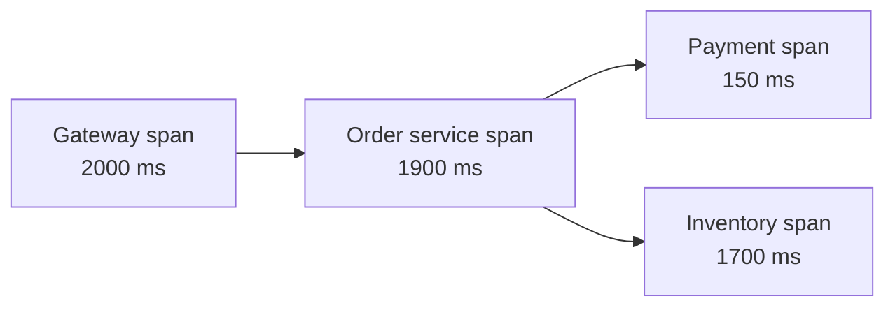

# Observability

Observability is being able to understand what's happening inside a running system by looking at what it emits. In a distributed system, a single user request may pass through a dozen services, and when it's slow, nobody can attach a debugger. You need evidence recorded ahead of time.

Three kinds of data do most of the work.

## Logs

A log is a timestamped record of something that happened: a request arrived, a query failed, a user signed in. They're the most detailed and the most expensive to store. Write them as structured JSON instead of free text so they can be searched and filtered, include ids that tie them to a request, and send them to a central place such as Elasticsearch, Loki or a cloud logging service. Logs on a server that has just died are useless.

## Metrics

A metric is a number measured over time: requests per second, error rate, CPU use, queue depth. They're cheap to store, fast to query and good for dashboards and alerts. Prometheus with Grafana is the common open source pairing. Metrics tell you that something is wrong, but not why.

A handy checklist for services is the four golden signals from Google's SRE book: latency, traffic, errors and saturation (how full the resource is). Another, called RED, covers request rate, errors and duration.

## Traces

A trace follows one request across every service it touches. It's made of spans, one per operation, with timings and parent-child links. A trace shows you that a checkout took 2 seconds and that 1.7 of them were a slow call to the inventory service.

For this to work, a trace id is created at the edge and passed along on every call, usually in a header. OpenTelemetry is the open standard for producing traces, metrics and logs, and Jaeger and Tempo are common backends. Tracing every request is costly, so most systems sample, perhaps keeping 1% plus all the slow or failed ones.

## Using them together

A typical investigation goes like this. An alert fires on a metric: the error rate is up. A dashboard narrows it to one service. A trace of a failing request shows which downstream call is slow. The logs for that trace id give the exact error.

## Alerting

Alert on symptoms users feel, such as high error rate or slow responses, not on every internal cause like high CPU. Too many alerts and people stop reading them. Tie alerts to your [SLOs](04-sla-slo-sli.md), and make each one actionable, with a link to what to do about it.

<!-- nav:start -->
---

Previous: [Consensus and Leader Election](07-consensus-and-leader-election.md) | Next: [Disaster Recovery](../05-infrastructure-and-security/01-disaster-recovery.md) | [All topics](../README.md)
<!-- nav:end -->
