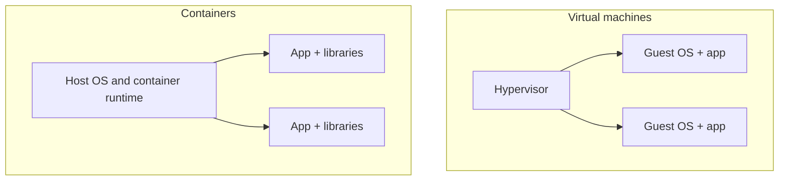

# Virtual Machines and Containers

Both let you run several isolated workloads on one physical machine. They do it at different levels, and that's where their differences come from.

## Virtual machines

A virtual machine emulates a whole computer. A piece of software called a hypervisor (VMware ESXi, KVM, Hyper-V) divides the physical hardware into several virtual ones, and each VM runs its own full operating system on top. Cloud servers like an EC2 instance are VMs.

Isolation is strong because each VM has its own kernel. A problem inside one is very unlikely to reach another. The price is weight. Each VM carries a full operating system, uses gigabytes of disk and memory, and takes tens of seconds to minutes to boot.

## Containers

A container isolates just a process, not a whole machine. All containers on a host share the host's operating system kernel. Linux provides the building blocks: namespaces give each container its own view of processes, network and filesystem, and cgroups limit how much CPU and memory it can use.

A container image packages the app along with its libraries and settings, so it runs the same on a laptop and in production. Images are small (often tens of megabytes), and containers start in a second or less. That makes them ideal for scaling quickly and for packing many services onto fewer machines. Docker made this approachable.

## Comparing them

| | Virtual machine | Container |
|---|---|---|
| Isolation | Strong, separate kernel | Lighter, shared kernel |
| Size | Gigabytes | Megabytes |
| Start time | Seconds to minutes | Under a second to seconds |
| Overhead | Higher | Low |
| Runs | Any operating system | Same kernel family as the host |

Because containers share the host kernel, a kernel vulnerability can affect all of them, and a Linux container can't run a Windows app. For hostile or multi-tenant workloads, people often run containers inside VMs, or use lightweight VMs such as Firecracker.

## Orchestration

Running a handful of containers by hand is fine. Running thousands needs automation to decide which machine each goes on, restart the ones that crash, scale them with load, and roll out new versions gradually. Kubernetes is the dominant tool for this. It's also what ties together several ideas from this guide: [service discovery](../04-design-toolkit/03-service-discovery.md), [load balancing](../01-fundamentals/05-load-balancing.md) and health checks.

<!-- nav:start -->
---

Previous: [Disaster Recovery](01-disaster-recovery.md) | Next: [OAuth 2.0 and OpenID Connect](03-oauth-and-openid-connect.md) | [All topics](../README.md)
<!-- nav:end -->
