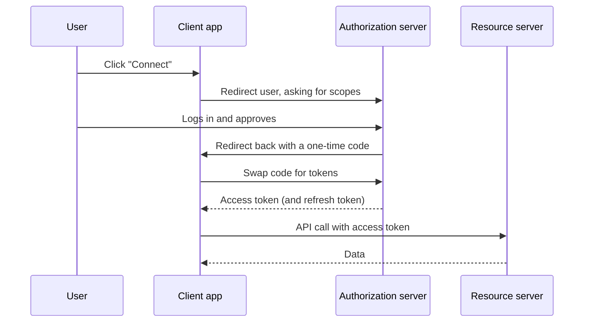

# OAuth 2.0 and OpenID Connect

When you click "Sign in with Google" or let an app read your calendar, two standards are at work. They're often confused, so it helps to separate them.

OAuth 2.0 is about authorization: letting an app act on your behalf with limited access, without giving it your password. OpenID Connect (OIDC) sits on top of OAuth and adds authentication: telling the app who you are.

## The players

The resource owner is the user. The client is the app that wants access. The authorization server is the service that authenticates the user and issues tokens (Google, Okta, Auth0). The resource server is the API holding the data, such as the calendar API.

## Authorization code flow

This is the standard flow for web and mobile apps. The user never types their password into the client.

The code is short-lived and useless alone. The client exchanges it, directly with the authorization server, for tokens. Public clients such as mobile apps and single-page apps add PKCE, a small extra step in which the client proves it's the same one that started the flow, so an intercepted code can't be used by someone else. Current guidance is to use PKCE for all clients.

## Tokens and scopes

An access token is a credential the client presents to the API. It's short-lived, often 5 to 60 minutes, to limit damage if it leaks. A refresh token is longer-lived and lets the client get new access tokens without sending the user through login again, so it must be stored very carefully.

Scopes describe what the token may do, such as `calendar.read`. The user sees them on the consent screen and the API enforces them. Ask only for what you need.

## What OpenID Connect adds

OIDC adds an ID token, a signed JWT that contains claims about the user: a stable user id, their email, when they logged in. The client verifies the signature and checks that the token was meant for it. It also defines a standard `/userinfo` endpoint. Request the `openid` scope and you're doing OIDC.

The key distinction is that an access token is for the API and says what you may do, and an ID token is for the client and says who logged in. Don't use an access token to decide who the user is.

## Mistakes to avoid

Don't use the old implicit flow, which returns tokens in the URL, and is dropped in OAuth 2.1. Check the `state` parameter to prevent forged callbacks, and the redirect URI must exactly match a registered one. Don't put tokens in places scripts can read if you can avoid it, and never log them.

<!-- nav:start -->
---

Previous: [Virtual Machines and Containers](02-vms-and-containers.md) | Next: [Single Sign-On](04-single-sign-on.md) | [All topics](../README.md)
<!-- nav:end -->
