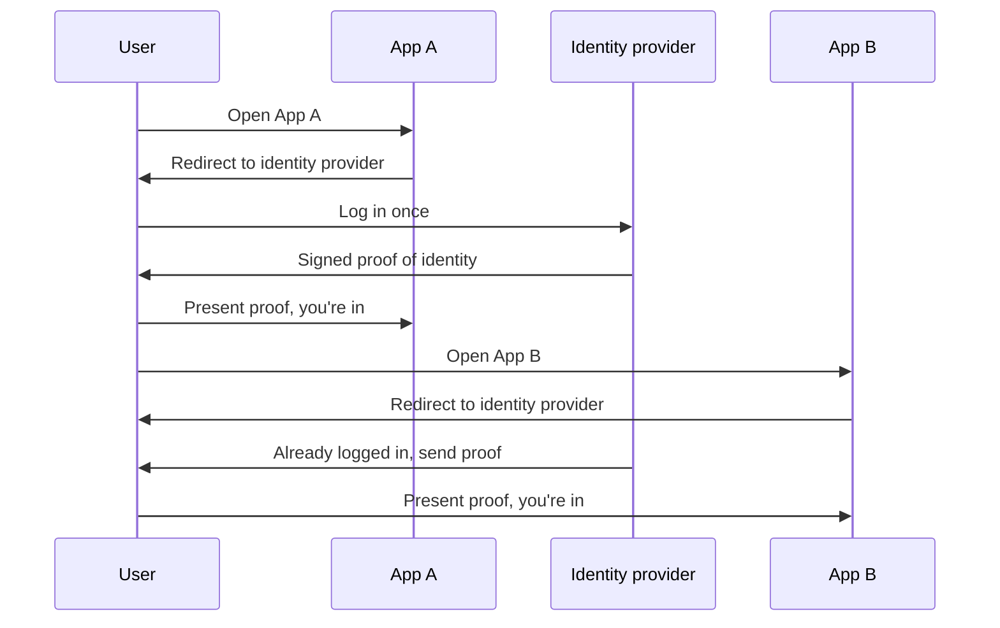

# Single Sign-On

Single sign-on (SSO) lets a person log in once and then use many applications without logging in again. At work you sign in with your company account in the morning and then open email, the ticket tracker and the wiki without typing a password.

The apps don't handle passwords at all. They trust a central identity provider (IdP), such as Okta, Microsoft Entra ID or Google Workspace. Each application is a service provider (SP) that relies on the IdP's word about who the user is.

The second time, the IdP already has a session for the user, so it skips the login screen and issues a new proof straight away. The apps never see the password.

## The protocols

SAML 2.0 is the older standard, XML based, and still the norm in big enterprises and older software. The IdP sends the app a signed XML assertion. OpenID Connect, described in [OAuth 2.0 and OpenID Connect](03-oauth-and-openid-connect.md), does the same job with JSON and JWTs, and is more common in newer apps and mobile. Kerberos is another long-standing mechanism inside company networks.

## What you get

Users have one password to remember and one place for multi-factor authentication, which makes it practical to require it. Admins can create and remove accounts in one place, so when someone leaves, access to everything ends at once. Apps are spared from storing credentials, which is a big security burden.

## Trade-offs

The IdP becomes a single point of failure and a high-value target. If it's down, nobody can log in anywhere, and if an attacker takes over one account, they get everything it can reach. That's why SSO accounts should have strong multi-factor authentication and the IdP should be highly available.

Logging out is also trickier than logging in. Ending the IdP session doesn't automatically end the sessions in each app, so single logout needs extra mechanisms and isn't always reliable. Keep app session lifetimes short for sensitive systems.

<!-- nav:start -->
---

Previous: [OAuth 2.0 and OpenID Connect](03-oauth-and-openid-connect.md) | Next: [TLS and mTLS](05-tls-and-mtls.md) | [All topics](../README.md)
<!-- nav:end -->
