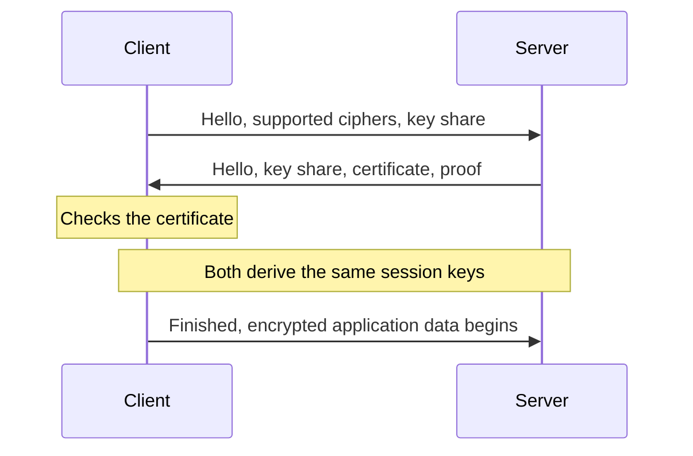

# TLS and mTLS

TLS (Transport Layer Security) is what puts the padlock in the browser and the "s" in HTTPS. It protects data travelling over a network in three ways. Encryption stops eavesdroppers reading it. Integrity checks stop anyone altering it unnoticed. Authentication lets the client confirm it's really talking to the server it meant to.

SSL is the old name for the same idea, and its versions are long obsolete. People still say "SSL certificate" out of habit, but what's in use today is TLS. Versions 1.0 and 1.1 are deprecated, and the current ones are TLS 1.2 and 1.3.

## The handshake

Before sending any data, the two sides agree on how to encrypt it. In simplified form, in TLS 1.3:

The key idea is that the client and server use a key exchange to reach a shared secret without ever sending it over the wire. They then use fast symmetric encryption with that secret for the actual traffic. TLS 1.3 completes the handshake in one round trip, where 1.2 needed two, and it removed several weak older options.

## Certificates

How does the client know the server's public key really belongs to `example.com` and not an impostor? Through a certificate, a document that binds a domain name to a public key, signed by a certificate authority (CA). Your operating system and browser ship with a list of CAs they trust. The server usually sends a chain: its own certificate, signed by an intermediate CA, signed by a root the client already trusts. The client checks each signature, the domain name, and that none have expired.

Certificates expire, commonly after 90 days for free ones from Let's Encrypt, so automate renewal. An expired certificate is one of the most common causes of preventable outages.

## Where TLS ends

In many systems, the load balancer or reverse proxy handles TLS and passes plain HTTP to the servers behind it. That's called TLS termination. It saves your servers the work, and the certificates sit in one place. The traffic behind it is unencrypted though, so if the internal network isn't fully trusted, re-encrypt it or use mTLS.

## mTLS

In ordinary TLS, only the server proves who it is. In mutual TLS, the client has to present a certificate too, and the server checks it. Both sides are authenticated.

That's not much use for a public website, since you can't hand out certificates to every visitor. It's very useful between services in your own system. A payment service can accept connections only from services that hold a valid certificate issued by your internal CA, and traffic between them is encrypted. This is part of the zero trust approach, where being inside the network isn't enough to be trusted.

Managing certificates for hundreds of services is a chore. Service meshes like Istio and Linkerd do it for you, issuing short-lived certificates and rotating them automatically.

<!-- nav:start -->
---

Previous: [Single Sign-On](04-single-sign-on.md) | [All topics](../README.md)
<!-- nav:end -->
